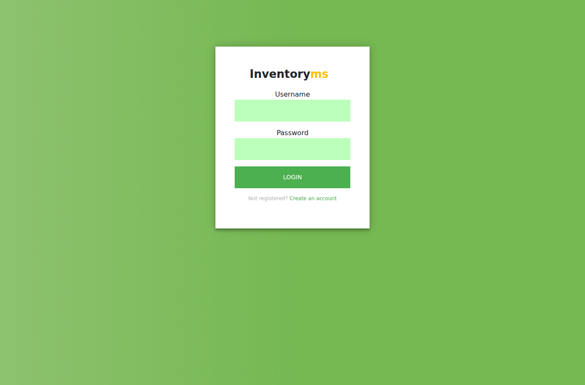

# TU02 – Kết quả bảo trì thích ứng

Nhánh `tu02-trien-khai-docker`, base `86e8d04328c5fd3b83af02079c54f6a89babfb2b`
(bao-tri đã có HC01–HC03, TU01). Code kiểm chứng tại
`4e5cff7a2160108cb6899e68b12a1e10f503516c`. Không tạo migration mới; accounts/0002
đã được TU01 tạo, không sửa migration/model trên TU02. Không nâng requirements.

## Kết quả thực tế ngày 24/11/2026

| Môi trường | Django | Suite | Kết quả |
|---|---|---|---|
| Windows, Python 3.12.10, SQLite | 5.2.19 | 82 test, 5.322s | OK, không có staticfiles/ |
| CI Ubuntu 24.04, Python 3.10.22, PostgreSQL 16.16 | 5.2.19 | 82 test, 4.096s | OK, không collectstatic |
| CI Ubuntu 24.04, Python 3.12.16, PostgreSQL 16.16 | 5.2.19 | 82 test, 2.874s | OK, không collectstatic |
| CI Docker Compose, image Python 3.12 + postgres:16-alpine | 5.2.19 | Build, health, login, persistence | PASS |

[CI thành công](https://github.com/MrTroll219/sales-and-inventory-management/actions/runs/45367681572).
Metadata và log gốc tải về ở [ci-final-run.json](../evidence/tu02/ci-final-run.json)
và [ci-final/](../evidence/tu02/ci-final/). Windows không có Docker Desktop/CLI:
**chưa chạy container trên Windows**; kết quả container ở trên thuộc CI Linux,
chưa triển khai lên VPS thật của nhóm. PostgreSQL cài sẵn Windows là 18.4,
không dùng nó thay cho đích 16 hoặc chạm dữ liệu của nó.

## Lựa chọn thiết kế và kiểm thử

- Nhận diện lệnh test bằng sys.argv để giữ lệnh test hiện có; StaticFilesStorage
  không phụ thuộc manifest build. Test tích hợp manifest TU01 dùng override production
  rõ ràng, vẫn kiểm tra đúng hành vi manifest và giữ assertions.
- 16 test mới tại transactions/tests/test_tu02_settings.py: thiếu/yếu key, DEBUG,
  dotenv/process precedence, DB mới/cũ, engine sai/thiếu cấu hình, host/origin/media,
  SSL/HSTS, storage test/production, deploy check và health probe.
- SSL qua env; HSTS mặc định 3600 khi SSL=true; include-subdomains/preload tách cờ
  để người vận hành xác nhận chính sách domain. Không silence cảnh báo Django.
- Gunicorn non-root; migrate runtime, collectstatic build-only; named volumes DB/MEDIA.
- CI mới chỉ test. Bốn workflow cũ giữ file/job, đổi trigger sang manual theo bổ sung
  TU02. Sửa cú pháp có sẵn ở ci_tf.yml (steps sai cấp, expression rỗng, runner sai)
  và monitor.yml (indent comment/output reference) để toàn bộ workflow hợp lệ.

CI lần đầu [45366825597](https://github.com/MrTroll219/sales-and-inventory-management/actions/runs/45366825597)
PASS Compose nhưng cả hai PG job có 1 ERROR: test TU01 cố tạo Profile email dài >150,
PostgreSQL chặn ngay VARCHAR thay vì để audit phát hiện như SQLite. Không đổi kỳ vọng,
không skip: fixture mở rộng cột của **bảng test tạm** thành 256, tạo dữ liệu lịch sử
sai rồi chạy cùng assertions audit/SELECT-only, xóa fixture và khôi phục độ rộng cột.
Không thay schema ứng dụng/migration/dữ liệu thật. Log lỗi ban đầu vẫn lưu ở
ci_initial_failed.txt và ci-initial/. Một workflow Terraform cũ cũng báo invalid YAML
ở lần push đầu; đã sửa cú pháp và actionlint kiểm tra cả 5 workflow PASS.

## Bằng chứng trước/sau

| Kịch bản | Trước TU02 | Sau TU02 |
|---|---|---|
| Test khi thiếu staticfiles/ | Phát hiện sau TU01: 5 lỗi Missing staticfiles manifest entry | Windows + 2 PG job đều 82 OK |
| W004 | HSTS chưa bật | SSL=true, HSTS=3600 |
| W008 | Không redirect HTTPS | SSL=true bật redirect |
| W009 | Key thử quá ngắn | Key ngẫu nhiên dài, kiểm tra cấu hình bắt buộc |
| W012 | Session cookie chưa secure | SSL=true bật secure |
| W016 | CSRF cookie chưa secure | SSL=true bật secure |
| W018 | DEBUG=true | DEBUG mặc định false |
| Container | Bản cũ runserver, SQLite trong image | Gunicorn non-root + PostgreSQL16 healthy |
| DB/MEDIA sau down/up | Chưa có named volume theo đích TU02 | DATABASE_AND_MEDIA_PERSISTENCE_PASS |

Output 6 cảnh báo trước: evidence/tu01/check_deploy.txt.
Sau: evidence/tu02/production_check_deploy.txt ghi **0 issues (0 silenced)**.
Lệnh sau dùng file .env production tạm đã sinh key dài, SSL=true,
HSTS=3600/include-subdomains=true/preload=true, hosts/origin thử example.invalid;
không lưu key và đã xóa file tạm. Test tự động cũng xác minh cùng cấu hình.

Lệnh thực tế Windows (venv Python 3.12.10), log đầy đủ lưu trong evidence/tu02:

```powershell
$env:DEBUG="true"; $env:SECRET_KEY="test"; $env:DB_ENGINE="sqlite"
python manage.py check
python manage.py makemigrations --check --dry-run
python -W error::DeprecationWarning -W error::PendingDeprecationWarning manage.py test . -v 2
```

```text
System check identified no issues (0 silenced).
No changes detected
Ran 82 tests in 5.322s
OK
```

CI dùng DEBUG=false và key fixture dài; command/output đầy đủ trong tests.yml và
ci-final/postgres16-python*/suite.txt. Build chạy collectstatic thành công;
entrypoint không gọi collectstatic. health, HTTP 200 và persistence có log riêng.



## Rủi ro và việc còn lại

- HTTP nội bộ là ngoại lệ có chủ đích; không dùng cấu hình lab cho endpoint công khai.
- Proxy TLS/MEDIA gateway và backup/restore thực tế trên VPS chưa được kiểm chứng.
  WhiteNoise phục vụ static, không phục vụ MEDIA khi DEBUG=false. Xem hướng dẫn triển khai.
- MEDIA_ROOT mới mặc định media; tệp cũ static/images cần người vận hành xác định
  tệp upload thực, sao lưu/chuyển sang volume media. Không tự di chuyển/xóa tệp cũ.
- Named volume bảo toàn qua down/up, không thay thế backup. CI chỉ xóa volume thử
  khi cleanup; không chạy thao tác đó trên dữ liệu thật.
- Bốn workflow cũ manual vẫn có mã deploy/monitor; TU02 không dispatch chúng.
- Cách test storage dựa trên argv của manage.py test; runner nhúng khác cần cấu hình riêng.
- Chưa làm TU03/HT/DP, không đổi nghiệp vụ HC01–HC03 và không mở PR.
