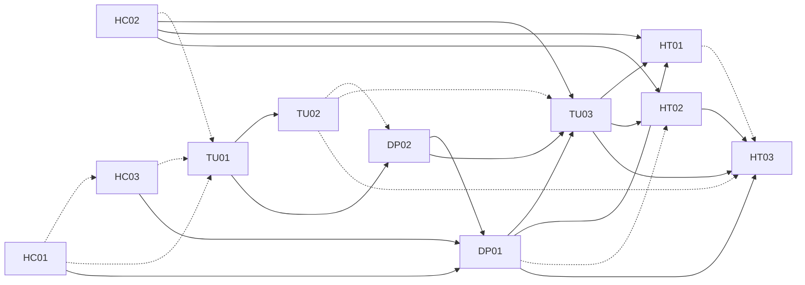

# 01. PHÂN TÍCH TÁC ĐỘNG BẢO TRÌ

Bộ tài liệu môn Bảo trì phần mềm – Project 2. Đề tài: **Bảo trì và hoàn thiện hệ thống quản lý bán hàng và tồn kho trên nền tảng Django**.

Phạm vi khảo sát là bản ứng dụng `123101a`, được đóng gói trong tag `v1-bao-tri` ở commit `1b06b13`; nhánh tài liệu kế thừa tag này. Các số liệu lấy từ `docs/BAO_CAO_TONG_HOP.md` và hồ sơ `evidence/final/`, không phải một lần chạy test mới của nhánh tài liệu. Mã FR/NFR/TC trong bộ tài liệu là định danh truy vết do tài liệu này quy định, không phải tên yêu cầu có sẵn trong code.

## 1. Hệ thống gốc và phương pháp phân tích

Hệ thống là ứng dụng web Django tổ chức theo mô hình Model–View–Template: URL định tuyến đến view, model/ORM thao tác dữ liệu, template và JavaScript phục vụ giao diện. Bản gốc là `v0-goc`, commit `038cbd5a7e3f4bdfab96f7f9d61016d1d2ea2dc4`, Django 5.1; Dockerfile/CI gốc hướng Python 3.10, SQLite dùng mặc định khi không có cấu hình Azure PostgreSQL. Excel được tạo bằng openpyxl, biểu mẫu dựa trên Django forms; django-filter và django-tables2 hiện diện nhưng một số khai báo giao dịch là mã chết. Các thông tin này được đối chiếu từ hướng dẫn, source tại tag, git log v0-goc..bao-tri và báo cáo tổng hợp, không suy ra rằng PostgreSQL bản gốc đã được nghiệm thu.

| App | Đối tượng chính | Trách nhiệm và liên hệ |
|---|---|---|
| store | Item, Category, Delivery | Hàng hóa, danh mục, giao hàng; Item được tham chiếu bởi giao dịch và hóa đơn |
| accounts | Profile, Vendor, Customer | Hồ sơ người dùng, nhà cung cấp, khách; dùng auth User của Django |
| transactions | Sale, SaleDetail, Purchase | Bán hàng, dòng bán và phiếu nhập; liên kết Item/Customer/Vendor |
| invoice | Invoice | Hóa đơn, số lượng, đơn giá, phí và tổng |
| bills | Bill | Chi phí/thanh toán và số tiền |

Ở bản gốc, quyền ghi tồn bị phân tán giữa Purchase.save, signal và view bán hàng; do đó tác động của một lỗi nhập không chỉ nằm ở phiếu mà lan tới số dư, thống kê và dữ liệu giao dịch tiếp theo. P0 cung cấp bảy test chứng minh lỗi, là đường cơ sở cho phân tích hồi quy, không phải yêu cầu thứ mười hai.

Thang **tác động** dưới đây là nhận định kỹ thuật của tài liệu: Cao khi thay số dư, tính tiền, transaction, schema hoặc audit; Trung bình khi đổi hợp đồng đầu vào, truy vấn hoặc trình bày; Thấp khi loại mã chết không được gọi. Đây không phải mức ưu tiên được người đề xuất phê duyệt. Nguồn không định danh người đề xuất và ưu tiên chính thức, nên hai trường đó được đánh dấu là thông tin cần bổ sung trong từng phiếu.

Thứ tự phiếu là thứ tự thực hiện đã được Git/báo cáo chứng minh: HC01, HC02, HC03, TU01, TU02, DP02, DP01, TU03, HT01, HT02, HT03. Không thay thứ tự này bằng thứ tự chữ số DP01–DP02 hoặc danh sách prompt ban đầu.

## 2. Phiếu yêu cầu HC01 – Tồn kho phiếu nhập

- **Mã:** HC01. **Loại:** bảo trì hiệu chỉnh. Khôi phục tính đúng đắn của chức năng nhập hàng đã có, thay vì bổ sung một chức năng mới.
- **Người đề xuất:** [cần bổ sung] — nguồn không định danh cá nhân/đơn vị ký phiếu.
- **Mức ưu tiên chính thức:** [cần bổ sung] — chưa có trường ưu tiên được phê duyệt trong nguồn.
- **Đường cơ sở truy vết:** nhánh `hc01-ton-kho-phieu-nhap`, commit cuối `31654e6`; nguồn: [docs/HC01.md](../HC01.md), [metadata](../../evidence/final/requirements.json).

### Hiện trạng và yêu cầu

Ở v0-goc, Purchase.save cộng toàn bộ số lượng sau mỗi lần lưu; signal post_save còn cộng thêm khi tạo mới. Phiếu nhập 10 làm tồn từ 0 thành 20; sửa mô tả tiếp tục làm tăng tồn.

Mỗi phiếu mới chỉ cộng kho một lần; khi sửa phải dùng số lượng đang lưu trong DB, áp chênh lệch và xử lý đổi mặt hàng. Từ chối thay đổi gây âm kho, giữ tính nguyên tử và công thức thành tiền.

### Phạm vi tác động

| File/nhóm file | Hàm/lớp | Bảng DB hoặc dữ liệu | Migration | Mức tác động và lý do |
| --- | --- | --- | --- | --- |
| transactions/models.py | Purchase.save tại mốc HC01 | transactions_purchase; store_item | Không | Cao: thay cơ chế cập nhật số dư |
| transactions/signals.py | post_save của Purchase tại mốc gốc | store_item | Không | Cao: loại cộng kho trùng |
| transactions/views.py | PurchaseUpdateView.form_valid | transactions_purchase; store_item | Không | Trung bình: đưa ValidationError lên form |
| transactions/tests/test_hc01_purchase_stock.py | PurchaseStockTests | DB test | Không | Trung bình: hồi quy tăng/giảm/đổi mặt hàng |

### Tác động liên yêu cầu và kiểm soát hồi quy

DP01 phải bảo toàn các hành vi đã sửa khi chuyển khỏi save(); HT01 phụ thuộc số dư đúng; HT03 bổ sung hoàn kho bán hàng, không thay quy tắc nhập. Bộ test của HC01 và test liên quan phải được đối chiếu tại mốc lịch sử và tại bản cuối; không coi thay đổi cách triển khai sau DP01/TU03 là một lỗi của đặc tả ban đầu. Các tiêu chí FR/NFR nằm trong 02_DAC_TA.md, minh chứng TC trong 04_KIEM_THU.md.

## 3. Phiếu yêu cầu HC02 – Excel và ngày giao

- **Mã:** HC02. **Loại:** bảo trì hiệu chỉnh. Sửa lỗi xuất dữ liệu và lỗi giữ ngày giao của chức năng hiện hữu.
- **Người đề xuất:** [cần bổ sung] — nguồn không định danh cá nhân/đơn vị ký phiếu.
- **Mức ưu tiên chính thức:** [cần bổ sung] — chưa có trường ưu tiên được phê duyệt trong nguồn.
- **Đường cơ sở truy vết:** nhánh `hc02-xuat-excel-ngay-giao`, commit cuối `0b62b64`; nguồn: [docs/HC02.md](../HC02.md), [metadata](../../evidence/final/requirements.json).

### Hiện trạng và yêu cầu

delivery_date cho phép NULL nhưng export cũ đọc tzinfo trực tiếp, gây AttributeError. Form datetime-local dùng DateInput có thể render sai value và làm mất ngày khi lưu lại.

Dùng tiện ích đổi ngày chung, xử lý None/aware/naive an toàn; giữ ngày giao khi sửa mô tả; xuất được file rỗng và bảo toàn quyền đăng nhập.

### Phạm vi tác động

| File/nhóm file | Hàm/lớp | Bảng DB hoặc dữ liệu | Migration | Mức tác động và lý do |
| --- | --- | --- | --- | --- |
| transactions/utils.py | to_excel_datetime | Không ghi DB | Không | Trung bình: hợp đồng ngày xuất |
| transactions/views.py | export_sales_to_excel; export_purchases_to_excel | sales; transactions_purchase | Không | Trung bình: đọc dữ liệu và ghi XLSX |
| transactions/forms.py | PurchaseForm.__init__; clean_delivery_date | transactions_purchase.delivery_date | Không | Trung bình: bảo toàn ngày giao |
| transactions/tests/test_hc02_dates.py | ExcelDateTests; ExportAndFormTests | DB test | Không | Trung bình: None, timezone, form round-trip |

### Tác động liên yêu cầu và kiểm soát hồi quy

TU03 dùng lại tiện ích với giờ Việt Nam; HT01 và HT02 kế thừa quy tắc xuất; TU01/TU02 cần giữ hành vi render và storage khi nâng môi trường. Bộ test của HC02 và test liên quan phải được đối chiếu tại mốc lịch sử và tại bản cuối; không coi thay đổi cách triển khai sau DP01/TU03 là một lỗi của đặc tả ban đầu. Các tiêu chí FR/NFR nằm trong 02_DAC_TA.md, minh chứng TC trong 04_KIEM_THU.md.

## 4. Phiếu yêu cầu HC03 – Tính tiền máy chủ

- **Mã:** HC03. **Loại:** bảo trì hiệu chỉnh. Khắc phục lỗi toàn vẹn tiền, kiểm tra đầu vào và kiểm soát đăng nhập trên chức năng tạo đơn có sẵn.
- **Người đề xuất:** [cần bổ sung] — nguồn không định danh cá nhân/đơn vị ký phiếu.
- **Mức ưu tiên chính thức:** [cần bổ sung] — chưa có trường ưu tiên được phê duyệt trong nguồn.
- **Đường cơ sở truy vết:** nhánh `hc03-tinh-tien-may-chu`, commit cuối `fbac946`; nguồn: [docs/HC03.md](../HC03.md), [metadata](../../evidence/final/requirements.json).

### Hiện trạng và yêu cầu

View cũ tin price/tổng tiền trong JSON, có thể lưu tổng 1 cho đơn giá DB 100 × 2. Chưa đăng nhập vẫn tạo đơn; số lượng âm có thể rơi xuống lỗi DB thay vì phản hồi dữ liệu không hợp lệ.

Máy chủ lấy giá DB, gộp dòng trùng, tính tiền và thuế cộng thêm, kiểm tra thanh toán/tồn kho trước khi ghi; dữ liệu sai bị từ chối và không để lại ghi dở dang.

### Phạm vi tác động

| File/nhóm file | Hàm/lớp | Bảng DB hoặc dữ liệu | Migration | Mức tác động và lý do |
| --- | --- | --- | --- | --- |
| transactions/pricing.py | compute_sale_totals; check_client_total | Không ghi DB | Không | Cao: quy tắc tính tiền |
| transactions/views.py | SaleCreateView; sale_login_required | sales; sale_details; store_item | Không | Cao: xác thực, giao dịch bán |
| accounts/models.py | Customer.get_full_name | Customers | Không | Trung bình: last_name NULL không làm sập form |
| transactions/templates/transactions/sale_create.html | JS tính tổng và nhãn thuế | Không | Không | Trung bình: đồng bộ biểu diễn tổng |

### Tác động liên yêu cầu và kiểm soát hồi quy

DP02 thay kiểu lưu tiền; DP01 di chuyển transaction bán sang service; TU03 đổi lượng tử hóa; HT03 dùng các SaleDetail để hoàn đúng lượng đã bán. Bộ test của HC03 và test liên quan phải được đối chiếu tại mốc lịch sử và tại bản cuối; không coi thay đổi cách triển khai sau DP01/TU03 là một lỗi của đặc tả ban đầu. Các tiêu chí FR/NFR nằm trong 02_DAC_TA.md, minh chứng TC trong 04_KIEM_THU.md.

## 5. Phiếu yêu cầu TU01 – Nâng Django 5.2

- **Mã:** TU01. **Loại:** bảo trì thích ứng. Điều chỉnh hệ thống theo môi trường framework Django 5.2 thay cho nền 5.1.
- **Người đề xuất:** [cần bổ sung] — nguồn không định danh cá nhân/đơn vị ký phiếu.
- **Mức ưu tiên chính thức:** [cần bổ sung] — chưa có trường ưu tiên được phê duyệt trong nguồn.
- **Đường cơ sở truy vết:** nhánh `tu01-nang-django-52`, commit cuối `86e8d04`; nguồn: [docs/TU01.md](../TU01.md), [metadata](../../evidence/final/requirements.json).

### Hiện trạng và yêu cầu

requirements pin Django 5.1; STATICFILES_STORAGE đã bị bỏ qua; accounts còn thiếu migration cho các trường Profile.

Chuyển Django 5.2.19, dùng STORAGES đúng API, bổ sung accounts/0002 sau kiểm tra dữ liệu, duy trì tính tương thích và manifest static.

### Phạm vi tác động

| File/nhóm file | Hàm/lớp | Bảng DB hoặc dữ liệu | Migration | Mức tác động và lý do |
| --- | --- | --- | --- | --- |
| requirements.txt | Pin Django | Không | Không | Trung bình: runtime |
| InventoryMS/settings.py | STORAGES | Không | Không | Trung bình: static/media backend |
| accounts/migrations/0002_alter_profile_email_alter_profile_first_name_and_more.py | Migration | accounts_profile | accounts/0002 | Cao: unique email, giới hạn tên |
| accounts/management/commands/check_profile_data.py | Command.handle | accounts_profile, chỉ đọc | Không | Cao: kiểm tra trước đổi schema |

### Tác động liên yêu cầu và kiểm soát hồi quy

TU02 sử dụng settings/storage mới; DP02 phụ thuộc accounts/0002; toàn bộ bộ test hiện hữu cần tiếp tục chạy sau nâng. Bộ test của TU01 và test liên quan phải được đối chiếu tại mốc lịch sử và tại bản cuối; không coi thay đổi cách triển khai sau DP01/TU03 là một lỗi của đặc tả ban đầu. Các tiêu chí FR/NFR nằm trong 02_DAC_TA.md, minh chứng TC trong 04_KIEM_THU.md.

## 6. Phiếu yêu cầu TU02 – Docker, PostgreSQL16, nginx/MEDIA

- **Mã:** TU02. **Loại:** bảo trì thích ứng. Thích ứng với Linux, container, PostgreSQL và cơ chế phục vụ static/media của môi trường vận hành đích.
- **Người đề xuất:** [cần bổ sung] — nguồn không định danh cá nhân/đơn vị ký phiếu.
- **Mức ưu tiên chính thức:** [cần bổ sung] — chưa có trường ưu tiên được phê duyệt trong nguồn.
- **Đường cơ sở truy vết:** nhánh `tu02-trien-khai-docker`, commit cuối `723a835`; nguồn: [docs/TU02.md](../TU02.md), [metadata](../../evidence/final/requirements.json).

### Hiện trạng và yêu cầu

Docker cũ dùng Python Alpine và runserver; DEBUG/host Azure gắn cứng; media trộn static; chưa có chứng minh giữ DB/media qua vòng đời container.

Dùng Python 3.12/Gunicorn non-root, PostgreSQL16, nginx phục vụ media, volume bền vững, cấu hình env và CI không deploy.

### Phạm vi tác động

| File/nhóm file | Hàm/lớp | Bảng DB hoặc dữ liệu | Migration | Mức tác động và lý do |
| --- | --- | --- | --- | --- |
| InventoryMS/settings.py | env_bool; env_list; db_value; STORAGES | Cấu hình kết nối, không đổi bảng | Không | Cao: môi trường toàn hệ thống |
| Dockerfile; entrypoint.sh | collectstatic build; migrate rồi Gunicorn | DB đích theo migration hiện có | Không mới | Cao: vòng đời triển khai |
| docker-compose.yml; nginx/default.conf | db/web/nginx; media alias và proxy | PostgreSQL, pgdata; media volume | Không | Cao: lưu trữ và truy cập |
| .github/workflows/tests.yml | Ma trận SQLite/PostgreSQL16, Python 3.10/3.12 | DB thử CI | Không | Trung bình: kiểm chứng nhiều môi trường |

### Tác động liên yêu cầu và kiểm soát hồi quy

DP02/TU03 cần kiểm migration trên PostgreSQL16; HT03 dùng môi trường này để chứng minh khóa hàng; test storage TU01 cần override production backend rõ ràng. Bộ test của TU02 và test liên quan phải được đối chiếu tại mốc lịch sử và tại bản cuối; không coi thay đổi cách triển khai sau DP01/TU03 là một lỗi của đặc tả ban đầu. Các tiêu chí FR/NFR nằm trong 02_DAC_TA.md, minh chứng TC trong 04_KIEM_THU.md.

## 7. Phiếu yêu cầu DP02 – Decimal và ràng buộc

- **Mã:** DP02. **Loại:** bảo trì dự phòng. Phòng ngừa sai số và dữ liệu bất hợp lệ bằng kiểu Decimal, ràng buộc DB và hồi quy dữ liệu trước khi mở rộng nghiệp vụ.
- **Người đề xuất:** [cần bổ sung] — nguồn không định danh cá nhân/đơn vị ký phiếu.
- **Mức ưu tiên chính thức:** [cần bổ sung] — chưa có trường ưu tiên được phê duyệt trong nguồn.
- **Đường cơ sở truy vết:** nhánh `dp02-decimal-rang-buoc`, commit cuối `b72bf15`; nguồn: [docs/DP02.md](../DP02.md), [metadata](../../evidence/final/requirements.json).

### Hiện trạng và yêu cầu

Các trường tiền dùng Float/Decimal lẫn lộn; Invoice.quantity là Float; chưa có bộ CHECK nghiệp vụ đồng nhất.

Chuẩn hóa Decimal(15,2) tại mốc DP02, quantity Invoice nguyên không âm, preflight và migration an toàn; chứng minh constraint trên hai backend.

### Phạm vi tác động

| File/nhóm file | Hàm/lớp | Bảng DB hoặc dữ liệu | Migration | Mức tác động và lý do |
| --- | --- | --- | --- | --- |
| store/models.py; invoice/models.py; bills/models.py; transactions/models.py | Item; Invoice; Bill; Sale; SaleDetail; Purchase | store_item; invoice_invoice; bills_bill; sales; sale_details; transactions_purchase | 4 migration DP02 | Cao: đổi kiểu và CHECK |
| transactions/migrations/_dp02_data.py | audit_data; stage_float_values; copy_staged_values | Các cột tiền/quantity lịch sử | RunPython trong DP02 | Cao: chuyển dữ liệu không tự sửa |
| transactions/management/commands/check_decimal_data.py | Command.handle | Các bảng tiền, chỉ đọc | Không | Cao: cổng kiểm dữ liệu |
| transactions/pricing.py; invoice/models.py | compute_sale_totals; Invoice.save | Các tổng tiền | Theo migration trên | Cao: loại số học float |

### Tác động liên yêu cầu và kiểm soát hồi quy

DP01 cần kiểu tiền và constraints ổn định trước refactor; TU03 kế thừa Decimal rồi đổi scale thành 0; mọi form, export và fixture tiền chịu tác động. Bộ test của DP02 và test liên quan phải được đối chiếu tại mốc lịch sử và tại bản cuối; không coi thay đổi cách triển khai sau DP01/TU03 là một lỗi của đặc tả ban đầu. Các tiêu chí FR/NFR nằm trong 02_DAC_TA.md, minh chứng TC trong 04_KIEM_THU.md.

## 8. Phiếu yêu cầu DP01 – Tách dịch vụ kho, sổ kho

- **Mã:** DP01. **Loại:** bảo trì dự phòng. Giảm nguy cơ tái phát lỗi tồn kho do logic rải rác bằng một đầu mối ghi và sổ biến động.
- **Người đề xuất:** [cần bổ sung] — nguồn không định danh cá nhân/đơn vị ký phiếu.
- **Mức ưu tiên chính thức:** [cần bổ sung] — chưa có trường ưu tiên được phê duyệt trong nguồn.
- **Đường cơ sở truy vết:** nhánh `dp01-tach-nghiep-vu-kho`, commit cuối `abcfe86`; nguồn: [docs/DP01.md](../DP01.md), [metadata](../../evidence/final/requirements.json).

### Hiện trạng và yêu cầu

Sau HC, nghiệp vụ kho vẫn nằm trong save/view; xóa phiếu chưa đi qua một hợp đồng dịch vụ thống nhất; khó kiểm thử từng thao tác độc lập.

Tạo transactions/services, chỉ adjust_stock ghi Item.quantity; service public atomic, ghi StockMovement, xử lý xóa phiếu và đối soát.

### Phạm vi tác động

| File/nhóm file | Hàm/lớp | Bảng DB hoặc dữ liệu | Migration | Mức tác động và lý do |
| --- | --- | --- | --- | --- |
| transactions/services/stock.py | adjust_stock; save_item | store_item; transactions_stockmovement | transactions/0005 cho sổ | Cao: nguồn ghi số dư |
| transactions/services/purchases.py; sales.py | create/update/delete_purchase; create_sale | transactions_purchase; sales; sale_details; sổ kho | Không thêm ngoài 0005 | Cao: transaction nghiệp vụ |
| transactions/models.py; signals.py | Purchase.save; bỏ signal cộng kho | transactions_purchase; store_item | Không | Cao: loại side effect |
| transactions/management/commands/reconcile_stock.py | Command.handle | Số dư/sổ/chứng từ, mặc định chỉ đọc | Không | Cao: đối soát và repair có kiểm soát |
| store/forms.py; store/admin.py; transactions/admin.py | ItemForm; ItemAdmin; PurchaseAdmin | Item/Purchase/sổ kho | Không | Trung bình: chặn đường ghi ngoài hợp đồng |

### Tác động liên yêu cầu và kiểm soát hồi quy

TU03 phải đổi cách round trong pricing/service mà không phân tán ghi kho; HT01 đọc số dư do service duy trì; HT03 thêm cancel_sale và reason SALE_CANCEL. Bộ test của DP01 và test liên quan phải được đối chiếu tại mốc lịch sử và tại bản cuối; không coi thay đổi cách triển khai sau DP01/TU03 là một lỗi của đặc tả ban đầu. Các tiêu chí FR/NFR nằm trong 02_DAC_TA.md, minh chứng TC trong 04_KIEM_THU.md.

## 9. Phiếu yêu cầu TU03 – Giờ Việt Nam, tiếng Việt, VND

- **Mã:** TU03. **Loại:** bảo trì thích ứng. Điều chỉnh hệ thống cho ngôn ngữ, múi giờ, ngày tháng và đồng tiền của bối cảnh cửa hàng tại Việt Nam.
- **Người đề xuất:** [cần bổ sung] — nguồn không định danh cá nhân/đơn vị ký phiếu.
- **Mức ưu tiên chính thức:** [cần bổ sung] — chưa có trường ưu tiên được phê duyệt trong nguồn.
- **Đường cơ sở truy vết:** nhánh `tu03-viet-nam-vnd`, commit cuối `607c952`; nguồn: [docs/TU03.md](../TU03.md), [metadata](../../evidence/final/requirements.json).

### Hiện trạng và yêu cầu

Hệ thống ban đầu UTC/en-us, Ksh/$ lẫn lộn; sau DP02 tiền còn scale 2; cần quy tắc VND nhất quán từ lưu trữ đến hiển thị.

Dùng Asia/Ho_Chi_Minh, vi, VND nguyên đồng; một module tiền HALF_UP, form từ chối phần lẻ, migration bảo toàn ràng buộc và Excel đúng giờ.

### Phạm vi tác động

| File/nhóm file | Hàm/lớp | Bảng DB hoặc dữ liệu | Migration | Mức tác động và lý do |
| --- | --- | --- | --- | --- |
| InventoryMS/settings.py; store/form_labels.py | TIME_ZONE/LANGUAGE_CODE; VietnameseFormMixin | Không đổi timestamp DB | Không | Trung bình: nhập/hiển thị ngày |
| store/money.py; store/templatetags/vietnam.py | to_vnd; format_vnd; VNDField; vnd; vn_datetime | Tất cả trường tiền | 4 migration TU03 | Cao: hợp đồng tiền toàn hệ thống |
| transactions/pricing.py; services/purchases.py; models các app | compute_sale_totals; chuẩn hóa tiền | 15 trường tiền của 4 app | store/0003; transactions/0006; invoice/0003; bills/0003 | Cao: scale 0 và identities |
| transactions/migrations/_tu03_data.py; management/commands/check_vnd_data.py | audit; guard; stage/copy; Command.handle | Bảng tiền lịch sử | RunPython TU03 | Cao: kiểm round và dừng khi xung đột |
| templates các app; transactions/views.py | Nhãn Việt; export VND/giờ VN | Đọc bảng giao dịch | Không ngoài trên | Trung bình: mọi điểm trình bày tiền |

### Tác động liên yêu cầu và kiểm soát hồi quy

HT01/HT02/HT03 phải dùng nhãn, tiền và giờ theo TU03; DP01 tiếp tục sở hữu kho; test migration DP02 phải giữ kỳ vọng cent tại mốc lịch sử. Bộ test của TU03 và test liên quan phải được đối chiếu tại mốc lịch sử và tại bản cuối; không coi thay đổi cách triển khai sau DP01/TU03 là một lỗi của đặc tả ban đầu. Các tiêu chí FR/NFR nằm trong 02_DAC_TA.md, minh chứng TC trong 04_KIEM_THU.md.

## 10. Phiếu yêu cầu HT01 – Ngưỡng tồn tối thiểu

- **Mã:** HT01. **Loại:** bảo trì hoàn thiện. Bổ sung khả năng cảnh báo và hỗ trợ quyết định nhập hàng, hoàn thiện chức năng quản lý kho hiện có.
- **Người đề xuất:** [cần bổ sung] — nguồn không định danh cá nhân/đơn vị ký phiếu.
- **Mức ưu tiên chính thức:** [cần bổ sung] — chưa có trường ưu tiên được phê duyệt trong nguồn.
- **Đường cơ sở truy vết:** nhánh `ht01-ton-toi-thieu`, commit cuối `35176c4`; nguồn: [docs/HT01.md](../HT01.md), [metadata](../../evidence/final/requirements.json).

### Hiện trạng và yêu cầu

Item trước HT01 có quantity nhưng chưa có ngưỡng hoặc danh sách mặt hàng cần nhập.

Lưu ngưỡng từng hàng, liệt kê tồn bằng/thấp ngưỡng đã bật, cảnh báo dashboard, xuất Excel và chọn sẵn hàng khi tạo phiếu nhập.

### Phạm vi tác động

| File/nhóm file | Hàm/lớp | Bảng DB hoặc dữ liệu | Migration | Mức tác động và lý do |
| --- | --- | --- | --- | --- |
| store/models.py | Item; ItemQuerySet.needs_restock/restock_list | store_item.min_stock_level | store/0004 | Cao: thêm trường dùng trong predicate |
| store/forms.py | ItemForm.clean_min_stock_level; save | store_item | Không thêm | Trung bình: metadata qua save_item |
| store/views.py; store/urls.py | LowStockListView; export_low_stock_to_excel; dashboard | Item/Category/Vendor, chỉ đọc | Không | Trung bình: query, count, Excel |
| transactions/views.py; templates store | PurchaseCreateView.get_initial; UI ngưỡng/highlight | Đọc item, chưa tạo phiếu trên GET | Không | Trung bình: liên kết sang quy trình nhập |

### Tác động liên yêu cầu và kiểm soát hồi quy

HT03 hoàn kho có thể làm item rời danh sách; các đường ghi DP01 phải được giữ; thay đổi metadata không được làm lệch sổ. Bộ test của HT01 và test liên quan phải được đối chiếu tại mốc lịch sử và tại bản cuối; không coi thay đổi cách triển khai sau DP01/TU03 là một lỗi của đặc tả ban đầu. Các tiêu chí FR/NFR nằm trong 02_DAC_TA.md, minh chứng TC trong 04_KIEM_THU.md.

## 11. Phiếu yêu cầu HT02 – Lọc và xuất giao dịch

- **Mã:** HT02. **Loại:** bảo trì hoàn thiện. Mở rộng khả năng tìm giao dịch, tổng hợp và xuất đúng phạm vi người dùng quan tâm.
- **Người đề xuất:** [cần bổ sung] — nguồn không định danh cá nhân/đơn vị ký phiếu.
- **Mức ưu tiên chính thức:** [cần bổ sung] — chưa có trường ưu tiên được phê duyệt trong nguồn.
- **Đường cơ sở truy vết:** nhánh `ht02-loc-giao-dich`, commit cuối `b806fd4`; nguồn: [docs/HT02.md](../HT02.md), [metadata](../../evidence/final/requirements.json).

### Hiện trạng và yêu cầu

List/export cũ trả toàn bộ, filter khai báo field Sale không tồn tại và mã bảng giao dịch không được sử dụng.

Một đường lọc đã validate cho list/export, theo ngày Việt Nam và các tiêu chí nghiệp vụ, giữ tham số phân trang và tổng đúng toàn tập.

### Phạm vi tác động

| File/nhóm file | Hàm/lớp | Bảng DB hoặc dữ liệu | Migration | Mức tác động và lý do |
| --- | --- | --- | --- | --- |
| transactions/filters.py | TransactionFilterForm; SaleFilter; PurchaseFilter; filtered_transactions | sales; transactions_purchase; Customers; Vendor; Item | Không | Trung bình: semantics tập kết quả |
| transactions/views.py | TransactionListMixin; list/export | Các bảng giao dịch, chỉ đọc | Không | Trung bình: count/sum và joined query |
| transactions/templates/transactions/filter_panel.html; sales_list.html; purchases_list.html | Form GET, query string, summary | Không | Không | Trung bình: UI lọc và xuất |
| transactions/tables.py | Xóa SaleTable/PurchaseTable chết | Không | Không | Thấp: loại code không được dùng |

### Tác động liên yêu cầu và kiểm soát hồi quy

HT03 thêm status vào SaleFilter và loại CANCELLED khỏi tổng doanh thu; HC02/TU03 cung cấp quy tắc Excel/ngày/tiền; không thay luồng kho DP01. Bộ test của HT02 và test liên quan phải được đối chiếu tại mốc lịch sử và tại bản cuối; không coi thay đổi cách triển khai sau DP01/TU03 là một lỗi của đặc tả ban đầu. Các tiêu chí FR/NFR nằm trong 02_DAC_TA.md, minh chứng TC trong 04_KIEM_THU.md.

## 12. Phiếu yêu cầu HT03 – Hủy đơn, lịch sử, hoàn kho

- **Mã:** HT03. **Loại:** bảo trì hoàn thiện. Bổ sung nghiệp vụ hủy có kiểm soát, lịch sử và hoàn kho thay cho chức năng xóa đơn không đáp ứng quản trị giao dịch.
- **Người đề xuất:** [cần bổ sung] — nguồn không định danh cá nhân/đơn vị ký phiếu.
- **Mức ưu tiên chính thức:** [cần bổ sung] — chưa có trường ưu tiên được phê duyệt trong nguồn.
- **Đường cơ sở truy vết:** nhánh `ht03-huy-don`, commit cuối `123101a`; nguồn: [docs/HT03.md](../HT03.md), [metadata](../../evidence/final/requirements.json).

### Hiện trạng và yêu cầu

Sale chưa có status/audit; route xóa dùng slug dù model không có slug. Xóa đơn không hoàn kho và mất dấu vết.

Hủy có lý do và actor/time; khóa Sale, hoàn qua DP01 đúng một lần; cập nhật doanh thu/filter/UI và chỉ cho superuser xóa đơn đã hủy.

### Phạm vi tác động

| File/nhóm file | Hàm/lớp | Bảng DB hoặc dữ liệu | Migration | Mức tác động và lý do |
| --- | --- | --- | --- | --- |
| transactions/models.py | Sale.status; SaleCancellation | sales; transactions_salecancellation | transactions/0007 | Cao: trạng thái và audit |
| transactions/services/sales.py | cancel_sale; SaleAlreadyCancelled | Sale/Detail; Item; StockMovement; Cancellation | Không thêm ngoài 0007 | Cao: atomic/khóa/hoàn kho |
| transactions/views.py; urls.py; forms.py; templates | SaleCancelView; SaleDeleteView; SaleCancellationForm | Sale/Cancellation | Không | Cao: quyền và đường xóa |
| store/views.py; transactions/filters.py; views.py | dashboard; SaleFilter.status; export status | sales và các tổng, chỉ đọc | Không | Trung bình: doanh thu và lọc |
| transactions/admin.py; management/commands/reconcile_stock.py | SaleCancellationAdmin; SaleAdmin; Command.handle | Audit/sổ/chứng từ | Không | Cao: lưu lịch sử và đối soát |

### Tác động liên yêu cầu và kiểm soát hồi quy

Dùng service/sổ DP01; mở rộng filter HT02; tác động count/đề xuất HT01 qua số dư; giữ format tiền/ngày TU03. Bộ test của HT03 và test liên quan phải được đối chiếu tại mốc lịch sử và tại bản cuối; không coi thay đổi cách triển khai sau DP01/TU03 là một lỗi của đặc tả ban đầu. Các tiêu chí FR/NFR nằm trong 02_DAC_TA.md, minh chứng TC trong 04_KIEM_THU.md.

## 13. Ma trận phụ thuộc giữa các yêu cầu

Hàng là yêu cầu phụ thuộc, cột là yêu cầu cung cấp nền tảng. **D**: phụ thuộc vào hợp đồng/kết quả triển khai đã dùng; **I**: phụ thuộc tích hợp hoặc phạm vi hồi quy. D không có nghĩa mọi cách triển khai khác đều bắt buộc có thứ tự tương tự; ma trận mô tả bản đã làm. Dấu “—” là không ghi nhận phụ thuộc trực tiếp, không khẳng định hoàn toàn độc lập. Các quan hệ bắc cầu không lặp lại đầy đủ.

| Yêu cầu | HC01 | HC02 | HC03 | TU01 | TU02 | DP02 | DP01 | TU03 | HT01 | HT02 | HT03 |
| --- | --- | --- | --- | --- | --- | --- | --- | --- | --- | --- | --- |
| HC01 | × | — | — | — | — | — | — | — | — | — | — |
| HC02 | — | × | — | — | — | — | — | — | — | — | — |
| HC03 | I | — | × | — | — | — | — | — | — | — | — |
| TU01 | I | I | I | × | — | — | — | — | — | — | — |
| TU02 | — | — | — | D | × | — | — | — | — | — | — |
| DP02 | — | — | — | D | I | × | — | — | — | — | — |
| DP01 | D | — | D | — | — | D | × | — | — | — | — |
| TU03 | — | D | — | — | I | D | D | × | — | — | — |
| HT01 | — | D | — | — | — | — | D | D | × | — | — |
| HT02 | — | D | — | — | — | — | I | D | — | × | — |
| HT03 | — | — | — | — | I | — | D | D | I | D | × |

Ba lỗi HC được khắc phục trước để có đường cơ sở đúng cho nâng framework. TU01 chuẩn hóa runtime/storage và accounts migration; TU02 tạo môi trường PostgreSQL16/CI trước khi chuyển dữ liệu Decimal. DP02 đi trước DP01 theo hợp đồng đã chốt, để lớp dịch vụ không phải refactor trên kiểu tiền Float; DP01 đi trước TU03 giúp thay chính sách tiền tại ít đầu mối hơn. HT01 và HT02 bổ sung khả năng quản trị khi nền dữ liệu/kho đã ổn định; HT03 thực hiện cuối vì cần service hoàn kho, bộ lọc trạng thái và đối soát các tích hợp hiện hữu. Một số bước có thể độc lập về thuật toán, nhưng thứ tự thực tế còn nhằm giới hạn phạm vi hồi quy từng commit.

## 14. Sơ đồ phụ thuộc

Mũi tên liền biểu thị D; nét đứt biểu thị I. Sơ đồ giữ các quan hệ chủ đạo để đọc thuận tiện; ma trận ở trên là biểu diễn chi tiết.

## 15. Kết luận phân tích

Tác động trọng yếu tập trung ở hai trục: tính toàn vẹn số dư/tiền và thích ứng môi trường. Các thay đổi hiển thị như VND, lọc và cảnh báo chỉ có ý nghĩa khi sử dụng đúng hợp đồng dữ liệu và dịch vụ phía dưới. Phiếu không coi dữ liệu lịch sử đang sai là đã được tự chữa. Những rủi ro còn mở về admin, route, dữ liệu thật và triển khai được giữ trong báo cáo tổng hợp và phần cuối tài liệu kiểm thử; chưa sửa code trong đợt biên soạn này.

## Nguồn tham chiếu

- [docs/BAO_CAO_TONG_HOP.md](../../docs/BAO_CAO_TONG_HOP.md)
- [docs/HC01.md](../../docs/HC01.md)
- [docs/HC02.md](../../docs/HC02.md)
- [docs/HC03.md](../../docs/HC03.md)
- [docs/TU01.md](../../docs/TU01.md)
- [docs/TU02.md](../../docs/TU02.md)
- [docs/DP02.md](../../docs/DP02.md)
- [docs/DP01.md](../../docs/DP01.md)
- [docs/TU03.md](../../docs/TU03.md)
- [docs/HT01.md](../../docs/HT01.md)
- [docs/HT02.md](../../docs/HT02.md)
- [docs/HT03.md](../../docs/HT03.md)
- [evidence/final/ancestors.json](../../evidence/final/ancestors.json)
- [evidence/final/requirements.json](../../evidence/final/requirements.json)
- [evidence/final/test_history.json](../../evidence/final/test_history.json)
- [InventoryMS/settings.py](../../InventoryMS/settings.py)
- [store/models.py](../../store/models.py)
- [accounts/models.py](../../accounts/models.py)
- [transactions/models.py](../../transactions/models.py)
- [invoice/models.py](../../invoice/models.py)
- [bills/models.py](../../bills/models.py)
- [../huong-dan-va-prompt-codex.md](../../../huong-dan-va-prompt-codex.md): phần C, các mục Hiện trạng, Yêu cầu và Tiêu chí chấp nhận. Tệp ở thư mục cha, không thuộc Git của repo; liên kết có hiệu lực trong workspace đã cung cấp.
