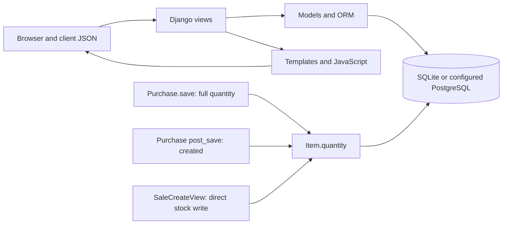
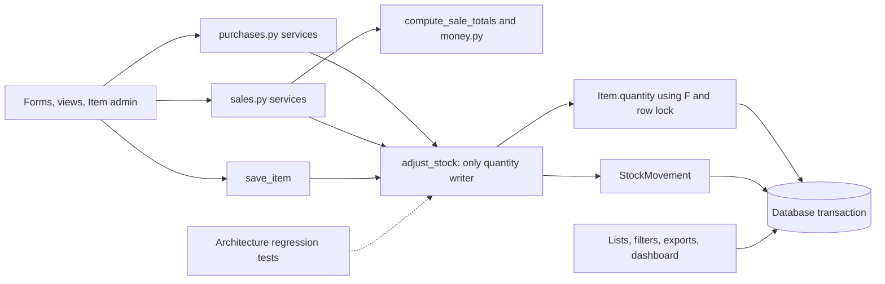
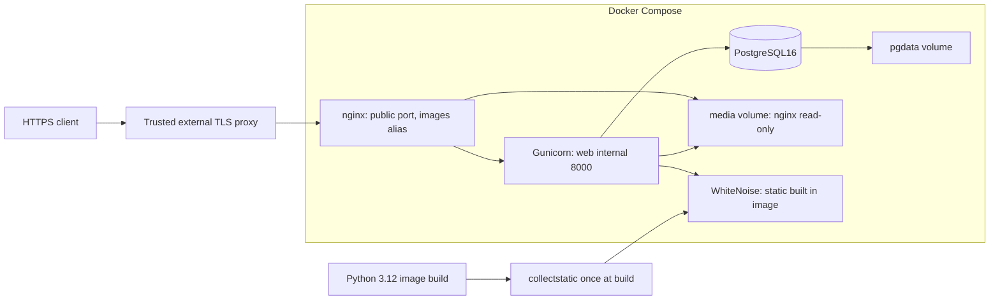
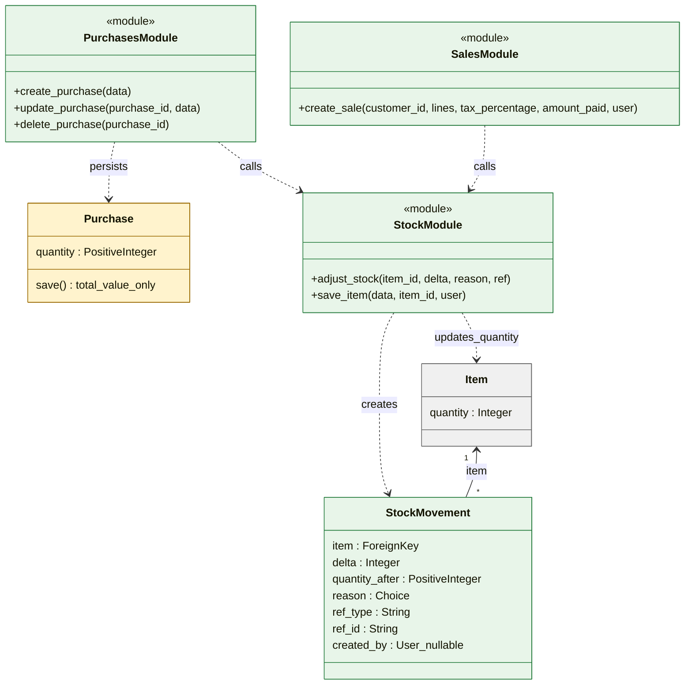
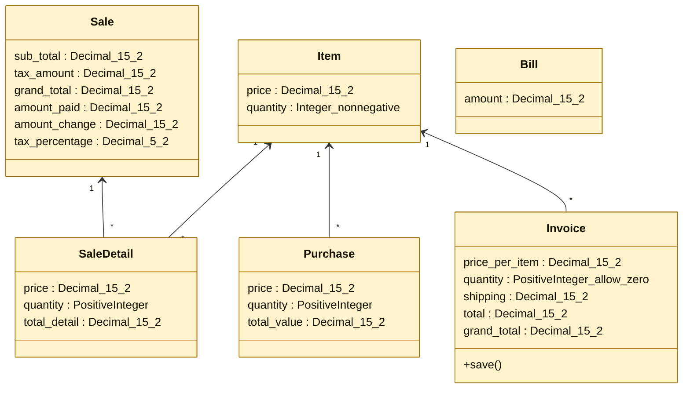
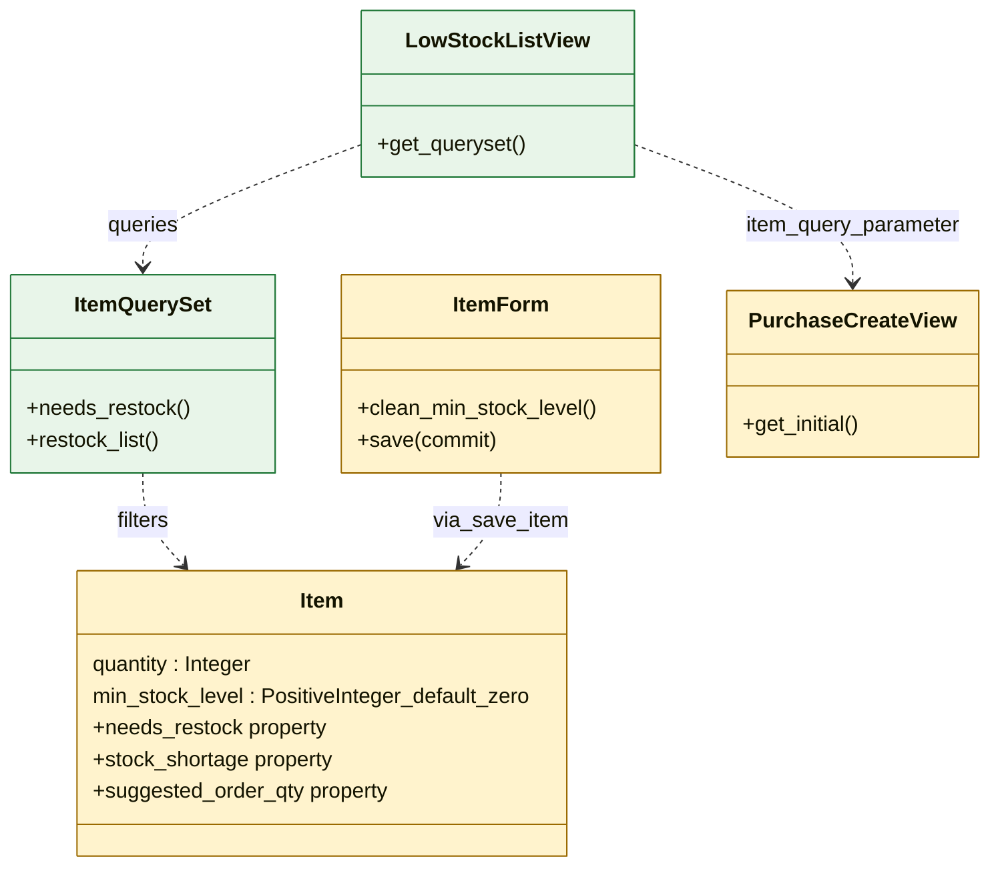
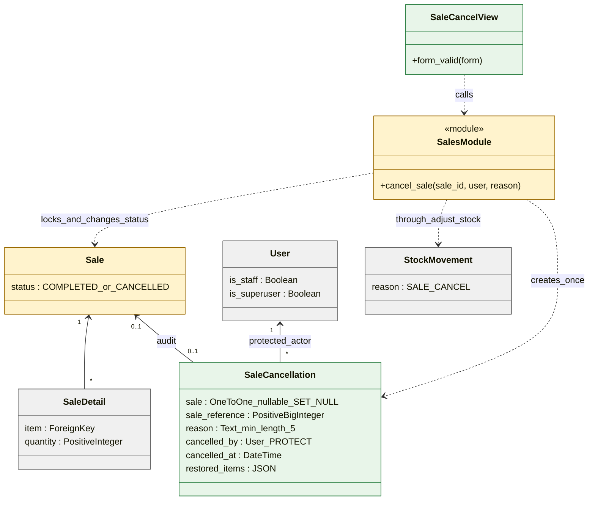
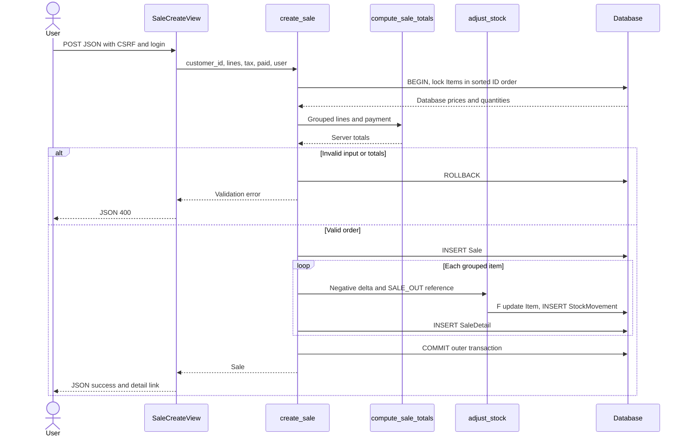
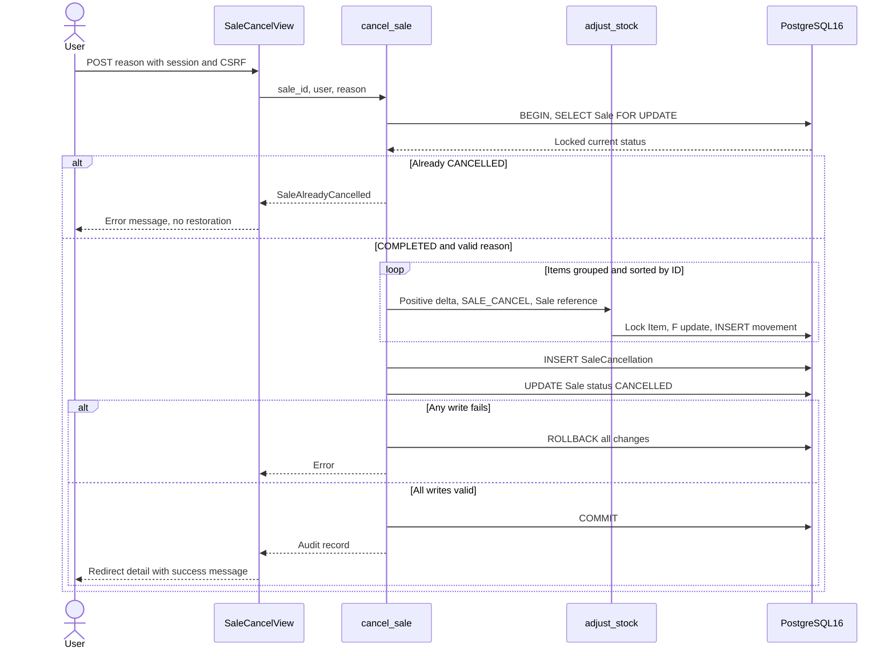
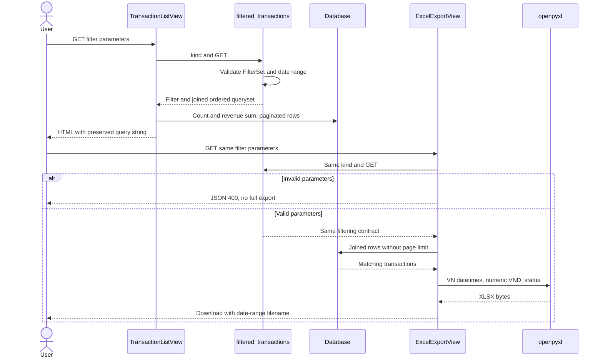

# 03. THIẾT KẾ BẢO TRÌ

Bộ tài liệu môn Bảo trì phần mềm – Project 2. Đề tài: **Bảo trì và hoàn thiện hệ thống quản lý bán hàng và tồn kho trên nền tảng Django**.

Phạm vi khảo sát là bản ứng dụng `123101a`, được đóng gói trong tag `v1-bao-tri` ở commit `1b06b13`; nhánh tài liệu kế thừa tag này. Các số liệu lấy từ `docs/BAO_CAO_TONG_HOP.md` và hồ sơ `evidence/final/`, không phải một lần chạy test mới của nhánh tài liệu. Mã FR/NFR/TC trong bộ tài liệu là định danh truy vết do tài liệu này quy định, không phải tên yêu cầu có sẵn trong code.


## Hồ sơ tài liệu và hướng dẫn đọc

Tài liệu được biên soạn cho nhóm bảo trì, người phản biện và giảng viên học phần Bảo trì phần mềm. Người đọc nghiệp vụ tập trung vào hiện trạng, hành vi mong muốn và bằng chứng; người triển khai đọc thêm kiến trúc, migration và ràng buộc. Phạm vi là 11 yêu cầu trên hệ thống bán hàng và tồn kho Django; không bổ sung chức năng ngoài phạm vi đã thực hiện.

| Phiên bản | Ngày | Người chuẩn bị | Nội dung cập nhật |
|---|---|---|---|
| 1.0 | 28/11/2026 | Nhóm Nguyễn Đức Khang, Châu Trường Phúc, Nguyễn Trường Thịnh | Hồ sơ kỹ thuật và bản Word ban đầu, commit 31668be |
| 1.1 | 28/11/2026 | Nhóm Nguyễn Đức Khang, Châu Trường Phúc, Nguyễn Trường Thịnh | Bổ sung cấu trúc theo mẫu Project 2, xuất Word A4; chưa có chữ ký phê duyệt của nhóm |

Quy ước: **[GIỮ]** là nội dung kế thừa; **[SỬA]** là điều chỉnh chức năng đang có; **[MỚI]** là nội dung bổ sung. Mã HC/TU/HT/DP liên kết yêu cầu bảo trì; FR/NFR là tiêu chí chức năng/phi chức năng; TC là trường hợp kiểm thử. Những mã FR/NFR/TC được đặt trong bộ hồ sơ này, không giả định phần mềm gốc đã có đặc tả với các mã tương tự.

| Thuật ngữ | Giải thích |
|---|---|
| Baseline | Mốc đối chiếu cố định v0-goc; không đồng nhất với main hiện tại của tác giả |
| Migration / preflight | Chuyển schema, dữ liệu / kiểm tra dữ liệu trước chuyển đổi |
| Atomic / rollback | Ghi toàn bộ giao dịch hoặc phục hồi toàn bộ khi thất bại |
| Ledger / StockMovement | Sổ ghi biến động tồn kho dùng để đối soát |
| CI / coverage | Kiểm chứng tự động / tỷ lệ dòng mã được thực thi, không đồng nghĩa chứng minh hết lỗi |

Nguồn biểu mẫu: bộ Project 2 do môn học cung cấp, gồm Yeucau_Project2.pdf, KehoachBT.pdf, Phantichsutacdong.pdf, DactaYCTD.pdf, ThietkeYCTD.pdf, Tài liệu kiểm thử.docx và Vidu_Dacta_Thietke.pdf. Mẫu kiểm thử ghi học kỳ 3 năm 2024–2025; đây là thông tin của mẫu, không dùng làm học kỳ thực tế của nhóm. Ngày và người phê duyệt nghiệp vụ chưa có hồ sơ riêng, không suy diễn từ trạng thái test PASS.

## 1. Nguyên tắc và kiến trúc trước bảo trì

Thiết kế giữ cấu trúc Django nhiều app hiện có; không dựng thêm một microservice hoặc lớp miền không có trong source. Mục tiêu là cô lập ghi tồn, chuẩn hóa tiền và làm rõ hợp đồng giữa view, service, ORM và giao diện. Sơ đồ trước mô tả hành vi tại tag v0-goc; sơ đồ sau mô tả bản đóng gói cuối. Các biểu tượng module trong sơ đồ lớp chỉ nhóm hàm Python thật, không phải lớp mới được tự giả định.



Hai đường cộng kho Purchase.save và post_save giải thích lỗi cộng hai lần lúc tạo. SaleCreateView trước bảo trì còn trực tiếp xử lý giá/tổng client và tồn. ORM cho phép ghi dữ liệu nhưng chưa có một hợp đồng tập trung bảo vệ biến động kho. Đây là cấu trúc có thể quan sát trong source gốc và tài liệu P0/HC, không phải mọi đường trong sơ đồ đều là một lớp Python.

## 2. Kiến trúc sau bảo trì và triển khai

Trong đường ghi ứng dụng đã tổ chức, các form/view/admin phù hợp gọi service; **adjust_stock** là đầu mối ghi Item.quantity, đồng thời ghi StockMovement. Purchase.save chỉ tính tiền. Các truy vấn danh sách/export/dashboard có thể dùng ORM trực tiếp vì chỉ đọc. Atomic lồng bên trong service thuộc cùng giao dịch ngoài, không commit riêng từng dòng.



Test kiến trúc kiểm các mẫu ghi rõ ràng trong mã, không phải cơ chế phân quyền SQL. Raw ORM và các đường sửa SaleDetail admin còn là rủi ro đã công bố; không diễn giải sơ đồ “sau” như một cam kết mọi đường ghi bên ngoài ứng dụng đều bị chặn.

Triển khai TU02 gồm PostgreSQL16, web Gunicorn và nginx; TLS thật kết thúc ở proxy tin cậy bên ngoài. Media được nginx đọc read-only, trong khi web vẫn có quyền ghi volume. Static được collectstatic lúc build và WhiteNoise phục vụ từ image.



Docker/CI cuối được chứng minh bằng run đúng SHA trong evidence/final; không có bằng chứng VPS thật đã được triển khai. Secret lấy từ env và không nhúng vào image; build chỉ dùng key sinh tạm cho collectstatic.

## 3. Sơ đồ lớp và dấu hiệu thay đổi

**Chú thích màu:** xanh nhạt = thành phần mới ở yêu cầu đang mô tả; vàng nhạt = thành phần đã có nhưng thay đổi; xám = thành phần giữ lại. Các sơ đồ có classDef tương ứng và style trực tiếp cùng bảng màu để giữ hiển thị trên renderer được kiểm tra; màu là ký hiệu phân tích, không phải thuộc tính runtime. StockModule/PurchasesModule/SalesModule là alias sơ đồ cho transactions/services/*.py, được đánh dấu stereotype module. Chữ ký đầy đủ, gồm đối số keyword-only, ghi trong mục 7.

### 3.1. DP01 – Hợp đồng kho và sổ biến động



StockMovement lưu cả delta và số dư sau để đối soát; reference là ref_type/ref_id, không phải FK đến chứng từ có thể bị xóa. created_by có thể NULL. Item vẫn là bảng số dư vật chất; ledger không thay bảng Item bằng một kho dữ liệu khác.

### 3.2. DP02 – Chuẩn hóa mô hình tiền

Sơ đồ này biểu diễn **mốc DP02**, nên tiền là Decimal(15,2). Sau TU03, các trường tiền trong sơ đồ thành Decimal(15,0); tax_percentage giữ Decimal(5,2). Invoice.quantity là PositiveIntegerField nhưng vẫn cho 0 theo giả định DP02. Các quan hệ tới Customer/Vendor không vẽ để tập trung vào kiểu và ràng buộc.



### 3.3. HT01 – Ngưỡng và truy vấn cần nhập

ItemQuerySet và LowStockListView là thành phần mới; ItemForm và PurchaseCreateView được mở rộng. needs_restock/stock_shortage/suggested_order_qty là property, không phải cột DB mới. Chỉ min_stock_level được lưu thêm.



### 3.4. HT03 – Trạng thái và lịch sử hủy

SaleCancellation.sale dùng SET_NULL để giữ lịch sử khi superuser xóa đơn đã hủy. Vì vậy hai phía quan hệ audit đều có tính tùy chọn; sale_reference bảo toàn mã nguồn. User bị PROTECT nếu đã làm actor hủy. SALE_CANCEL vốn là lựa chọn reason trong StockMovement từ DP01; HT03 bắt đầu sử dụng cho luồng hủy.



## 4. Sơ đồ tuần tự

### 4.1. Tạo đơn bán – HC03 và DP01

Trước khi tạo Sale, service gộp dòng, khóa Item và kiểm tiền; lỗi dữ liệu trả 400. Lỗi ghi sau khi đã tạo header hoặc movement vẫn phải rollback transaction. AJAX anonymous bị xử lý trước luồng này bằng 401; CSRF không bị tắt.



### 4.2. Hủy đơn – HT03

Hai luồng hủy phải tranh cùng khóa Sale. Luồng đến sau đọc lại status sau khi chờ, nên không được lặp hoàn kho. Các Item được hoàn theo thứ tự ID; audit và status nằm trong cùng transaction. Lỗi quyền/lý do được kiểm trước ghi; sơ đồ không mô tả tất cả phản hồi middleware.



### 4.3. Xuất Excel đã lọc – HT02

List và export chia sẻ hàm tạo queryset, không chia sẻ một snapshot transaction giữa hai HTTP request. Do đó tiêu chí cùng tập được chứng minh khi cùng tham số và dữ liệu không đổi; giao dịch mới xen giữa có thể thay tập kết quả. Number_format và đổi timezone kế thừa HC02/TU03.



## 5. Thay đổi CSDL và ràng buộc

### 5.1. Bảng/trường và dữ liệu mới hoặc đổi kiểu

| Phạm vi | Thiết kế cuối | Nguồn thay đổi |
| --- | --- | --- |
| accounts_profile | email max150 unique; first_name/last_name max30 | TU01 accounts/0002 |
| store_item.price | Float → Decimal(15,2) → VNDField(15,0) | DP02, TU03 |
| sales | sub_total/tax_amount/grand_total/amount_paid/amount_change (15,0); tax_percentage (5,2) | DP02/TU03 |
| sale_details | price, total_detail (15,0); quantity nguyên dương | DP02/TU03 |
| transactions_purchase | price, total_value (15,0); quantity nguyên dương | DP02/TU03 |
| invoice_invoice | price_per_item/shipping/total/grand_total (15,0); quantity PositiveInteger, cho 0 | DP02/TU03 |
| bills_bill.amount | Float → Decimal(15,2) → VNDField(15,0) | DP02/TU03 |
| transactions_stockmovement | item FK CASCADE; delta, quantity_after, reason, ref_type/ref_id, created_at, created_by nullable SET_NULL | DP01 transactions/0005 |
| store_item.min_stock_level | PositiveIntegerField default0; validators 0..2147483647 | HT01 store/0004 |
| sales.status | COMPLETED/CANCELLED, default COMPLETED | HT03 transactions/0007 |
| transactions_salecancellation | sale OneToOne nullable SET_NULL; sale_reference; reason; actor PROTECT; timestamp; restored_items JSON | HT03 transactions/0007 |

Profile unique không tự gộp email trùng; NULL và chuỗi rỗng không có cùng ý nghĩa. Migration tiền dùng helper đóng băng/cột tạm; không dùng import runtime để thay chính sách cũ mỗi khi module tiền đổi. Lịch sử có thể dừng trước chuyển nếu preflight phát hiện lỗi.

### 5.2. Danh mục CHECK có tên trong source cuối

Bảng dưới trích tên trực tiếp từ Meta.constraints của model, không đếm các CHECK ngầm sinh bởi PositiveIntegerField hoặc unique FK/email. Các đẳng thức Sale dùng F và Round ở scale 0 của bản cuối; 22 CHECK DP02 được giữ độ chặt, TU03 thêm miền nguyên/range, DP01/HT03 thêm kiểm reason/status tương ứng.

| Model | Tên CHECK trong mã nguồn |
| --- | --- |
| store.Item | item_price_nonnegative, item_quantity_nonnegative, item_price_vnd_int |
| transactions.Sale | sale_status_valid, sale_subtotal_nonnegative, sale_grand_nonnegative, sale_tax_nonnegative, sale_paid_nonnegative, sale_change_nonnegative, sale_tax_percentage_range, sale_grand_matches_parts, sale_change_matches_payment, sale_sub_total_vnd_int, sale_tax_amount_vnd_int, sale_grand_total_vnd_int, sale_amount_paid_vnd_int, sale_amount_change_vnd_int |
| transactions.SaleCancellation | sale_cancellation_reason_min_length |
| transactions.SaleDetail | sale_detail_price_nonnegative, sale_detail_total_nonnegative, sale_detail_quantity_positive, saledetail_price_vnd_int, saledetail_total_detail_vnd_int |
| transactions.Purchase | purchase_price_nonnegative, purchase_total_nonnegative, purchase_quantity_positive, purchase_price_vnd_int, purchase_total_value_vnd_int |
| transactions.StockMovement | stock_movement_valid_reason |
| invoice.Invoice | invoice_price_nonnegative, invoice_shipping_nonnegative, invoice_total_nonnegative, invoice_grand_nonnegative, invoice_quantity_nonnegative, invoice_price_per_item_vnd_int, invoice_shipping_vnd_int, invoice_total_vnd_int, invoice_grand_total_vnd_int |
| bills.Bill | bill_amount_nonnegative, bill_amount_vnd_int |

OneToOne SaleCancellation.sale bảo đảm duy nhất theo đơn còn tồn tại; PROTECT actor và SET_NULL Sale là hai chính sách xóa khác nhau. Kiểm dữ liệu trong form/service không thay thế CHECK DB; ngược lại CHECK không thực hiện nghiệp vụ hoàn kho hoặc tạo movement thay service.

## 6. Migration và triển khai dữ liệu

Nguồn evidence/final/migration_project_order.txt ghi 19 migration dự án, không gồm 18 migration Django xen kẽ. Thứ tự dưới là kế hoạch thực tế, không phải suy diễn từ mã yêu cầu:

```text
accounts.0001_initial
accounts.0002_alter_profile_email_alter_profile_first_name_and_more
store.0001_initial
transactions.0001_initial
transactions.0002_rename_discount_amount_sale_tax_amount_and_more
transactions.0003_alter_purchase_quantity
invoice.0001_initial
bills.0001_initial
transactions.0004_dp02_decimal_constraints
store.0002_dp02_decimal_constraints
transactions.0005_dp01_stock_movement
invoice.0002_dp02_decimal_constraints
bills.0002_dp02_decimal_constraints
bills.0003_tu03_vnd
invoice.0003_tu03_vnd
store.0003_tu03_vnd
store.0004_ht01_min_stock_level
transactions.0006_tu03_vnd
transactions.0007_ht03_sale_cancellation
```

Trên dữ liệu v0, cần backup, dừng nguồn ghi, preflight Profile trước accounts/0002, check_decimal_data trước DP02, seed ledger DP01 có đối chiếu tồn đầu, check_vnd_data trước TU03, rồi mới hoàn tất HT01/HT03. Không chạy target migration cũ trên DB đã nâng để tránh unapply và mất audit. Trên DB trống chạy migrate đầy đủ rồi các preflight chỉ đọc. Hai đường triển khai và lệnh Docker đã có ở mục 5 và 8 báo cáo tổng hợp.

Chuyển Float→Decimal và cents→đồng mất thông tin phần lẻ; reverse migration không phải biện pháp phục hồi dữ liệu. FINAL/nhánh tài liệu không chạy migrate trên DB thật và không thực hiện --fix.

## 7. Thiết kế theo từng yêu cầu

### 7.1. HC01 – Tồn kho phiếu nhập

**Model/phạm vi:** Mỗi phiếu mới chỉ cộng kho một lần; khi sửa phải dùng số lượng đang lưu trong DB, áp chênh lệch và xử lý đổi mặt hàng. Từ chối thay đổi gây âm kho, giữ tính nguyên tử và công thức thành tiền.

**Hàm/lớp và chữ ký:**

- `Purchase.save(self, *args, **kwargs)` — xử lý chênh lệch tại mốc HC01; sau DP01 chỉ tính total_value.
- `update_purchase(purchase_id, data)` — đầu mối cập nhật ở bản cuối, giữ nguyên các quy tắc HC01.

**Luồng xử lý:**

1. Đọc phiếu cũ từ DB trong transaction.
2. Xác định delta theo mặt hàng cũ/mới.
3. Kiểm tra mọi số dư không âm, áp delta có khóa/F().
4. Lưu phiếu; bất kỳ lỗi nào rollback.

**Liên hệ:** DP01 phải bảo toàn các hành vi đã sửa khi chuyển khỏi save(); HT01 phụ thuộc số dư đúng; HT03 bổ sung hoàn kho bán hàng, không thay quy tắc nhập. Nguồn chi tiết: [docs/HC01.md](../HC01.md).

### 7.2. HC02 – Excel và ngày giao

**Model/phạm vi:** Dùng tiện ích đổi ngày chung, xử lý None/aware/naive an toàn; giữ ngày giao khi sửa mô tả; xuất được file rỗng và bảo toàn quyền đăng nhập.

**Hàm/lớp và chữ ký:**

- `to_excel_datetime(value, tz=None)` — chuẩn hóa datetime dành cho Excel.
- `PurchaseForm.clean_delivery_date(self)` — giữ giây/vi giây cũ nếu người dùng không đổi phút.

**Luồng xử lý:**

1. Đọc datetime tùy chọn.
2. Nếu None thì ghi ô trống; nếu aware thì localtime trước khi bỏ tzinfo.
3. Ghi dữ liệu vào workbook và number_format ngày.
4. Với form, parse datetime-local rồi bảo toàn giá trị cũ khi chỉ đổi mô tả.

**Liên hệ:** TU03 dùng lại tiện ích với giờ Việt Nam; HT01 và HT02 kế thừa quy tắc xuất; TU01/TU02 cần giữ hành vi render và storage khi nâng môi trường. Nguồn chi tiết: [docs/HC02.md](../HC02.md).

### 7.3. HC03 – Tính tiền máy chủ

**Model/phạm vi:** Máy chủ lấy giá DB, gộp dòng trùng, tính tiền và thuế cộng thêm, kiểm tra thanh toán/tồn kho trước khi ghi; dữ liệu sai bị từ chối và không để lại ghi dở dang.

**Hàm/lớp và chữ ký:**

- `compute_sale_totals(lines, tax_percentage, amount_paid)` — hàm tính thuần, trả các tổng và dòng đã chuẩn hóa.
- `create_sale(customer_id, lines, tax_percentage, amount_paid, user)` — sau DP01 sở hữu transaction và ghi kho.
- `SaleCreateView(request)` — parse JSON và trả phản hồi; không tin các tổng client.

**Luồng xử lý:**

1. Xác thực request và parse JSON bằng Decimal.
2. Chuẩn hóa/gộp dòng, khóa Item theo ID và lấy giá DB.
3. Tính tổng, kiểm tra các khai báo client và khả năng thanh toán.
4. Tạo Sale, trừ kho qua service, tạo SaleDetail; commit hoặc rollback.

**Liên hệ:** DP02 thay kiểu lưu tiền; DP01 di chuyển transaction bán sang service; TU03 đổi lượng tử hóa; HT03 dùng các SaleDetail để hoàn đúng lượng đã bán. Nguồn chi tiết: [docs/HC03.md](../HC03.md).

### 7.4. TU01 – Nâng Django 5.2

**Model/phạm vi:** Chuyển Django 5.2.19, dùng STORAGES đúng API, bổ sung accounts/0002 sau kiểm tra dữ liệu, duy trì tính tương thích và manifest static.

**Hàm/lớp và chữ ký:**

- `Command.handle(self, *args, **options) trong check_profile_data` — audit trước migrate.
- `StorageUpgradeTests` — kiểm manifest và default storage trong thư mục tạm.

**Luồng xử lý:**

1. Đối chiếu requirements và pin bản đích.
2. Kiểm Profile cũ bằng preflight.
3. Áp accounts/0002 khi dữ liệu sạch.
4. Chạy collectstatic, check và suite để xác minh API/storage.

**Liên hệ:** TU02 sử dụng settings/storage mới; DP02 phụ thuộc accounts/0002; toàn bộ bộ test hiện hữu cần tiếp tục chạy sau nâng. Nguồn chi tiết: [docs/TU01.md](../TU01.md).

### 7.5. TU02 – Docker, PostgreSQL16, nginx/MEDIA

**Model/phạm vi:** Dùng Python 3.12/Gunicorn non-root, PostgreSQL16, nginx phục vụ media, volume bền vững, cấu hình env và CI không deploy.

**Hàm/lớp và chữ ký:**

- `env_bool(name, default=False), env_list(name, default=""), db_value(name, legacy=None, default="")` — parse cấu hình.
- `seed_default_media(media_root)` — chỉ tạo ảnh mặc định thiếu.
- `scripts/ci_compose_smoke.py` — kiểm health, login, MEDIA và persistence.

**Luồng xử lý:**

1. Build image và collectstatic với key build tạm.
2. DB healthy, entrypoint seed media và audit Profile khi bảng đã có.
3. Migrate rồi chạy Gunicorn non-root.
4. nginx proxy request/static và đọc media; CI kiểm down/up cùng production settings.

**Liên hệ:** DP02/TU03 cần kiểm migration trên PostgreSQL16; HT03 dùng môi trường này để chứng minh khóa hàng; test storage TU01 cần override production backend rõ ràng. Nguồn chi tiết: [docs/TU02.md](../TU02.md).

### 7.6. DP02 – Decimal và ràng buộc

**Model/phạm vi:** Chuẩn hóa Decimal(15,2) tại mốc DP02, quantity Invoice nguyên không âm, preflight và migration an toàn; chứng minh constraint trên hai backend.

**Hàm/lớp và chữ ký:**

- `audit_data(apps, connection)` — audit dữ liệu lịch sử ở helper đóng băng.
- `Command.handle(...) của check_decimal_data` — preflight không sửa.
- `Invoice.save(self, *args, **kwargs)` — tính tổng bằng Decimal; bản cuối dùng VND theo TU03.

**Luồng xử lý:**

1. Audit số tiền, quantity và các đẳng thức trên schema cũ.
2. Dừng nếu có vi phạm; không nới constraint để vượt qua.
3. Dùng cột tạm và Decimal chuyển dữ liệu; thêm CHECK.
4. Đối chiếu dữ liệu và chạy hồi quy/coverage trên hai DB.

**Liên hệ:** DP01 cần kiểu tiền và constraints ổn định trước refactor; TU03 kế thừa Decimal rồi đổi scale thành 0; mọi form, export và fixture tiền chịu tác động. Nguồn chi tiết: [docs/DP02.md](../DP02.md).

### 7.7. DP01 – Tách dịch vụ kho, sổ kho

**Model/phạm vi:** Tạo transactions/services, chỉ adjust_stock ghi Item.quantity; service public atomic, ghi StockMovement, xử lý xóa phiếu và đối soát.

**Hàm/lớp và chữ ký:**

- `adjust_stock(item_id, delta, *, reason, ref=None) -> int.`
- `save_item(data, item_id=None, user=None) -> Item.`
- `create_purchase(data), update_purchase(purchase_id, data), delete_purchase(purchase_id).`
- `create_sale(customer_id, lines, tax_percentage, amount_paid, user) -> Sale.`

**Luồng xử lý:**

1. View/form chuẩn hóa đầu vào rồi gọi service.
2. Service mở atomic, khóa chứng từ/item và kiểm tra quy tắc.
3. adjust_stock cập nhật F() và ghi movement.
4. Lưu/xóa chứng từ; rollback toàn bộ nếu lỗi; đối soát qua command khi cần.

**Liên hệ:** TU03 phải đổi cách round trong pricing/service mà không phân tán ghi kho; HT01 đọc số dư do service duy trì; HT03 thêm cancel_sale và reason SALE_CANCEL. Nguồn chi tiết: [docs/DP01.md](../DP01.md).

### 7.8. TU03 – Giờ Việt Nam, tiếng Việt, VND

**Model/phạm vi:** Dùng Asia/Ho_Chi_Minh, vi, VND nguyên đồng; một module tiền HALF_UP, form từ chối phần lẻ, migration bảo toàn ràng buộc và Excel đúng giờ.

**Hàm/lớp và chữ ký:**

- `to_vnd(value) -> Decimal; format_vnd(value) -> str.`
- `VNDField; VNDFormField` — thống nhất lưu/validation tiền.
- `to_excel_datetime(value, tz=None)` — export truyền timezone Việt Nam rõ ràng.
- `audit(apps, connection, project=...)` — kiểm tra hiện trạng hoặc giá trị dự kiến sau round.

**Luồng xử lý:**

1. Parse tiền vào Decimal và kiểm hữu hạn.
2. Round tới đồng theo một chính sách; tính thuế/tổng phía server.
3. Validate input form; preflight trước chuyển dữ liệu, dùng cột tạm và CHECK.
4. Render filter vnd/vn_datetime và ghi Excel numeric đúng locale.

**Liên hệ:** HT01/HT02/HT03 phải dùng nhãn, tiền và giờ theo TU03; DP01 tiếp tục sở hữu kho; test migration DP02 phải giữ kỳ vọng cent tại mốc lịch sử. Nguồn chi tiết: [docs/TU03.md](../TU03.md).

### 7.9. HT01 – Ngưỡng tồn tối thiểu

**Model/phạm vi:** Lưu ngưỡng từng hàng, liệt kê tồn bằng/thấp ngưỡng đã bật, cảnh báo dashboard, xuất Excel và chọn sẵn hàng khi tạo phiếu nhập.

**Hàm/lớp và chữ ký:**

- `Item.needs_restock; stock_shortage; suggested_order_qty` — các property.
- `ItemQuerySet.needs_restock(self); restock_list(self).`
- `LowStockListView.get_queryset(self); export_low_stock_to_excel(request).`

**Luồng xử lý:**

1. Quản lý lưu ngưỡng qua ItemForm/save_item.
2. Query trực tiếp quantity so ngưỡng; tính thiếu và đề xuất.
3. Hiển thị count/list hoặc xuất toàn tập.
4. Chuyển form nhập với item ban đầu; service nhập giữ quyền kiểm tra khi POST.

**Liên hệ:** HT03 hoàn kho có thể làm item rời danh sách; các đường ghi DP01 phải được giữ; thay đổi metadata không được làm lệch sổ. Nguồn chi tiết: [docs/HT01.md](../HT01.md).

### 7.10. HT02 – Lọc và xuất giao dịch

**Model/phạm vi:** Một đường lọc đã validate cho list/export, theo ngày Việt Nam và các tiêu chí nghiệp vụ, giữ tham số phân trang và tổng đúng toàn tập.

**Hàm/lớp và chữ ký:**

- `filtered_transactions(kind, params) -> (FilterSet, QuerySet).`
- `export_filename(kind, filters) -> str.`
- `TransactionListMixin.get_queryset(self); get_context_data(self, **kwargs).`

**Luồng xử lý:**

1. Validate bộ tham số GET bằng FilterSet/form.
2. Invalid trả queryset rỗng cho list hoặc lỗi 400 cho export.
3. Valid dùng queryset join/sắp xếp chung.
4. List aggregate rồi phân trang; export ghi toàn tập và giữ format TU03.

**Liên hệ:** HT03 thêm status vào SaleFilter và loại CANCELLED khỏi tổng doanh thu; HC02/TU03 cung cấp quy tắc Excel/ngày/tiền; không thay luồng kho DP01. Nguồn chi tiết: [docs/HT02.md](../HT02.md).

### 7.11. HT03 – Hủy đơn, lịch sử, hoàn kho

**Model/phạm vi:** Hủy có lý do và actor/time; khóa Sale, hoàn qua DP01 đúng một lần; cập nhật doanh thu/filter/UI và chỉ cho superuser xóa đơn đã hủy.

**Hàm/lớp và chữ ký:**

- `cancel_sale(sale_id, user, reason) -> SaleCancellation.`
- `SaleCancelView.form_valid(self, form); SaleDeleteView.form_valid(self, form).`
- `SaleCancellation.clean(self); SaleCancellationAdmin` — audit chỉ xem.

**Luồng xử lý:**

1. Kiểm quyền; khóa Sale trong atomic.
2. Nếu đã CANCELLED thì báo lỗi trước mọi lần hoàn.
3. Gộp SaleDetail theo item, gọi adjust_stock reason SALE_CANCEL.
4. Tạo audit, đổi status; commit hoặc rollback tất cả; UI/tổng/đối soát dùng trạng thái mới.

**Liên hệ:** Dùng service/sổ DP01; mở rộng filter HT02; tác động count/đề xuất HT01 qua số dư; giữ format tiền/ngày TU03. Nguồn chi tiết: [docs/HT03.md](../HT03.md).

## 8. Giới hạn thiết kế và truy vết

Thiết kế mô tả bản đã thực hiện, không bổ sung service, bảng hay quyền ngoài source. Các đường admin/ORM còn mở, sai route và giới hạn precision Excel được giữ trong danh mục tồn đọng, không được vẽ thành thành phần đã sửa. Màu sơ đồ đánh dấu thay đổi tại từng mốc, trong khi bảng CSDL ghi bản cuối; hai góc nhìn không đồng nhất về thời điểm nhưng được ghi rõ. Cú pháp Mermaid được kiểm tra bằng công cụ parse/render; kết quả xác minh và tình trạng Pandoc lưu ở KIEM_TRA_TAI_LIEU.json trong cùng thư mục.

## 9. Bổ sung cơ sở thiết kế và từ điển dữ liệu

Thiết kế giữ kiến trúc Django MVT để giảm phạm vi thay đổi; lớp dịch vụ DP01 tập trung transaction và kho thay vì tách microservice hoặc trigger riêng từng backend. DB constraint bổ sung lớp bảo vệ độc lập với form. nginx xử lý media khi DEBUG=False; static build nằm trong image. Lựa chọn và phương án thay thế theo từng yêu cầu được phân tích ở tài liệu 01; không diễn giải kiến trúc sau như cơ chế cấm mọi SQL/admin tùy ý.

Từ điển dưới bao quát dữ liệu chính liên quan đến phạm vi bảo trì, không thay thế mô tả model nguyên bản. Các trường tiền hiện tại là VNDField kế thừa DecimalField(15,0); phần trăm thuế giữ Decimal(5,2). Tên bảng sales và sale_details là db_table thực tế, không tự ghép tiền tố app.

| Đối tượng và trường | Kiểu / ràng buộc | Ý nghĩa và xử lý |
|---|---|---|
| Bill.amount | VNDField(15,0), không âm | Chi phí; [SỬA] DP02/TU03 |
| Customer | Đối tượng khách hàng; tên nối an toàn | Tác nhân được tham chiếu ở Sale; [SỬA] HC03 xử lý last_name rỗng |
| Invoice.quantity | PositiveIntegerField, cho 0 | [SỬA] DP02; giả định 0 còn cần nghiệm thu nghiệp vụ |
| Invoice.price_per_item, shipping, total, grand_total | VNDField(15,0), không âm | [SỬA] DP02/TU03; logic hóa đơn theo model, không đồng nhất Sale |
| Item.price | VNDField(15,0), không âm | Giá DB làm nguồn tính; [SỬA] DP02/TU03 |
| Item.quantity | Số nguyên không âm | Số dư; [SỬA] DP01 chỉ adjust_stock ghi trong đường ứng dụng |
| Item.min_stock_level | PositiveIntegerField, default 0 | [MỚI] HT01; 0 tắt cảnh báo |
| Item.needs_restock, stock_shortage, suggested_order_qty | Property / queryset, không phải cột | [MỚI] HT01; tính từ số dư và ngưỡng |
| Profile.email, first_name, last_name | email max150 unique; tên max30 | [SỬA] TU01; preflight không tự gộp |
| Purchase.item, vendor | ForeignKey theo model | Hàng và nhà cung cấp của phiếu nhập |
| Purchase.price, total_value, quantity | Tiền VND; lượng nguyên dương | Service nhập tính total, delta tồn; save chỉ tính tiền sau DP01 |
| Purchase.delivery_date | Datetime có thể NULL | [SỬA] HC02 giữ giá trị khi chỉ sửa mô tả |
| Sale.customer, date_added | Khách; datetime có timezone | Tham chiếu khách và thời điểm lọc/xuất |
| Sale.sub_total, tax_amount, grand_total | Tiền VND không âm | grand_total = sub_total + tax_amount |
| Sale.amount_paid, amount_change | Tiền VND không âm | amount_change = amount_paid − grand_total |
| Sale.tax_percentage | Decimal(5,2), 0..100 | Thuế cộng thêm, làm tròn đến đồng sau TU03 |
| Sale.status | COMPLETED / CANCELLED | [MỚI] HT03; mặc định COMPLETED |
| SaleCancellation | OneToOne sale nullable SET_NULL; sale_reference | [MỚI] HT03; audit còn tham chiếu mã khi đơn bị xóa |
| SaleCancellation.reason, cancelled_by, cancelled_at | Lý do >=5 sau trim; FK User PROTECT; thời điểm | Ai hủy, vì sao và khi nào |
| SaleCancellation.restored_items | JSON | Số lượng đã hoàn của từng item; không thay sổ kho |
| SaleDetail.item, quantity, price, total_detail | FK; lượng nguyên dương; tiền VND không âm | Dòng bán; căn cứ hoàn kho |
| StockMovement | FK item; delta; quantity_after; reason; ref_type/ref_id | [MỚI] DP01; delta và số dư sau điều chỉnh; lý do theo choice/CHECK |
| StockMovement.created_by, created_at | User nullable SET_NULL; thời điểm | Thông tin truy vết người tạo và thời điểm |
| Vendor | Nhà cung cấp | Dùng ở phiếu nhập và thông tin hàng cần nhập |

## 10. Thiết kế giao diện và sử dụng dữ liệu

Ảnh giao diện thật được đặt trong mục bằng chứng tài liệu 04 và dẫn lại ở từng chức năng dưới đây; không tự vẽ thêm màn hình chưa tồn tại. Mã thiết kế TK-<MÃ> là mã mới để truy vết trong hồ sơ này; không tìm thấy mã thiết kế gốc có sẵn. Thay đổi giữ, sửa và mới được gắn nhãn rõ; thiết kế lớp có màu theo chú thích ở phần 3.

### 10.1. TK-HC01-HC02

| Thành phần thiết kế | Mô tả |
|---|---|
| Mục đích và thay đổi | [SỬA] Tạo và sửa phiếu nhập |
| Hàm/lớp | PurchaseForm / PurchaseCreateView / PurchaseUpdateView |
| Điều khiển giao diện | item, vendor: lựa chọn; quantity, price: số; description: văn bản; delivery_date: datetime-local có thể trống; delivery_status: lựa chọn |
| Mặc định, xử lý và ràng buộc | Khi tạo chưa có ngày giao có thể để trống; khi sửa dùng giá trị DB, giữ giây nếu không đổi phút. item từ GET chỉ là dữ liệu điền sẵn, người dùng có thể đổi. |
| Sử dụng dữ liệu: thêm/sửa/xóa/truy vấn | Purchase: thêm/sửa/truy vấn; Item: đọc và cập nhật tồn qua service; StockMovement: thêm sau DP01. |
| Giao diện minh họa | evidence/hc02/sau/ và mục 5.2 tài liệu 04 |

### 10.2. TK-HC03-TU03

| Thành phần thiết kế | Mô tả |
|---|---|
| Mục đích và thay đổi | [SỬA] Tạo và chi tiết đơn bán |
| Hàm/lớp | SaleCreateView, create_sale, compute_sale_totals |
| Điều khiển giao diện | Khách: lựa chọn; dòng hàng/lượng; thuế/phải trả/đã trả; nút lưu; chi tiết hiển thị tiền qua vnd |
| Mặc định, xử lý và ràng buộc | Thuế trong 0..100; tiền nguyên; JS chỉ hỗ trợ xem trước; server quyết định giá/tổng. Sai trả lỗi, không ghi dở. |
| Sử dụng dữ liệu: thêm/sửa/xóa/truy vấn | Sale/SaleDetail: thêm/truy vấn; Item: đọc, trừ qua service; StockMovement: thêm. |
| Giao diện minh họa | evidence/hc03/sau/, evidence/tu03/ và mục 5.3/5.5 tài liệu 04 |

### 10.3. TK-HT01

| Thành phần thiết kế | Mô tả |
|---|---|
| Mục đích và thay đổi | [MỚI] Ngưỡng và danh sách cần nhập |
| Hàm/lớp | ItemForm, LowStockListView, export_low_stock_to_excel |
| Điều khiển giao diện | Ngưỡng: số nguyên; bảng tên/danh mục/tồn/ngưỡng/thiếu/đề xuất/NCC; nút tạo phiếu; liên kết Excel; thẻ dashboard |
| Mặc định, xử lý và ràng buộc | Ngưỡng mặc định 0; cần nhập khi min>0 và tồn<=min; sắp thiếu giảm dần; nút tạo phiếu truyền item, không ghi phiếu ở GET. |
| Sử dụng dữ liệu: thêm/sửa/xóa/truy vấn | Item: sửa metadata qua save_item, truy vấn ngưỡng/tồn; Purchase chưa ghi khi mới mở form. |
| Giao diện minh họa | evidence/ht01/ và mục 5.6 tài liệu 04 |

### 10.4. TK-HT02

| Thành phần thiết kế | Mô tả |
|---|---|
| Mục đích và thay đổi | [MỚI] Bộ lọc danh sách giao dịch |
| Hàm/lớp | SaleFilter, PurchaseFilter, TransactionListMixin |
| Điều khiển giao diện | Ngày từ/đến; khách và tìm tên/sđt, tiền min/max; phiếu nhập thêm NCC/hàng/trạng thái giao; nút lọc và xuất Excel; phân trang |
| Mặc định, xử lý và ràng buộc | Không điều kiện lấy tất cả; đầu vào sai hiện lỗi; date_to trọn ngày Việt Nam; export mang GET và dùng tập đầy đủ, không chỉ trang hiện tại. |
| Sử dụng dữ liệu: thêm/sửa/xóa/truy vấn | Sale/Customer hoặc Purchase/Item/Vendor: chỉ truy vấn; không ghi tồn. |
| Giao diện minh họa | evidence/ht02/ và mục 5.7 tài liệu 04 |

### 10.5. TK-HT03

| Thành phần thiết kế | Mô tả |
|---|---|
| Mục đích và thay đổi | [MỚI] Form hủy và lịch sử đơn |
| Hàm/lớp | SaleCancellationForm, SaleCancelView, cancel_sale |
| Điều khiển giao diện | Lý do: textarea; nút xác nhận; nhãn trạng thái; thông tin người/thời điểm/lý do trên chi tiết |
| Mặc định, xử lý và ràng buộc | Ẩn nút khi đã hủy; quyền kiểm lại ở server; lý do sau trim >=5; hủy lặp không hoàn lần hai; superuser chỉ xóa đơn đã hủy. |
| Sử dụng dữ liệu: thêm/sửa/xóa/truy vấn | Sale: sửa status/truy vấn; SaleDetail: đọc; Item: hoàn qua service; StockMovement/SaleCancellation: thêm; xóa Sale giữ audit theo SET_NULL. |
| Giao diện minh họa | evidence/ht03/ và mục 5.8 tài liệu 04 |

Các yêu cầu TU01/TU02/DP02/DP01 chủ yếu thay nền tảng, dữ liệu hoặc tổ chức mã; không giả định có màn hình thao tác riêng. Giao diện được giữ và kiểm chứng qua ảnh/log/test đã dẫn. Nguồn ghi SaleDetail admin trực tiếp vẫn là rủi ro còn mở, không được che bởi sơ đồ dịch vụ.

## 11. Bảng tham khảo tới các yêu cầu chức năng

Mỗi FR trong tài liệu 02 được gắn với thành phần triển khai. Liên kết TC theo mã yêu cầu là nhóm kiểm chứng, không khẳng định ánh xạ một-một từng FR tới một test duy nhất. Chữ ký hàm và luồng từng yêu cầu ở phần 7 vẫn là mô tả chi tiết; bảng dưới phục vụ tra cứu theo mã đặc tả.

| Mã FR | Thành phần đáp ứng | Nhóm bằng chứng |
|---|---|---|
| FR-HC01-1 | Purchase service, PurchaseUpdateView, adjust_stock | TC-HC01-*; docs/HC01.md |
| FR-HC01-2 | Purchase service, PurchaseUpdateView, adjust_stock | TC-HC01-*; docs/HC01.md |
| FR-HC01-3 | Purchase service, PurchaseUpdateView, adjust_stock | TC-HC01-*; docs/HC01.md |
| FR-HC01-4 | Purchase service, PurchaseUpdateView, adjust_stock | TC-HC01-*; docs/HC01.md |
| FR-HC01-5 | Purchase service, PurchaseUpdateView, adjust_stock | TC-HC01-*; docs/HC01.md |
| FR-HC02-1 | to_excel_datetime, PurchaseForm, hai view export | TC-HC02-*; docs/HC02.md |
| FR-HC02-2 | to_excel_datetime, PurchaseForm, hai view export | TC-HC02-*; docs/HC02.md |
| FR-HC02-3 | to_excel_datetime, PurchaseForm, hai view export | TC-HC02-*; docs/HC02.md |
| FR-HC02-4 | to_excel_datetime, PurchaseForm, hai view export | TC-HC02-*; docs/HC02.md |
| FR-HC02-5 | to_excel_datetime, PurchaseForm, hai view export | TC-HC02-*; docs/HC02.md |
| FR-HC03-1 | SaleCreateView, compute_sale_totals, create_sale | TC-HC03-*; docs/HC03.md |
| FR-HC03-2 | SaleCreateView, compute_sale_totals, create_sale | TC-HC03-*; docs/HC03.md |
| FR-HC03-3 | SaleCreateView, compute_sale_totals, create_sale | TC-HC03-*; docs/HC03.md |
| FR-HC03-4 | SaleCreateView, compute_sale_totals, create_sale | TC-HC03-*; docs/HC03.md |
| FR-HC03-5 | SaleCreateView, compute_sale_totals, create_sale | TC-HC03-*; docs/HC03.md |
| FR-HC03-6 | SaleCreateView, compute_sale_totals, create_sale | TC-HC03-*; docs/HC03.md |
| FR-TU01-1 | requirements, InventoryMS.settings.STORAGES, accounts/0002, check_profile_data | TC-TU01-*; docs/TU01.md |
| FR-TU01-2 | requirements, InventoryMS.settings.STORAGES, accounts/0002, check_profile_data | TC-TU01-*; docs/TU01.md |
| FR-TU01-3 | requirements, InventoryMS.settings.STORAGES, accounts/0002, check_profile_data | TC-TU01-*; docs/TU01.md |
| FR-TU01-4 | requirements, InventoryMS.settings.STORAGES, accounts/0002, check_profile_data | TC-TU01-*; docs/TU01.md |
| FR-TU01-5 | requirements, InventoryMS.settings.STORAGES, accounts/0002, check_profile_data | TC-TU01-*; docs/TU01.md |
| FR-TU02-1 | settings, Dockerfile, compose/nginx, entrypoint, CI smoke | TC-TU02-*; docs/TU02.md |
| FR-TU02-2 | settings, Dockerfile, compose/nginx, entrypoint, CI smoke | TC-TU02-*; docs/TU02.md |
| FR-TU02-3 | settings, Dockerfile, compose/nginx, entrypoint, CI smoke | TC-TU02-*; docs/TU02.md |
| FR-TU02-4 | settings, Dockerfile, compose/nginx, entrypoint, CI smoke | TC-TU02-*; docs/TU02.md |
| FR-TU02-5 | settings, Dockerfile, compose/nginx, entrypoint, CI smoke | TC-TU02-*; docs/TU02.md |
| FR-TU02-6 | settings, Dockerfile, compose/nginx, entrypoint, CI smoke | TC-TU02-*; docs/TU02.md |
| FR-DP02-1 | VND/Decimal model fields, CHECK, migration DP02, check_decimal_data | TC-DP02-*; docs/DP02.md |
| FR-DP02-2 | VND/Decimal model fields, CHECK, migration DP02, check_decimal_data | TC-DP02-*; docs/DP02.md |
| FR-DP02-3 | VND/Decimal model fields, CHECK, migration DP02, check_decimal_data | TC-DP02-*; docs/DP02.md |
| FR-DP02-4 | VND/Decimal model fields, CHECK, migration DP02, check_decimal_data | TC-DP02-*; docs/DP02.md |
| FR-DP02-5 | VND/Decimal model fields, CHECK, migration DP02, check_decimal_data | TC-DP02-*; docs/DP02.md |
| FR-DP01-1 | transactions.services, adjust_stock, StockMovement, reconcile_stock | TC-DP01-*; docs/DP01.md |
| FR-DP01-2 | transactions.services, adjust_stock, StockMovement, reconcile_stock | TC-DP01-*; docs/DP01.md |
| FR-DP01-3 | transactions.services, adjust_stock, StockMovement, reconcile_stock | TC-DP01-*; docs/DP01.md |
| FR-DP01-4 | transactions.services, adjust_stock, StockMovement, reconcile_stock | TC-DP01-*; docs/DP01.md |
| FR-DP01-5 | transactions.services, adjust_stock, StockMovement, reconcile_stock | TC-DP01-*; docs/DP01.md |
| FR-DP01-6 | transactions.services, adjust_stock, StockMovement, reconcile_stock | TC-DP01-*; docs/DP01.md |
| FR-TU03-1 | store.money, VNDField/form field, vnd filter, migration TU03, Excel helper | TC-TU03-*; docs/TU03.md |
| FR-TU03-2 | store.money, VNDField/form field, vnd filter, migration TU03, Excel helper | TC-TU03-*; docs/TU03.md |
| FR-TU03-3 | store.money, VNDField/form field, vnd filter, migration TU03, Excel helper | TC-TU03-*; docs/TU03.md |
| FR-TU03-4 | store.money, VNDField/form field, vnd filter, migration TU03, Excel helper | TC-TU03-*; docs/TU03.md |
| FR-TU03-5 | store.money, VNDField/form field, vnd filter, migration TU03, Excel helper | TC-TU03-*; docs/TU03.md |
| FR-TU03-6 | store.money, VNDField/form field, vnd filter, migration TU03, Excel helper | TC-TU03-*; docs/TU03.md |
| FR-TU03-7 | store.money, VNDField/form field, vnd filter, migration TU03, Excel helper | TC-TU03-*; docs/TU03.md |
| FR-HT01-1 | Item.min_stock_level, ItemQuerySet, LowStockListView, dashboard và export | TC-HT01-*; docs/HT01.md |
| FR-HT01-2 | Item.min_stock_level, ItemQuerySet, LowStockListView, dashboard và export | TC-HT01-*; docs/HT01.md |
| FR-HT01-3 | Item.min_stock_level, ItemQuerySet, LowStockListView, dashboard và export | TC-HT01-*; docs/HT01.md |
| FR-HT01-4 | Item.min_stock_level, ItemQuerySet, LowStockListView, dashboard và export | TC-HT01-*; docs/HT01.md |
| FR-HT01-5 | Item.min_stock_level, ItemQuerySet, LowStockListView, dashboard và export | TC-HT01-*; docs/HT01.md |
| FR-HT01-6 | Item.min_stock_level, ItemQuerySet, LowStockListView, dashboard và export | TC-HT01-*; docs/HT01.md |
| FR-HT02-1 | SaleFilter/PurchaseFilter, filtered_transactions, TransactionListMixin, export | TC-HT02-*; docs/HT02.md |
| FR-HT02-2 | SaleFilter/PurchaseFilter, filtered_transactions, TransactionListMixin, export | TC-HT02-*; docs/HT02.md |
| FR-HT02-3 | SaleFilter/PurchaseFilter, filtered_transactions, TransactionListMixin, export | TC-HT02-*; docs/HT02.md |
| FR-HT02-4 | SaleFilter/PurchaseFilter, filtered_transactions, TransactionListMixin, export | TC-HT02-*; docs/HT02.md |
| FR-HT02-5 | SaleFilter/PurchaseFilter, filtered_transactions, TransactionListMixin, export | TC-HT02-*; docs/HT02.md |
| FR-HT02-6 | SaleFilter/PurchaseFilter, filtered_transactions, TransactionListMixin, export | TC-HT02-*; docs/HT02.md |
| FR-HT03-1 | cancel_sale, SaleCancellation, cancel/delete views, filter và dashboard | TC-HT03-*; docs/HT03.md |
| FR-HT03-2 | cancel_sale, SaleCancellation, cancel/delete views, filter và dashboard | TC-HT03-*; docs/HT03.md |
| FR-HT03-3 | cancel_sale, SaleCancellation, cancel/delete views, filter và dashboard | TC-HT03-*; docs/HT03.md |
| FR-HT03-4 | cancel_sale, SaleCancellation, cancel/delete views, filter và dashboard | TC-HT03-*; docs/HT03.md |
| FR-HT03-5 | cancel_sale, SaleCancellation, cancel/delete views, filter và dashboard | TC-HT03-*; docs/HT03.md |
| FR-HT03-6 | cancel_sale, SaleCancellation, cancel/delete views, filter và dashboard | TC-HT03-*; docs/HT03.md |
| FR-HT03-7 | cancel_sale, SaleCancellation, cancel/delete views, filter và dashboard | TC-HT03-*; docs/HT03.md |
| FR-HT03-8 | cancel_sale, SaleCancellation, cancel/delete views, filter và dashboard | TC-HT03-*; docs/HT03.md |


## Nguồn tham chiếu

- [docs/BAO_CAO_TONG_HOP.md](../../docs/BAO_CAO_TONG_HOP.md)
- [docs/HC01.md](../../docs/HC01.md)
- [docs/HC02.md](../../docs/HC02.md)
- [docs/HC03.md](../../docs/HC03.md)
- [docs/TU01.md](../../docs/TU01.md)
- [docs/TU02.md](../../docs/TU02.md)
- [docs/DP02.md](../../docs/DP02.md)
- [docs/DP01.md](../../docs/DP01.md)
- [docs/TU03.md](../../docs/TU03.md)
- [docs/HT01.md](../../docs/HT01.md)
- [docs/HT02.md](../../docs/HT02.md)
- [docs/HT03.md](../../docs/HT03.md)
- [transactions/services/stock.py](../../transactions/services/stock.py)
- [transactions/services/purchases.py](../../transactions/services/purchases.py)
- [transactions/services/sales.py](../../transactions/services/sales.py)
- [transactions/models.py](../../transactions/models.py)
- [transactions/admin.py](../../transactions/admin.py)
- [transactions/pricing.py](../../transactions/pricing.py)
- [transactions/filters.py](../../transactions/filters.py)
- [transactions/utils.py](../../transactions/utils.py)
- [store/models.py](../../store/models.py)
- [accounts/models.py](../../accounts/models.py)
- [invoice/models.py](../../invoice/models.py)
- [bills/models.py](../../bills/models.py)
- [InventoryMS/settings.py](../../InventoryMS/settings.py)
- [Dockerfile](../../Dockerfile)
- [docker-compose.yml](../../docker-compose.yml)
- [nginx/default.conf](../../nginx/default.conf)
- [entrypoint.sh](../../entrypoint.sh)
- [evidence/final/migration_project_order.txt](../../evidence/final/migration_project_order.txt)
- [evidence/final/ci_run.json](../../evidence/final/ci_run.json)
- [../huong-dan-va-prompt-codex.md](../../../huong-dan-va-prompt-codex.md): phần C, các mục Hiện trạng, Yêu cầu và Tiêu chí chấp nhận. Tệp ở thư mục cha, không thuộc Git của repo; liên kết có hiệu lực trong workspace đã cung cấp.

- Bộ biểu mẫu Project 2 do học phần cung cấp: kế hoạch, phân tích tác động, đặc tả, thiết kế, kiểm thử; đối chiếu các mục tương ứng trong bản cập nhật 1.1.

- Thông tin trường theo trang bìa mẫu Tài liệu kiểm thử.docx; lớp CT244H – Bảo trì phần mềm theo người dùng; giảng viên Ph.D Huỳnh Quang Nghi và thành viên Nguyễn Đức Khang (B2303874), Châu Trường Phúc (B2303892), Nguyễn Trường Thịnh (B2303905) theo trang bìa DMTHINH.docx do người dùng cung cấp.
