# 04. KIỂM THỬ VÀ BẰNG CHỨNG

Bộ tài liệu môn Bảo trì phần mềm – Project 2. Đề tài: **Bảo trì và hoàn thiện hệ thống quản lý bán hàng và tồn kho trên nền tảng Django**.

Phạm vi khảo sát là bản ứng dụng `123101a`, được đóng gói trong tag `v1-bao-tri` ở commit `1b06b13`; nhánh tài liệu kế thừa tag này. Các số liệu lấy từ `docs/BAO_CAO_TONG_HOP.md` và hồ sơ `evidence/final/`, không phải một lần chạy test mới của nhánh tài liệu. Mã FR/NFR/TC trong bộ tài liệu là định danh truy vết do tài liệu này quy định, không phải tên yêu cầu có sẵn trong code.


## 1. Chiến lược kiểm thử

Kiểm thử có hai mục tiêu: chứng minh lỗi gốc và chứng minh bản sửa giữ các bất biến nghiệp vụ. P0 chủ động viết kỳ vọng đúng rồi chạy trên code sai; test đỏ ở P0 không phải bằng chứng thất bại của bản cuối. Hồi quy được mở rộng dần và chạy lại sau mỗi yêu cầu. Các TC dưới là chọn lọc từ test thật, không phải bộ test mới được tự viết cho tài liệu.

| Tầng | Nội dung | Ví dụ nguồn |
|---|---|---|
| Hồi quy P0 | 7 kịch bản lỗi nhập/Excel/tổng tiền/quyền/số lượng | transactions/tests/test_hc_regression.py |
| Unit | Decimal/VND, tiện ích datetime, parse settings, pricing | test_hc03_sales.py, test_tu03_vnd.py, test_tu02_settings.py |
| Integration | Client HTTP/form, service–ORM–ledger, workbook thật | test_hc01_purchase_stock.py, test_dp01_services.py, test_ht02_filters.py |
| Migration | Rollback về schema lịch sử, seed dữ liệu hợp lệ/xấu, migrate tới mốc đích | test_dp02_migrations.py, test_tu03_migrations.py, test_ht03_migration.py |
| Kiến trúc | Cấm mẫu ghi Item.quantity ngoài stock.py; public service atomic | test_dp01_architecture.py |
| Đồng thời | Hai luồng hủy cùng Sale, khóa DB thật | test_ht03_concurrency.py trên PostgreSQL16 |
| Triển khai | Build/health/login/MEDIA/persistence/deploy check | scripts/ci_compose_smoke.py và artifact CI |

Môi trường local cuối là Windows PowerShell, Python 3.12.10, Django 5.2.19 và SQLite 3.49.1. CI Ubuntu 24.04 chạy SQLite và PostgreSQL 16.16 với Python 3.10.22/3.12.16. Test không cần mạng; pip/build image và việc cài trình duyệt của job là bước chuẩn bị khác với logic test. Coverage 7.17.5 đo local SQLite, source năm app, omit tests/tests.py/migrations. Không công bố coverage PostgreSQL vì không có số đo đó trong nguồn.

## 2. Quy ước TC và tính xác thực kết quả

Mã TC-<MÃ>-nn là mã của bảng tài liệu; số TC chọn lọc không phải tổng số test được thêm ở yêu cầu. Tên `file.py::Class.test_method` lấy trực tiếp từ AST source, gồm cả test được sinh bằng factory ở DP02. Mỗi tên đã được đối chiếu kết quả `ok` của đúng mục test trong log CI PostgreSQL16/Python 3.12 đúng SHA 123101a. Cột “thực tế” xác nhận các assertion nêu ở cột mong đợi đã đạt, không phải output thủ công được dựng lại.

Các input/expected thuộc source **bản cuối**. Khi test lịch sử được cập nhật chính sách VND hoặc chuyển lời gọi service, tên test vẫn có thể mang từ “cent”; không dùng tên đó để suy ra chính sách tiền cuối. Test migration DP02 được đánh giá ở mốc schema cent của nó. Không sửa hay chạy lại test trong công việc soạn tài liệu này. Các đường dẫn ảnh và TC được kiểm tra tồn tại/tương ứng; bằng chứng thô ở evidence/.

### 2.1. HC01 – Tồn kho phiếu nhập

| Mã TC | Tên chức năng | Tên test (đường dẫn::tên) | Dữ liệu vào | Kết quả mong đợi | Kết quả thực tế | Đạt |
| --- | --- | --- | --- | --- | --- | --- |
| TC-HC01-01 | Giảm số lượng nhập | transactions/tests/test_hc01_purchase_stock.py::PurchaseStockTests.test_reduce_quantity_changes_stock_by_difference | Phiếu A:10, giá5; sửa quantity=4; B tồn7 | A tồn4/B7; total_value=20 | Assert khớp kỳ vọng; CI PG16: ok | Đạt |
| TC-HC01-02 | Đổi mặt hàng | transactions/tests/test_hc01_purchase_stock.py::PurchaseStockTests.test_change_item_moves_old_and_new_quantities | Phiếu A10 đổi thành B6; B ban đầu7 | A về0, B thành13; phiếu trỏ B, quantity6 | Assert khớp kỳ vọng; CI PG16: ok | Đạt |
| TC-HC01-03 | Lưu không đổi | transactions/tests/test_hc01_purchase_stock.py::PurchaseStockTests.test_repeated_unchanged_save_does_not_add_stock | Tạo phiếu10 rồi gọi update hai lần không đổi | A vẫn10, B vẫn7 | Assert khớp kỳ vọng; CI PG16: ok | Đạt |
| TC-HC01-04 | Chặn âm kho | transactions/tests/test_hc01_purchase_stock.py::PurchaseStockTests.test_reduce_below_sold_stock_rolls_back_purchase | Phiếu10 nhưng tồn còn2; sửa phiếu còn1 | ValidationError có "sẽ âm"; phiếu giữ10/50, tồn2 | Assert khớp kỳ vọng; CI PG16: ok | Đạt |
| TC-HC01-05 | Lỗi trên form | transactions/tests/test_hc01_purchase_stock.py::PurchaseStockTests.test_form_shows_validation_error_without_database_writes | POST sửa phiếu10 thành1 khi tồn2 | HTTP200 form lỗi; quantity/description/tồn không đổi | Assert khớp kỳ vọng; CI PG16: ok | Đạt |
| TC-HC01-06 | Dữ liệu trong bộ nhớ cũ | transactions/tests/test_hc01_purchase_stock.py::PurchaseStockTests.test_stale_purchase_uses_current_database_quantity | Phiếu10; một bản sửa15, bản stale sửa12 | Tồn cuối12, không cộng theo quantity stale10 | Assert khớp kỳ vọng; CI PG16: ok | Đạt |

**Đối chiếu:** [docs/HC01.md](../HC01.md), [transactions/tests/test_hc01_purchase_stock.py](../../transactions/tests/test_hc01_purchase_stock.py). Kết quả cuối: [suite PostgreSQL16/Python 3.12](../../evidence/final/ci/postgres16-python3.12/suite.txt).

### 2.2. HC02 – Excel và ngày giao

| Mã TC | Tên chức năng | Tên test (đường dẫn::tên) | Dữ liệu vào | Kết quả mong đợi | Kết quả thực tế | Đạt |
| --- | --- | --- | --- | --- | --- | --- |
| TC-HC02-01 | Ngày NULL | transactions/tests/test_hc02_dates.py::ExcelDateTests.test_none_stays_empty | to_excel_datetime(None) | Trả None | Assert khớp kỳ vọng; CI PG16: ok | Đạt |
| TC-HC02-02 | Đổi ngày theo timezone | transactions/tests/test_hc02_dates.py::ExcelDateTests.test_local_timezone_conversion_crosses_midnight | UTC 01/01/2026 17:30, timezone VN | Naive 02/01/2026 00:30 | Assert khớp kỳ vọng; CI PG16: ok | Đạt |
| TC-HC02-03 | Excel ngày đủ/thiếu | transactions/tests/test_hc02_dates.py::ExportAndFormTests.test_purchase_export_mixed_dates_and_cell_formats | Hai phiếu, một delivery_date NULL, một UTC17:30 | 3 dòng gồm header; ô NULL trống; ngày VN đúng và format DD/MM/YYYY HH:MM | Assert khớp kỳ vọng; CI PG16: ok | Đạt |
| TC-HC02-04 | Excel tập rỗng | transactions/tests/test_hc02_dates.py::ExportAndFormTests.test_empty_purchase_export_has_headers_only | Không có phiếu nhập | Workbook một dòng; cột6 có tiêu đề Ngày giao | Assert khớp kỳ vọng; CI PG16: ok | Đạt |
| TC-HC02-05 | Giữ ngày khi sửa mô tả | transactions/tests/test_hc02_dates.py::ExportAndFormTests.test_edit_form_round_trip_preserves_delivery_date | GET form, POST lại value 2026-01-02T00:30, đổi mô tả | Redirect302; ngày DB giữ UTC17:30; tồn vẫn10 | Assert khớp kỳ vọng; CI PG16: ok | Đạt |
| TC-HC02-06 | Bảo vệ export | transactions/tests/test_hc02_dates.py::ExportAndFormTests.test_exports_still_require_login | Logout rồi gọi sales-export/purchases-export | Redirect tới login, không xuất trái quyền | Assert khớp kỳ vọng; CI PG16: ok | Đạt |

**Đối chiếu:** [docs/HC02.md](../HC02.md), [transactions/tests/test_hc02_dates.py](../../transactions/tests/test_hc02_dates.py). Kết quả cuối: [suite PostgreSQL16/Python 3.12](../../evidence/final/ci/postgres16-python3.12/suite.txt).

### 2.3. HC03 – Tính tiền máy chủ

| Mã TC | Tên chức năng | Tên test (đường dẫn::tên) | Dữ liệu vào | Kết quả mong đợi | Kết quả thực tế | Đạt |
| --- | --- | --- | --- | --- | --- | --- |
| TC-HC03-01 | Giá máy chủ | transactions/tests/test_hc03_sales.py::SaleCreationTests.test_valid_sale_uses_database_price_ignoring_client_price | DB giá100/tồn5, bán2; client khai price0.01 | HTTP200; detail giá100/tổng200; Sale tổng200; tồn còn3 | Assert khớp kỳ vọng; CI PG16: ok | Đạt |
| TC-HC03-02 | Thuế cộng thêm | transactions/tests/test_hc03_sales.py::SaleCreationTests.test_additive_tax_and_change_are_calculated_by_server | 2×100, thuế10%, trả250; client tax/change999 | Thuế20, tổng220, tiền thừa30 | Assert khớp kỳ vọng; CI PG16: ok | Đạt |
| TC-HC03-03 | Thanh toán thiếu | transactions/tests/test_hc03_sales.py::SaleCreationTests.test_underpayment_is_rejected | Đơn200, amount_paid199 | JSON400; Sale/Detail/kho không đổi | Assert khớp kỳ vọng; CI PG16: ok | Đạt |
| TC-HC03-04 | Gộp dòng trùng | transactions/tests/test_hc03_sales.py::SaleCreationTests.test_duplicate_lines_over_stock_are_rejected_as_a_group | Hai dòng cùng item quantity3+3, tồn5 | JSON400; không có ghi dở dang | Assert khớp kỳ vọng; CI PG16: ok | Đạt |
| TC-HC03-05 | AJAX chưa login | transactions/tests/test_hc03_sales.py::SaleCreationTests.test_ajax_anonymous_is_json_401_with_no_writes | Logout rồi POST payload hợp lệ | JSON401 status error; snapshot DB giữ nguyên | Assert khớp kỳ vọng; CI PG16: ok | Đạt |
| TC-HC03-06 | Số lượng không hợp lệ | transactions/tests/test_hc03_sales.py::SaleCreationTests.test_invalid_quantity_values_are_rejected | Ma trận quantity sai trong test, gồm không nguyên/không dương | Mọi trường hợp bị từ chối400 và giữ snapshot | Assert khớp kỳ vọng; CI PG16: ok | Đạt |

**Đối chiếu:** [docs/HC03.md](../HC03.md), [transactions/tests/test_hc03_sales.py](../../transactions/tests/test_hc03_sales.py). Kết quả cuối: [suite PostgreSQL16/Python 3.12](../../evidence/final/ci/postgres16-python3.12/suite.txt).

### 2.4. TU01 – Nâng Django 5.2

| Mã TC | Tên chức năng | Tên test (đường dẫn::tên) | Dữ liệu vào | Kết quả mong đợi | Kết quả thực tế | Đạt |
| --- | --- | --- | --- | --- | --- | --- |
| TC-TU01-01 | Migration DB trống | accounts/tests/test_tu01_upgrade.py::ProfileUpgradeTests.test_empty_accounts_schema_migrates_to_0002 | Schema accounts0001 không Profile | Migrate0002 thành công, count0, email unique | Assert khớp kỳ vọng; CI PG16: ok | Đạt |
| TC-TU01-02 | Migration dữ liệu demo | accounts/tests/test_tu01_upgrade.py::ProfileUpgradeTests.test_demo_data_migrates_without_changing_values | Email thường, rỗng một lần, nhiều NULL; tên30 ký tự | Dữ liệu id/email/tên giữ nguyên; unique hoạt động | Assert khớp kỳ vọng; CI PG16: ok | Đạt |
| TC-TU01-03 | Phát hiện dữ liệu xấu | accounts/tests/test_tu01_upgrade.py::ProfileUpgradeTests.test_preflight_detects_duplicates_including_empty_and_overlong_data | Email trùng, hai chuỗi rỗng, email151, tên31 | CommandError; report đúng; chỉ SELECT, dữ liệu không đổi | Assert khớp kỳ vọng; CI PG16: ok | Đạt |
| TC-TU01-04 | Dữ liệu biên hợp lệ | accounts/tests/test_tu01_upgrade.py::ProfileUpgradeTests.test_preflight_allows_multiple_null_emails_and_boundary_lengths | Nhiều email NULL, một rỗng, email150, tên30 | safe_to_migrate=true, không báo trùng | Assert khớp kỳ vọng; CI PG16: ok | Đạt |
| TC-TU01-05 | Manifest static | transactions/tests/test_tu01_storage.py::StorageUpgradeTests.test_collectstatic_writes_manifest_and_rewrites_css_asset | CSS tham chiếu SVG, production storage trong thư mục tạm | Có staticfiles.json, file băm và URL CSS đã rewrite | Assert khớp kỳ vọng; CI PG16: ok | Đạt |
| TC-TU01-06 | Media storage | transactions/tests/test_tu01_storage.py::StorageUpgradeTests.test_default_storage_still_saves_and_reads_media | Lưu TU01 sample.txt trong MEDIA_ROOT tạm | Đọc đúng bytes và URL /test-media/tu01/sample.txt | Assert khớp kỳ vọng; CI PG16: ok | Đạt |

**Đối chiếu:** [docs/TU01.md](../TU01.md), [accounts/tests/test_tu01_upgrade.py](../../accounts/tests/test_tu01_upgrade.py), [transactions/tests/test_tu01_storage.py](../../transactions/tests/test_tu01_storage.py). Kết quả cuối: [suite PostgreSQL16/Python 3.12](../../evidence/final/ci/postgres16-python3.12/suite.txt).

### 2.5. TU02 – Docker, PostgreSQL16, nginx/MEDIA

| Mã TC | Tên chức năng | Tên test (đường dẫn::tên) | Dữ liệu vào | Kết quả mong đợi | Kết quả thực tế | Đạt |
| --- | --- | --- | --- | --- | --- | --- |
| TC-TU02-01 | Mặc định môi trường | transactions/tests/test_tu02_settings.py::DeploymentSettingsTests.test_debug_defaults_false_and_local_sqlite_remains_available | Không truyền DEBUG/DB override | DEBUG false; DB sqlite; hosts mặc định đúng test | Assert khớp kỳ vọng; CI PG16: ok | Đạt |
| TC-TU02-02 | Secret bắt buộc | transactions/tests/test_tu02_settings.py::DeploymentSettingsTests.test_missing_secret_is_rejected | SECRET_KEY không có trong env thử | Lỗi rõ SECRET_KEY is required | Assert khớp kỳ vọng; CI PG16: ok | Đạt |
| TC-TU02-03 | Ưu tiên cấu hình DB | transactions/tests/test_tu02_settings.py::DeploymentSettingsTests.test_generic_database_variables_override_azure_variables | Đồng thời DB_* generic và AZURE_POSTGRESQL_* | Dùng DB_NAME/user/password/host/port generic theo assert | Assert khớp kỳ vọng; CI PG16: ok | Đạt |
| TC-TU02-04 | Chính sách HTTPS | transactions/tests/test_tu02_settings.py::DeploymentSettingsTests.test_ssl_true_sets_https_cookie_hsts_and_proxy_flags | DJANGO_SECURE_SSL=true; HSTS mặc định hoặc override | Redirect/cookie secure bật; HSTS3600/31536000; proxy header đúng | Assert khớp kỳ vọng; CI PG16: ok | Đạt |
| TC-TU02-05 | Deploy check | transactions/tests/test_tu02_settings.py::DeploymentSettingsTests.test_production_deploy_check_has_zero_issues | Key fixture dài, SSL true, domain thử, HSTS flags | Exit0; System check identified no issues | Assert khớp kỳ vọng; CI PG16: ok | Đạt |
| TC-TU02-06 | Ảnh mặc định | transactions/tests/test_tu02_settings.py::DefaultMediaTests.test_missing_default_is_seeded_as_valid_jpeg | MEDIA_ROOT tạm thiếu avatar | Copy đúng bytes nguồn và ảnh JPEG hợp lệ | Assert khớp kỳ vọng; CI PG16: ok | Đạt |

**Đối chiếu:** [docs/TU02.md](../TU02.md), [transactions/tests/test_tu02_settings.py](../../transactions/tests/test_tu02_settings.py). Kết quả cuối: [suite PostgreSQL16/Python 3.12](../../evidence/final/ci/postgres16-python3.12/suite.txt).

### 2.6. DP02 – Decimal và ràng buộc

| Mã TC | Tên chức năng | Tên test (đường dẫn::tên) | Dữ liệu vào | Kết quả mong đợi | Kết quả thực tế | Đạt |
| --- | --- | --- | --- | --- | --- | --- |
| TC-DP02-01 | CHECK tổng tiền | transactions/tests/test_dp02_decimal.py::TransactionConstraintTests.test_sale_grand_matches_parts | Fixture sub100/tax10, update grand111/change9 | IntegrityError bởi sale_grand_matches_parts | Assert khớp kỳ vọng; CI PG16: ok | Đạt |
| TC-DP02-02 | CHECK tiền thừa | transactions/tests/test_dp02_decimal.py::TransactionConstraintTests.test_sale_change_matches_payment | Fixture paid120/grand110, update change9 | IntegrityError bởi sale_change_matches_payment | Assert khớp kỳ vọng; CI PG16: ok | Đạt |
| TC-DP02-03 | Chuyển Float/cent lịch sử | transactions/tests/test_dp02_migrations.py::DecimalMigrationTests.test_legacy_demo_migrates_with_half_up_decimal_values_preserved | Schema v0; item1.005; invoice19.99, phí0.105; bill2.675 | Ở mốc DP02: item1.01, invoice total59.97/grand60.08, bill2.68; kho giữ10 | Assert khớp kỳ vọng; CI PG16: ok | Đạt |
| TC-DP02-04 | Chặn quantity lịch sử | transactions/tests/test_dp02_migrations.py::DecimalMigrationTests.test_fractional_and_negative_invoice_quantities_block_before_conversion | Invoice.quantity lần lượt1.5 và -1 | Preflight lỗi; migration RuntimeError; quantity không tự làm tròn | Assert khớp kỳ vọng; CI PG16: ok | Đạt |
| TC-DP02-05 | Preflight chỉ đọc | transactions/tests/test_dp02_migrations.py::DecimalMigrationTests.test_clean_preflight_uses_only_read_queries_and_changes_nothing | Dữ liệu lịch sử sạch | safe_to_migrate=true; SELECT/PRAGMA; Invoice không đổi | Assert khớp kỳ vọng; CI PG16: ok | Đạt |
| TC-DP02-06 | Validation Invoice | invoice/tests/test_dp02_decimal.py::InvoiceDecimalTests.test_fractional_or_negative_quantity_is_not_rounded | quantity1.5, -1, NaN, Infinity | ValidationError, không tự làm tròn để lưu | Assert khớp kỳ vọng; CI PG16: ok | Đạt |

**Đối chiếu:** [docs/DP02.md](../DP02.md), [transactions/tests/test_dp02_decimal.py](../../transactions/tests/test_dp02_decimal.py), [transactions/tests/test_dp02_migrations.py](../../transactions/tests/test_dp02_migrations.py), [invoice/tests/test_dp02_decimal.py](../../invoice/tests/test_dp02_decimal.py). Kết quả cuối: [suite PostgreSQL16/Python 3.12](../../evidence/final/ci/postgres16-python3.12/suite.txt).

### 2.7. DP01 – Tách dịch vụ kho, sổ kho

| Mã TC | Tên chức năng | Tên test (đường dẫn::tên) | Dữ liệu vào | Kết quả mong đợi | Kết quả thực tế | Đạt |
| --- | --- | --- | --- | --- | --- | --- |
| TC-DP01-01 | Movement đúng tham chiếu | transactions/tests/test_dp01_services.py::InventoryServiceTests.test_adjustment_records_exact_delta_balance_reference_and_actor | Tồn10, adjust -2, ref count42 và user | Tồn8; delta-2, after8; ref/actor đúng | Assert khớp kỳ vọng; CI PG16: ok | Đạt |
| TC-DP01-02 | Sửa phiếu qua service | transactions/tests/test_dp01_services.py::InventoryServiceTests.test_update_purchase_posts_only_difference | Fixture tồn10, nhập3 rồi sửa5, sau đó chỉ sửa description | Tồn15; movement delta2; sửa description không thêm bút toán | Assert khớp kỳ vọng; CI PG16: ok | Đạt |
| TC-DP01-03 | Xóa phiếu | transactions/tests/test_dp01_services.py::InventoryServiceTests.test_delete_purchase_debits_stock_and_preserves_audit_reference | Fixture tồn10, nhập3 rồi xóa | Phiếu mất; tồn10; PURCHASE_DELETE -3, after10, giữ ref_id | Assert khớp kỳ vọng; CI PG16: ok | Đạt |
| TC-DP01-04 | Rollback movement | transactions/tests/test_dp01_services.py::InventoryServiceTests.test_ledger_failure_rolls_back_stock_write | Mock StockMovement.create lỗi sau cập nhật F | RuntimeError; snapshot tồn/chứng từ/ledger giữ nguyên | Assert khớp kỳ vọng; CI PG16: ok | Đạt |
| TC-DP01-05 | Đối soát và repair | transactions/tests/test_dp01_services.py::InventoryServiceTests.test_reconcile_is_read_only_until_fix_and_fix_is_idempotent | DB test cố ý đổi tồn10 thành7, ledger10 | Lệnh đọc không ghi; --fix về10, delta0; fix lần hai không thêm record | Assert khớp kỳ vọng; CI PG16: ok | Đạt |
| TC-DP01-06 | Kiến trúc ghi kho | transactions/tests/test_dp01_architecture.py::InventoryArchitectureTests.test_only_stock_module_explicitly_writes_item_quantity | Quét source app, trừ tests/migrations/stock.py | Không có mẫu ghi Item.quantity trái đầu mối | Assert khớp kỳ vọng; CI PG16: ok | Đạt |

**Đối chiếu:** [docs/DP01.md](../DP01.md), [transactions/tests/test_dp01_services.py](../../transactions/tests/test_dp01_services.py), [transactions/tests/test_dp01_architecture.py](../../transactions/tests/test_dp01_architecture.py). Kết quả cuối: [suite PostgreSQL16/Python 3.12](../../evidence/final/ci/postgres16-python3.12/suite.txt).

### 2.8. TU03 – Giờ Việt Nam, tiếng Việt, VND

| Mã TC | Tên chức năng | Tên test (đường dẫn::tên) | Dữ liệu vào | Kết quả mong đợi | Kết quả thực tế | Đạt |
| --- | --- | --- | --- | --- | --- | --- |
| TC-TU03-01 | Round đồng | transactions/tests/test_tu03_vnd.py::VNDCurrencyTests.test_half_up_rounding | 1234.5,1234.4,19.99,-1.5 trong test helper | 1235,1234,20,-2; không suy ra model chấp nhận tiền âm | Assert khớp kỳ vọng; CI PG16: ok | Đạt |
| TC-TU03-02 | Định dạng VND | transactions/tests/test_tu03_vnd.py::VNDCurrencyTests.test_formatter_and_template_filter | 1250000 qua helper và filter | Cùng trả 1.250.000 ₫ | Assert khớp kỳ vọng; CI PG16: ok | Đạt |
| TC-TU03-03 | Thuế nguyên đồng | transactions/tests/test_tu03_vnd.py::VNDApplicationTests.test_sale_tax_rounds_to_dong_and_inventory_is_unchanged_in_policy | 3×33333, thuế10%, trả110000, tồn10 | Sub99999/tax10000/grand109999/change1; tồn7, movement-3 | Assert khớp kỳ vọng; CI PG16: ok | Đạt |
| TC-TU03-04 | Form tiền nguyên | transactions/tests/test_tu03_vnd.py::VNDApplicationTests.test_all_money_forms_reject_fraction_and_accept_integral_value | Item/Purchase/Invoice/Bill: 1000.5 và 1000.00 | Từ chối phần lẻ với thông báo; nhận giá trị nguyên | Assert khớp kỳ vọng; CI PG16: ok | Đạt |
| TC-TU03-05 | Excel giờ VN | transactions/tests/test_tu03_vnd.py::VNDApplicationTests.test_excel_sales_forces_vn_time_and_numeric_vnd_columns | Sale UTC01/01/2026 17:30, override runtime UTC | Excel02/01/2026 00:30, tổng109999, format ₫ | Assert khớp kỳ vọng; CI PG16: ok | Đạt |
| TC-TU03-06 | Migration VND | transactions/tests/test_tu03_migrations.py::VNDMigrationTests.test_legacy_decimal_values_round_half_up_without_touching_stock | Giá cũ19.99 và dữ liệu Decimal hợp lệ | Giá20, kho12 giữ nguyên; tổng sale109999, change1 | Assert khớp kỳ vọng; CI PG16: ok | Đạt |
| TC-TU03-07 | Xung đột round | transactions/tests/test_tu03_migrations.py::VNDMigrationTests.test_rounding_conflicts_stop_migration_without_repair_or_disabled_checks | Sub0.49, tax0.49, grand0.98 trong schema lịch sử | Preflight false, migration dừng; dữ liệu0.98/giá19.99 giữ nguyên | Assert khớp kỳ vọng; CI PG16: ok | Đạt |

**Đối chiếu:** [docs/TU03.md](../TU03.md), [transactions/tests/test_tu03_vnd.py](../../transactions/tests/test_tu03_vnd.py), [transactions/tests/test_tu03_migrations.py](../../transactions/tests/test_tu03_migrations.py). Kết quả cuối: [suite PostgreSQL16/Python 3.12](../../evidence/final/ci/postgres16-python3.12/suite.txt).

### 2.9. HT01 – Ngưỡng tồn tối thiểu

| Mã TC | Tên chức năng | Tên test (đường dẫn::tên) | Dữ liệu vào | Kết quả mong đợi | Kết quả thực tế | Đạt |
| --- | --- | --- | --- | --- | --- | --- |
| TC-HT01-01 | Biên cảnh báo | store/tests/test_ht01_restock.py::RestockTests.test_boundaries_match_queryset_and_property | Các item3/5,5/5,6/5, ngưỡng0 | Query và property đồng ý: chỉ3/5,5/5 cần nhập | Assert khớp kỳ vọng; CI PG16: ok | Đạt |
| TC-HT01-02 | Bán/nhập thay trạng thái | store/tests/test_ht01_restock.py::RestockTests.test_sale_enters_list_and_purchase_to_target_leaves_it | Item6/5 bán3 rồi nhập7 qua service | 3/5 xuất hiện;10/5 biến mất | Assert khớp kỳ vọng; CI PG16: ok | Đạt |
| TC-HT01-03 | Dashboard đồng bộ | store/tests/test_ht01_restock.py::RestockTests.test_dashboard_count_and_link_match_list | Hai item cần nhập, bán item6 xuống5 | Count2 rồi3, link tới low-stock đúng | Assert khớp kỳ vọng; CI PG16: ok | Đạt |
| TC-HT01-04 | Quyền xem | store/tests/test_ht01_restock.py::RestockTests.test_anonymous_list_export_and_dashboard_redirect | Logout, gọi list/export/dashboard | Redirect login cho các URL | Assert khớp kỳ vọng; CI PG16: ok | Đạt |
| TC-HT01-05 | Điền sẵn item | store/tests/test_ht01_restock.py::RestockTests.test_purchase_prefill_is_initial_only_and_does_not_write | GET ?item=<id>; POST item khác | GET không ghi; POST giữ item đã bind thay vì bị GET ghi đè | Assert khớp kỳ vọng; CI PG16: ok | Đạt |
| TC-HT01-06 | Excel cần nhập | store/tests/test_ht01_restock.py::RestockTests.test_excel_matches_live_list_has_vietnamese_headers_and_vn_timestamp | Danh sách fixture; mockUTC01/01/2026 17:30 | Dòng đúng tập/thứ tự, header Việt, timestamp02/01 00:30 | Assert khớp kỳ vọng; CI PG16: ok | Đạt |

**Đối chiếu:** [docs/HT01.md](../HT01.md), [store/tests/test_ht01_restock.py](../../store/tests/test_ht01_restock.py). Kết quả cuối: [suite PostgreSQL16/Python 3.12](../../evidence/final/ci/postgres16-python3.12/suite.txt).

### 2.10. HT02 – Lọc và xuất giao dịch

| Mã TC | Tên chức năng | Tên test (đường dẫn::tên) | Dữ liệu vào | Kết quả mong đợi | Kết quả thực tế | Đạt |
| --- | --- | --- | --- | --- | --- | --- |
| TC-HT02-01 | Biên ngày Việt Nam | transactions/tests/test_ht02_filters.py::TransactionFilterTests.test_vietnam_date_bounds_include_last_microsecond_exclude_next_midnight | 5 mốc UTC theo fixture, lọc tháng11/2026 | Sale/Purchase chỉ indices2,4,1; loại00:00 hôm sau | Assert khớp kỳ vọng; CI PG16: ok | Đạt |
| TC-HT02-02 | Ngày và khách | transactions/tests/test_ht02_filters.py::TransactionFilterTests.test_customer_and_combined_date_customer | Customer A; kết hợp01–30/11 | Toàn kỳ3 dòng, kết hợp2 dòng | Assert khớp kỳ vọng; CI PG16: ok | Đạt |
| TC-HT02-03 | List/Excel cùng tập | transactions/tests/test_ht02_filters.py::TransactionFilterTests.test_every_valid_filter_exports_exact_list_queryset | Bốn tổ hợp sale/purchase theo test | Cùng danh sách ID và số dòng toàn tập | Assert khớp kỳ vọng; CI PG16: ok | Đạt |
| TC-HT02-04 | Phân trang và tổng | transactions/tests/test_ht02_filters.py::TransactionFilterTests.test_pagination_and_export_links_keep_query_and_totals_include_all_pages | Khách A có14 sale, truy cập trang2 | 4 dòng trang2, tổng17000, Excel14; query giữ | Assert khớp kỳ vọng; CI PG16: ok | Đạt |
| TC-HT02-05 | Tham số rác | transactions/tests/test_ht02_filters.py::TransactionFilterTests.test_invalid_parameters_are_errors_never_500 | customer=abc, min=xyz, NaN/âm/lẻ/ngày sai và các subTest | List200 có lỗi/count0; export400, không500 | Assert khớp kỳ vọng; CI PG16: ok | Đạt |
| TC-HT02-06 | Tránh N+1 | transactions/tests/test_ht02_filters.py::TransactionFilterTests.test_exports_use_one_joined_query_independent_of_row_count | RequestFactory export mỗi loại1 và5 dòng | assertNumQueries(1) cho mỗi export, row count đúng | Assert khớp kỳ vọng; CI PG16: ok | Đạt |

**Đối chiếu:** [docs/HT02.md](../HT02.md), [transactions/tests/test_ht02_filters.py](../../transactions/tests/test_ht02_filters.py). Kết quả cuối: [suite PostgreSQL16/Python 3.12](../../evidence/final/ci/postgres16-python3.12/suite.txt).

### 2.11. HT03 – Hủy đơn, lịch sử, hoàn kho

| Mã TC | Tên chức năng | Tên test (đường dẫn::tên) | Dữ liệu vào | Kết quả mong đợi | Kết quả thực tế | Đạt |
| --- | --- | --- | --- | --- | --- | --- |
| TC-HT03-01 | Hoàn kho/audit | transactions/tests/test_ht03_cancellation.py::CancellationTests.test_restores_two_items_audit_actor_reason_and_ledger | A×2, B×3 đã bán, tồn8/7; reason có khoảng trắng | Tồn10/10; reason trim; đúng actor;2 SALE_CANCEL và JSON A2/B3 | Assert khớp kỳ vọng; CI PG16: ok | Đạt |
| TC-HT03-02 | Hủy lặp | transactions/tests/test_ht03_cancellation.py::CancellationTests.test_second_cancel_raises_and_changes_nothing | Đã hủy, gọi lại actor/reason khác | SaleAlreadyCancelled; kho/audit/ledger không đổi | Assert khớp kỳ vọng; CI PG16: ok | Đạt |
| TC-HT03-03 | Lý do không hợp lệ | transactions/tests/test_ht03_cancellation.py::CancellationTests.test_empty_short_whitespace_and_non_string_reasons_rejected | Rỗng,abcd,khoảng trắng,None,số,bool | InventoryError và snapshot giữ nguyên | Assert khớp kỳ vọng; CI PG16: ok | Đạt |
| TC-HT03-04 | Phân quyền hủy | transactions/tests/test_ht03_cancellation.py::CancellationTests.test_anonymous_and_normal_user_cannot_get_or_post_cancel | Anonymous/user thường GET/POST | Redirect login hoặc403; kho không đổi | Assert khớp kỳ vọng; CI PG16: ok | Đạt |
| TC-HT03-05 | Doanh thu | transactions/tests/test_ht03_cancellation.py::CancellationTests.test_dashboard_revenue_and_count_exclude_cancelled_sales | Đơn hủy8000, đơn hoàn tất1000 | Dashboard chỉ có đơn1000 và tổng1000 | Assert khớp kỳ vọng; CI PG16: ok | Đạt |
| TC-HT03-06 | Xóa sau hủy | transactions/tests/test_ht03_cancellation.py::CancellationTests.test_only_superuser_can_delete_cancelled_and_history_survives | Staff thử xóa rồi superuser xóa cùng đơn | Staff403; super302; audit saleNULL giữ mã gốc, không hoàn thêm | Assert khớp kỳ vọng; CI PG16: ok | Đạt |
| TC-HT03-07 | Đối soát sau hủy | transactions/tests/test_ht03_cancellation.py::CancellationTests.test_reconcile_has_zero_stock_and_trade_differences_after_cancel_and_delete | Hai item có phiếu nhập và đơn bị hủy; sau đó xóa đơn | difference=0 và ledger_minus_trade=0, kho10 mỗi item | Assert khớp kỳ vọng; CI PG16: ok | Đạt |
| TC-HT03-08 | Hai luồng đồng thời | transactions/tests/test_ht03_concurrency.py::ConcurrentCancellationTests.test_two_threads_restore_same_sale_exactly_once_on_postgresql16 | Barrier2, hai connection gọi cancel_sale một đơn | PG16:1 cancelled+1 already_cancelled;1 audit,2 ledger; kho10/10 | PG16/Python 3.10 và3.12: ok; SQLite skip đúng test này | Đạt |

**Đối chiếu:** [docs/HT03.md](../HT03.md), [transactions/tests/test_ht03_cancellation.py](../../transactions/tests/test_ht03_cancellation.py), [transactions/tests/test_ht03_concurrency.py](../../transactions/tests/test_ht03_concurrency.py). Kết quả cuối: [suite PostgreSQL16/Python 3.12](../../evidence/final/ci/postgres16-python3.12/suite.txt).

## 3. Tiến trình test và diễn giải kết quả đỏ

| Mốc | Test thêm | Tổng | Kết quả tại mốc | Nguồn |
| --- | --- | --- | --- | --- |
| v0-goc | 0 | 0 | NO TESTS RAN | [log](../../evidence/final/v0_suite.txt) |
| P0/P0b | 7 | 7 | 6 FAIL + 1 ERROR | [log](../../evidence/p0b_suite.txt) |
| HC01 | 14 | 21 | 3 FAIL + 1 ERROR | [log](../../evidence/hc01/suite.txt) |
| HC02 | 15 | 36 | 3 FAIL | [log](../../evidence/hc02/suite.txt) |
| HC03 | 24 | 60 | OK | [log](../../evidence/hc03/suite.txt) |
| TU01 | 6 | 66 | OK | [log](../../evidence/tu01/sau_strict_suite.txt) |
| TU02 | 19 | 85 | OK | [log](../../evidence/tu02/bo-sung/sqlite_suite.txt) |
| DP02 | 39 | 124 | OK | [log](../../evidence/dp02/sau_suite_sqlite.txt) |
| DP01 | 27 | 151 | OK | [log](../../evidence/dp01/sau_suite_sqlite.txt) |
| TU03 | 17 | 168 | OK | [log](../../evidence/tu03/sau_suite_sqlite.txt) |
| HT01 | 21 | 189 | OK | [log](../../evidence/ht01/sau_suite_sqlite.txt) |
| HT02 | 25 | 214 | OK | [log](../../evidence/ht02/sau_suite_sqlite.txt) |
| HT03 | 33 | 247 | OK (SQLite skip 1 concurrency; PG16 không skip) | [log](../../evidence/ht03/sau_suite_sqlite.txt) |

Tại P0, **6 FAIL + 1 ERROR** phản ánh các lỗi gốc đã được cố ý kiểm chứng. Sau HC01, ba lỗi kho của P0 được sửa nhưng lỗi Excel và ba lỗi HC03 còn lại làm suite có **3 FAIL + 1 ERROR**. Sau HC02, lỗi export được sửa và chỉ còn **3 FAIL** của HC03. Đến HC03, toàn suite **60 test OK**. Không có skip để che các lỗi này. Sự khác biệt giữa test đặc trưng lỗi và test hồi quy sau sửa phải được giữ trong báo cáo.

TU02 có mốc trung gian 82 trước bản vá MEDIA; số cuối 85 gồm bản vá. Tổng 247 = P0 7 + 240 test thêm của 11 yêu cầu, theo requirements.json và test_history.json. Khi HT03 chạy trên SQLite, chỉ một test mới về đồng thời được skip vì engine không có SELECT FOR UPDATE; trên PostgreSQL16 không skip. Test đỏ lịch sử và skip được công bố không được gộp thành “tất cả mọi môi trường đều247 PASS”.

## 4. Coverage trước/sau theo app

| App | v0 covered/statements | v0 % (chỉ khởi tạo) | Cuối covered/statements | Cuối % |
|---|---|---|---|---|
| store | 208/279 | 74.55% | 364/426 | 85.45% |
| accounts | 196/248 | 79.03% | 221/263 | 84.03% |
| transactions | 157/283 | 55.48% | 818/845 | 96.80% |
| invoice | 75/86 | 87.21% | 96/104 | 92.31% |
| bills | 66/72 | 91.67% | 72/78 | 92.31% |

Nguồn: [coverage_by_app.json](../../evidence/final/coverage_by_app.json), [report cuối](../../evidence/final/coverage_report.txt), [report v0](../../evidence/final/v0_coverage_report.txt). Tổng cuối 1571/1716 statements, tương đương 91,55%; đây là line coverage. v0 có 0 test nhưng vẫn có phần trăm khác 0 do import/model/form/admin/startup được thực thi. Cột v0 là mức thực thi khởi tạo, không chứng minh nghiệp vụ được kiểm thử. Hai phép đo dùng cùng source/omit, nhưng Django 5.1 cho v0 và5.2.19 cho bản cuối.

Riêng tiêu chí DP02: transactions đạt 90,42% sau DP02, vượt ngưỡng 70% của prompt; đây là số tại mốc DP02, không thay cho 96,80% bản cuối. Nguồn: [docs/DP02.md](../DP02.md), [coverage_summary.json](../../evidence/dp02/coverage_summary.json). Việc thêm accounts vào số đo tổng hợp không làm đổi quy tắc omit của bốn app DP02.

## 5. Bằng chứng trước/sau và khả năng tái hiện

Các hình dưới là ảnh đã có trong evidence, không chụp lại hoặc chỉnh sửa trong đợt tài liệu. Tiêu đề ảnh xác định mốc, tránh dùng ảnh của mốc sau làm bằng chứng nguyên trạng v0. Một số ảnh tắt CDN ngoài để không phụ thuộc mạng, nên phần trang trí cũ có thể thiếu; giá trị nghiệp vụ vẫn từ DB thử/response thật.

### 5.1. HC01 – Tồn kho phiếu nhập

Trước: tạo phiếu 10 làm tồn 20. Sau HC01: cùng kịch bản chỉ còn 10. Các bước và snapshot chi tiết ở evidence/hc01/sau/observations.json và docs/HC01.md.

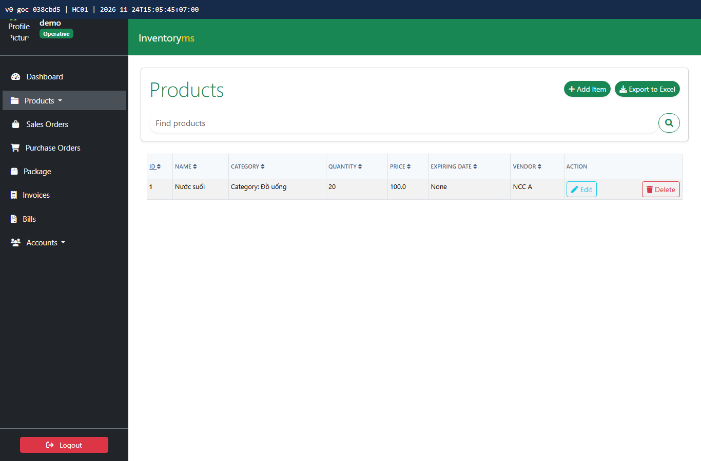

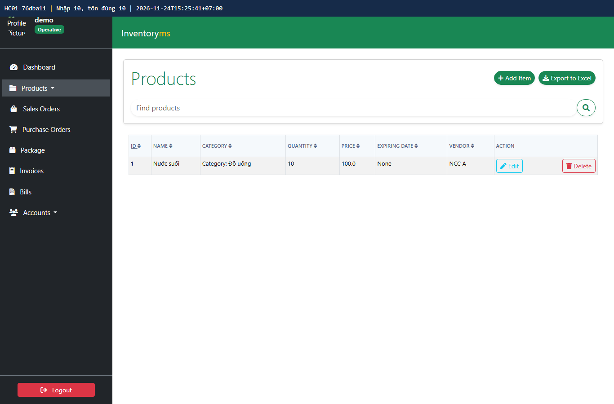

### 5.2. HC02 – Ngày giao trống và Excel

Trước: export gặp lỗi 500 khi delivery_date=NULL. Sau: tải XLSX và giữ ô ngày giao trống; workbook/ô được ghi trong BANG_CHUNG_SAU.md, không chỉ nhìn ảnh.


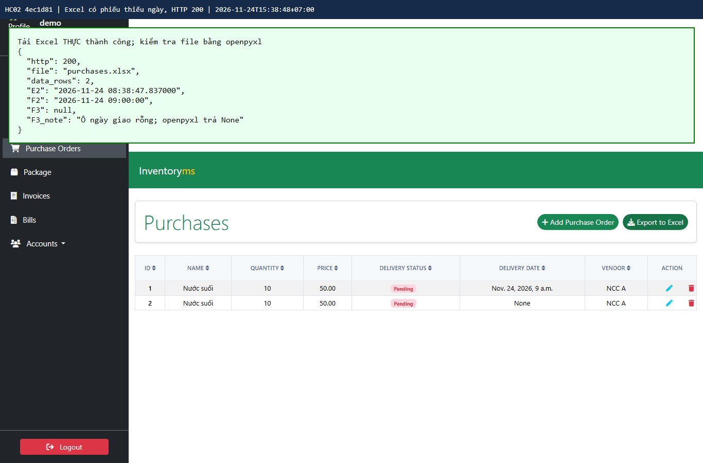

### 5.3. HC03 – Tổng tiền do máy chủ tính

Trước: chi tiết thể hiện tổng khai sai được lưu. Sau: đơn hợp lệ dùng giá DB và tổng đúng. Ảnh lỗi400/401 bổ sung có trong evidence/hc03/sau/.


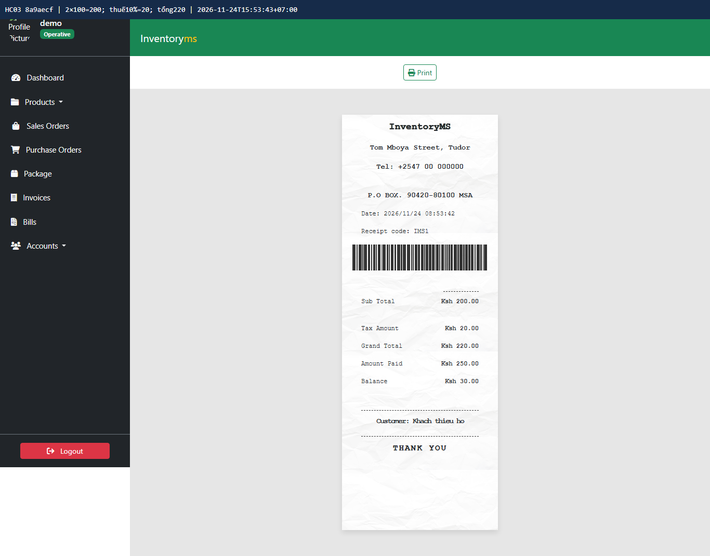

### 5.4. TU01/TU02 – Tương thích giao diện và container

Đây là bằng chứng **sau**, không có ảnh “trước” tương ứng trong cặp này. TU01 dùng manifest/check/dependencies log để đối chiếu trước/sau; TU02 dùng build/health/persistence logs, không bịa ảnh container gốc.

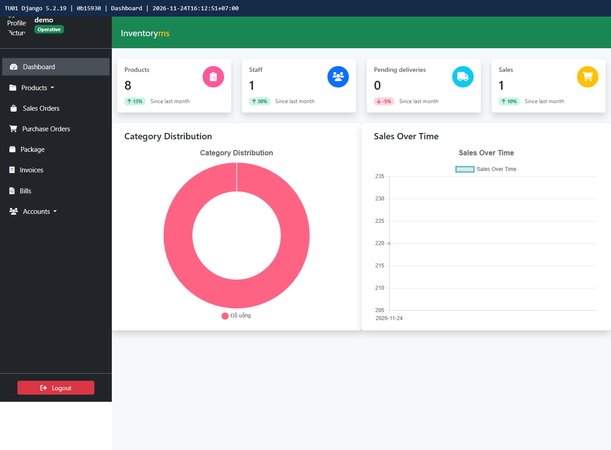

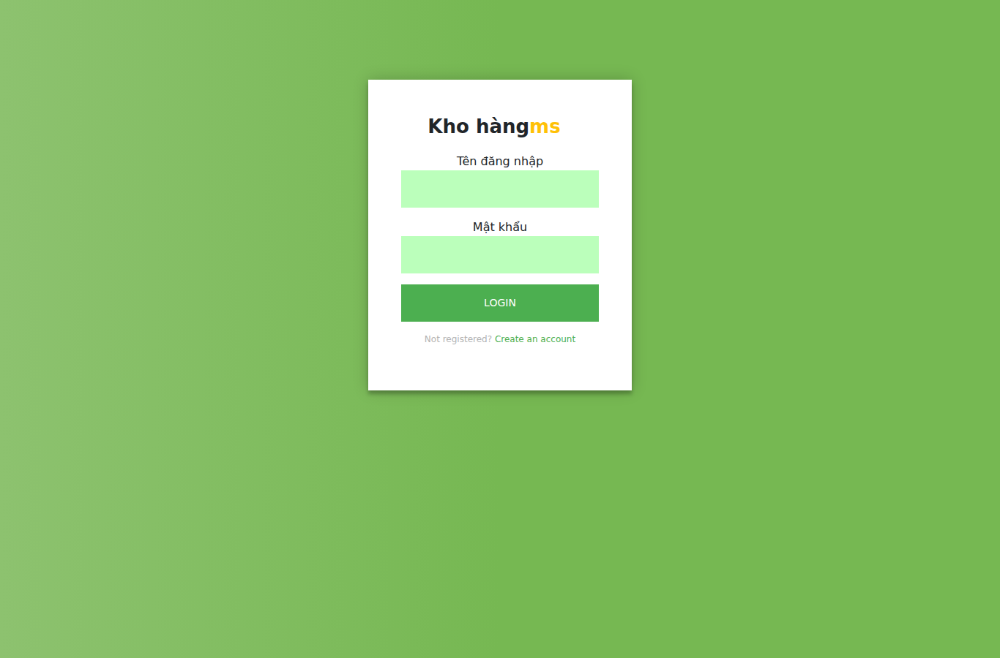

### 5.5. TU03 – Tiền và thời gian Việt Nam

Hai ảnh cùng kịch bản tại các checkout tương ứng; Excel thật và excel_cells.json nằm cạnh ảnh. Không suy ra có quy đổi tỷ giá vì chỉ đổi lượng tử hóa/hiển thị.

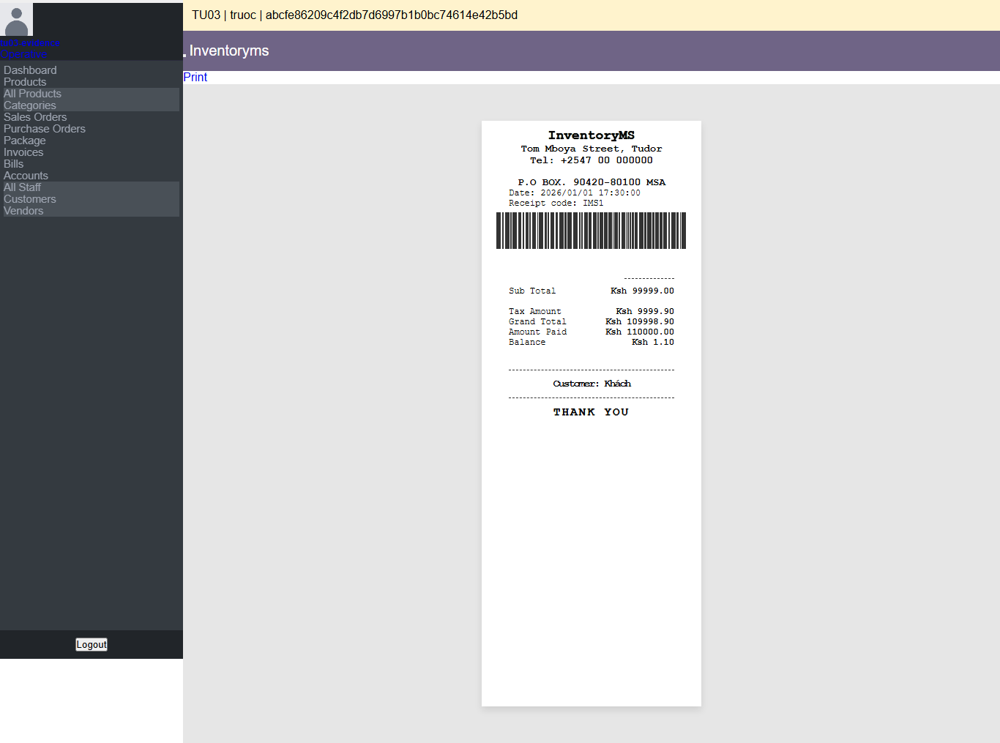

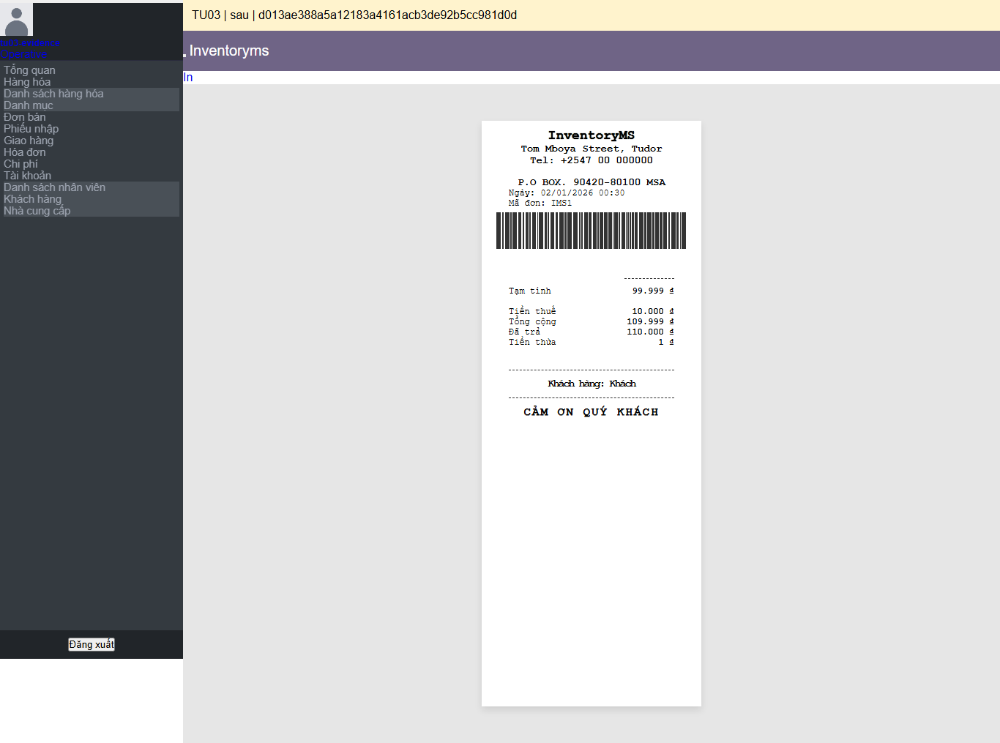

### 5.6. HT01 – Danh sách và dashboard cần nhập

Trước HT01 chưa có trường/ngưỡng/route này theo source. Hai hình dưới chỉ là ảnh sau; không dựng một ảnh trước của trang chưa tồn tại.

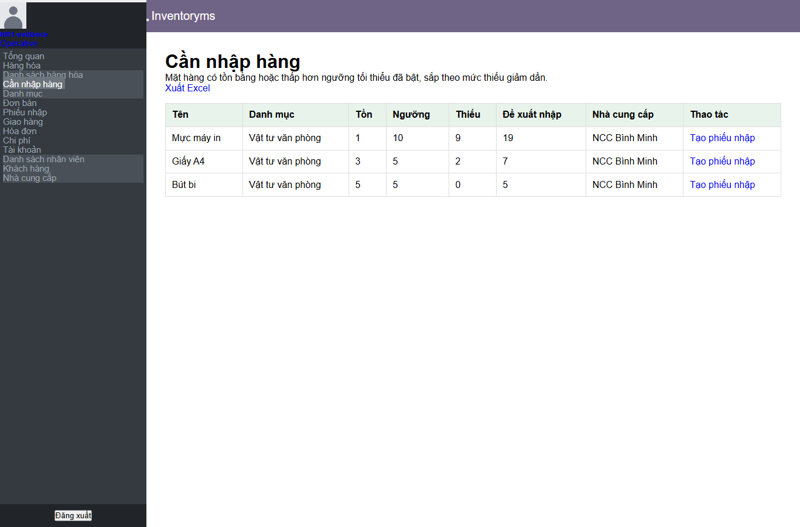


### 5.7. HT02 – Cùng tham số, khác tập kết quả

Ảnh trước và sau dùng cùng 5 giao dịch và cùng bộ lọc tháng 11 + khách A: bản trước vẫn 5 dòng, bản sau 2 dòng với tổng 5000. File Excel và capture.json ghi cùng số dòng/filename.

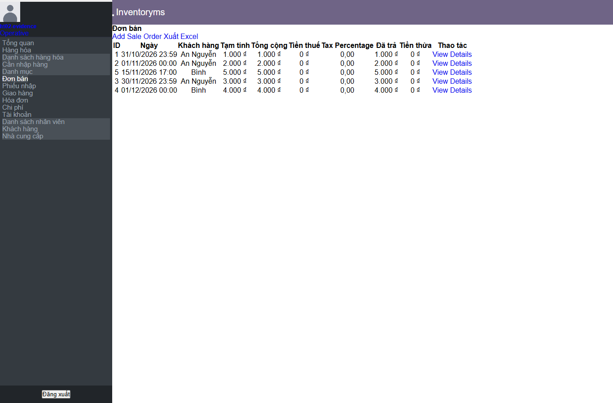

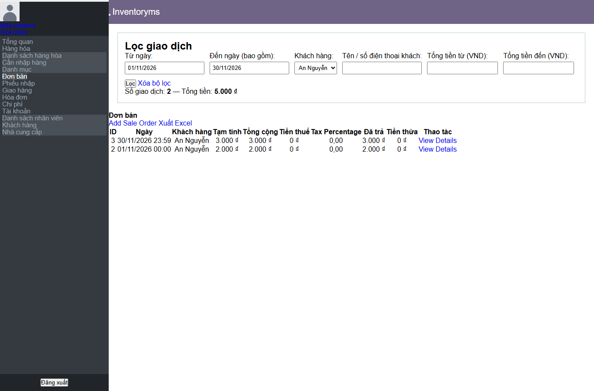

### 5.8. HT03 – Nút hủy và lịch sử

Ảnh trước HT03 chưa có trạng thái/nút hủy; ảnh thứ hai là code HT03 trước khi thao tác, có nút Hủy đơn; ảnh cuối là sau POST với lịch sử. snapshot.json và reconcile_stock.txt chứng minh kho/audit/ledger, không suy số dư chỉ từ ảnh hóa đơn.

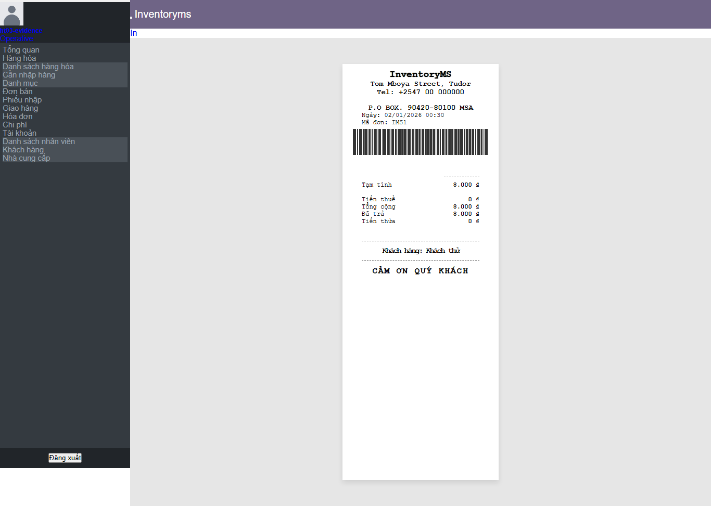

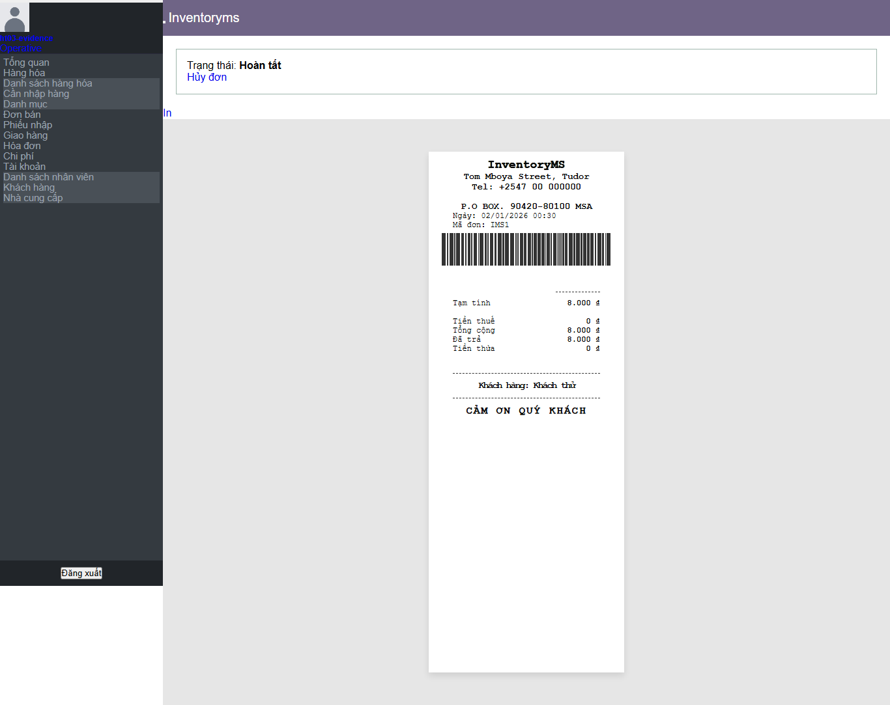

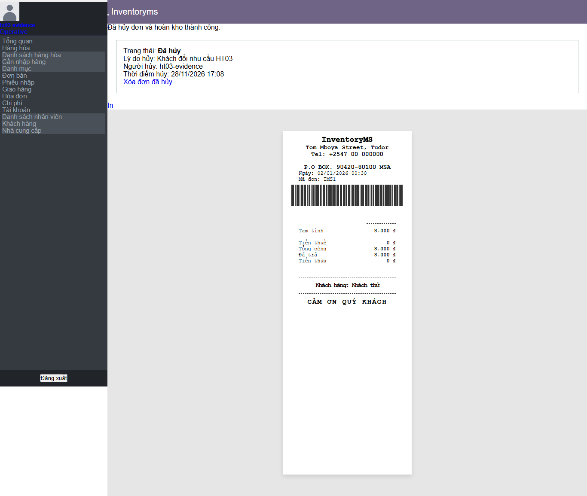

DP01/DP02 chủ yếu có bằng chứng test/service/migration/coverage, không có ảnh UI mới riêng để tự gán. Các TC về rollback/constraint và log migration là bằng chứng phù hợp hơn cho hai yêu cầu dự phòng.

## 6. Kết quả CI cuối cùng và các lệnh kiểm chứng

CI được dùng là **run 46141942142**, event push bao-tri, headSha123101a85ea74091c2863e0a00f952477918d925; tag v1-bao-tri bổ sung báo cáo/bằng chứng ở 1b06b13 nhưng không đổi source/test. Bản nhánh tài liệu này không được ghi là có một lần chạy247 test mới. Nguồn: [ci_run.json](../../evidence/final/ci_run.json), [workflow tests.yml](../../.github/workflows/tests.yml).

| Job | Output Ran N tests | Kết quả | Nguồn |
| --- | --- | --- | --- |
| sqlite-python3.10 | Ran 247 tests in 18.923s | OK (skipped=1) | [log](../../evidence/final/ci/sqlite-python3.10/suite.txt) |
| sqlite-python3.12 | Ran 247 tests in 18.117s | OK (skipped=1) | [log](../../evidence/final/ci/sqlite-python3.12/suite.txt) |
| postgres16-python3.10 | Ran 247 tests in 23.705s | OK | [log](../../evidence/final/ci/postgres16-python3.10/suite.txt) |
| postgres16-python3.12 | Ran 247 tests in 18.091s | OK | [log](../../evidence/final/ci/postgres16-python3.12/suite.txt) |

Docker smoke là job thứ năm PASS: build/up thành công, db/web/nginx healthy, login 200, MEDIA 200 đúng JPEG/bytes, DB và MEDIA còn sau down/up; production SSL check --deploy 0 issues. Bằng chứng ở [artifact](../../evidence/final/ci/compose-health-persistence/ps_after.txt) và [persistence](../../evidence/final/ci/compose-health-persistence/persistence.txt). Không có Docker cục bộ trên Windows.

Kiểm chứng local cuối bằng coverage: `Ran 247 tests in 29.294s`, `OK (skipped=1)`. `check`: `System check identified no issues (0 silenced).`; `makemigrations --check --dry-run`: `No changes detected`; migrate DB trống áp 37 migration gồm 19 dự án; hai preflight safe_to_migrate=true; reconcile fix=false/items=[] trên DB trống. Preflight sạch trên tập rỗng không thay cho kiểm dữ liệu cửa hàng thật. Từng output có trong evidence/final/ và commands.json.

Lệnh vận hành/test được lưu để truy vết, không chạy trên dữ liệu thật trong việc biên soạn:

```powershell
$env:DEBUG="true"; $env:SECRET_KEY="test"; $env:DB_ENGINE="sqlite"; $env:DJANGO_ENV_FILE="NUL"
python manage.py check
python manage.py makemigrations --check --dry-run
python -W error::DeprecationWarning -W error::PendingDeprecationWarning manage.py test . -v 2
```

Production check cần env riêng SSL=true/key đủ dài/HSTS đúng; không dùng SECRET_KEY=test với DEBUG=false. Chi tiết runner và cấu hình thử không chứa secret thật nằm trong evidence/final/run_validation.py và validation_metadata.json.

## 7. Lỗi tồn đọng, giới hạn và rủi ro

Danh mục đầy đủ có vị trí/mức độ/đề xuất loại bảo trì tại mục6 báo cáo tổng hợp. Các điểm trọng yếu gồm route Item.get_absolute_url sai item-detail; log Bill.slug; cột đơn giá purchases_list dùng total_value; SaleAdmin.search_fields dùng customer__name không tồn tại; SaleDetail admin còn sửa trực tiếp; nhãn tiếng Anh/CDN và thông tin công ty demo. CASCADE có thể làm mất sổ khi xóa hàng; Excel có giới hạn round mili giây; export bộ nhớ và dropdown chưa được load test quy mô lớn.

Hướng dẫn ban đầu còn nêu PurchaseDetailView tham chiếu purchasedetail.html không tồn tại; tại source nhánh này view vẫn tham chiếu tên đó và tệp vẫn thiếu. Đây là ghi nhận từ guide và kiểm tra tệp, **không có test HTTP mới** để công bố thêm số lỗi; không sửa trong bộ tài liệu.

Backup/restore, cửa sổ dừng ghi, lượng tử hóa tiền không đảo ngược và không quy đổi Ksh/VND là rủi ro triển khai bắt buộc xem xét. Chưa thử trên dữ liệu thật; chưa nghiệm thu proxy/TLS/VPS thật. Cần xác nhận Invoice quantity=0, ledger/--fix, quyền hủy và retention trước vận hành. Hai luồng hủy trên PostgreSQL16 không tương đương load test tổng thể. Vì vậy247 test và coverage cao không phải chứng minh mọi lỗi đã được loại bỏ.

## 8. Tình trạng biên soạn và xuất tài liệu

Bốn tệp Markdown được kiểm tra liên kết nguồn/ảnh, tên test và log tương ứng; Mermaid được parse/render để kiểm cú pháp, gồm classDef màu. Kết quả kỹ thuật và số mục/TC ghi trong KIEM_TRA_TAI_LIEU.json. Bản cập nhật đã cài Pandoc qua winget và xuất bốn tệp DOCX có mục lục, font Times New Roman và ảnh nhúng. Sơ đồ được render bằng Mermaid CLI thành PNG nền trắng trong img/; các khối Mermaid của Markdown vẫn được giữ nguyên. Số ảnh, bảng, heading và kết quả kiểm tra DOCX được ghi trong KIEM_TRA_TAI_LIEU.json. Bản Markdown trung gian và reference.docx dùng để xuất chỉ lưu trong thư mục build tạm, không commit.

## Nguồn tham chiếu

- [docs/BAO_CAO_TONG_HOP.md](../../docs/BAO_CAO_TONG_HOP.md)
- [docs/HC01.md](../../docs/HC01.md)
- [docs/HC02.md](../../docs/HC02.md)
- [docs/HC03.md](../../docs/HC03.md)
- [docs/TU01.md](../../docs/TU01.md)
- [docs/TU02.md](../../docs/TU02.md)
- [docs/DP02.md](../../docs/DP02.md)
- [docs/DP01.md](../../docs/DP01.md)
- [docs/TU03.md](../../docs/TU03.md)
- [docs/HT01.md](../../docs/HT01.md)
- [docs/HT02.md](../../docs/HT02.md)
- [docs/HT03.md](../../docs/HT03.md)
- [transactions/tests/test_hc01_purchase_stock.py](../../transactions/tests/test_hc01_purchase_stock.py)
- [transactions/tests/test_hc02_dates.py](../../transactions/tests/test_hc02_dates.py)
- [transactions/tests/test_hc03_sales.py](../../transactions/tests/test_hc03_sales.py)
- [accounts/tests/test_tu01_upgrade.py](../../accounts/tests/test_tu01_upgrade.py)
- [transactions/tests/test_tu01_storage.py](../../transactions/tests/test_tu01_storage.py)
- [transactions/tests/test_tu02_settings.py](../../transactions/tests/test_tu02_settings.py)
- [transactions/tests/test_dp02_decimal.py](../../transactions/tests/test_dp02_decimal.py)
- [transactions/tests/test_dp02_migrations.py](../../transactions/tests/test_dp02_migrations.py)
- [invoice/tests/test_dp02_decimal.py](../../invoice/tests/test_dp02_decimal.py)
- [transactions/tests/test_dp01_services.py](../../transactions/tests/test_dp01_services.py)
- [transactions/tests/test_dp01_architecture.py](../../transactions/tests/test_dp01_architecture.py)
- [transactions/tests/test_tu03_vnd.py](../../transactions/tests/test_tu03_vnd.py)
- [transactions/tests/test_tu03_migrations.py](../../transactions/tests/test_tu03_migrations.py)
- [store/tests/test_ht01_restock.py](../../store/tests/test_ht01_restock.py)
- [transactions/tests/test_ht02_filters.py](../../transactions/tests/test_ht02_filters.py)
- [transactions/tests/test_ht03_cancellation.py](../../transactions/tests/test_ht03_cancellation.py)
- [transactions/tests/test_ht03_concurrency.py](../../transactions/tests/test_ht03_concurrency.py)
- [transactions/tests/test_hc_regression.py](../../transactions/tests/test_hc_regression.py)
- [transactions/models.py](../../transactions/models.py)
- [transactions/views.py](../../transactions/views.py)
- [evidence/final/requirements.json](../../evidence/final/requirements.json)
- [evidence/final/test_history.json](../../evidence/final/test_history.json)
- [evidence/final/coverage_by_app.json](../../evidence/final/coverage_by_app.json)
- [evidence/final/coverage_final.json](../../evidence/final/coverage_final.json)
- [evidence/final/coverage_v0.json](../../evidence/final/coverage_v0.json)
- [evidence/final/ci_run.json](../../evidence/final/ci_run.json)
- [evidence/final/coverage_suite_sqlite.txt](../../evidence/final/coverage_suite_sqlite.txt)
- [evidence/dp02/coverage_summary.json](../../evidence/dp02/coverage_summary.json)
- [evidence/p0b_suite.txt](../../evidence/p0b_suite.txt)
- [evidence/hc01/suite.txt](../../evidence/hc01/suite.txt)
- [evidence/hc02/suite.txt](../../evidence/hc02/suite.txt)
- [evidence/ht01/BANG_CHUNG.md](../../evidence/ht01/BANG_CHUNG.md)
- [evidence/ht02/BANG_CHUNG.md](../../evidence/ht02/BANG_CHUNG.md)
- [evidence/ht03/BANG_CHUNG.md](../../evidence/ht03/BANG_CHUNG.md)
- [evidence/truoc/BANG_CHUNG_TRUOC.md](../../evidence/truoc/BANG_CHUNG_TRUOC.md)
- [../huong-dan-va-prompt-codex.md](../../../huong-dan-va-prompt-codex.md): phần C, các mục Hiện trạng, Yêu cầu và Tiêu chí chấp nhận. Tệp ở thư mục cha, không thuộc Git của repo; liên kết có hiệu lực trong workspace đã cung cấp.
