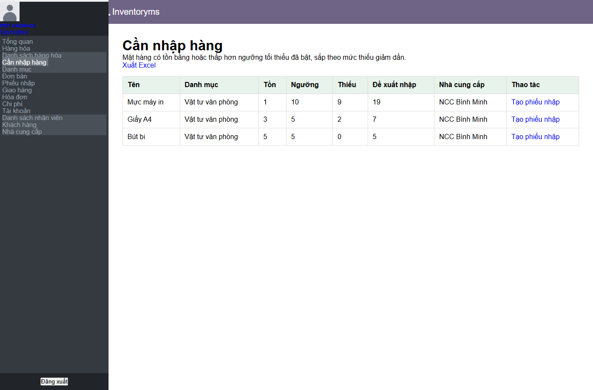

# HT01 – Bằng chứng cuối

Nguồn: 607c952 → 4256d01 → 17d44dd. Không sửa 24 file test lịch sử; 168 test cũ + 21 test mới = 189 PASS.

CI: https://github.com/MrTroll219/sales-and-inventory-management/actions/runs/46129446729 — 5/5 PASS, SQLite/PostgreSQL16, Python3.10/3.12 và Compose.

| Trường hợp | Trước | Sau |
|---|---|---|
| Danh sách cần nhập | Chưa có | Mực 1/10, Giấy 3/5, Bút 5/5; sắp thiếu 9,2,0 |
| Tồn 6/ngưỡng 5 và ngưỡng 0 | Chưa phân loại | Không có trong 3 dòng |
| Dashboard | Chưa có thẻ | Cần nhập hàng: 3 |
| Excel | Chưa có export này | 3 dòng, 7 cột, sheet Thông tin giờ VN |

Ảnh thật Playwright và file Excel ở `sau/`; đọc nội dung ô trong `sau/excel_cells.json`. DB thử tạm, không chạy trên dữ liệu thật; CDN ngoài bị chặn khi chụp. Chỉ phần mới có CSS cục bộ nên giao diện cũ có thể thiếu trang trí.

Log local: check.txt, migrations_check.txt, old_168_suite.txt, sau_suite_sqlite.txt. Log CI đầy đủ: ci-final/. Đối chiếu phạm vi: scope_checks.txt; source diff: diff_stat.txt. Tài liệu thiết kế, TC và cách thao tác nằm trong docs/HT01.md, test_cases.md.
