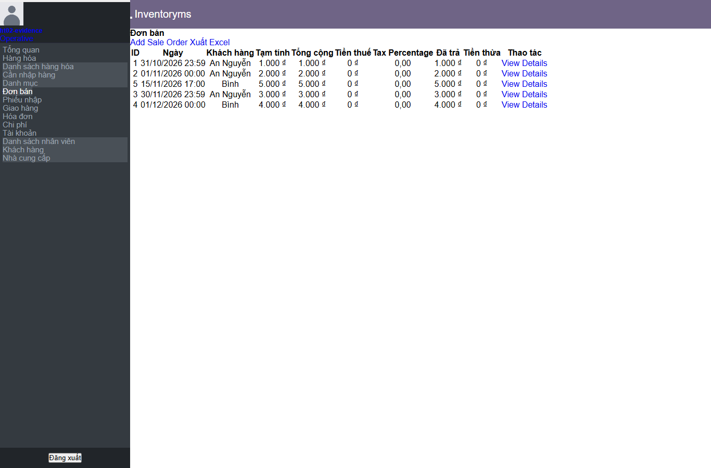
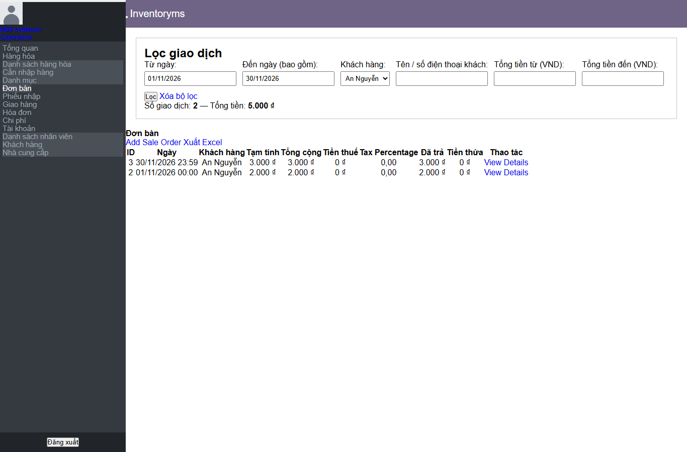
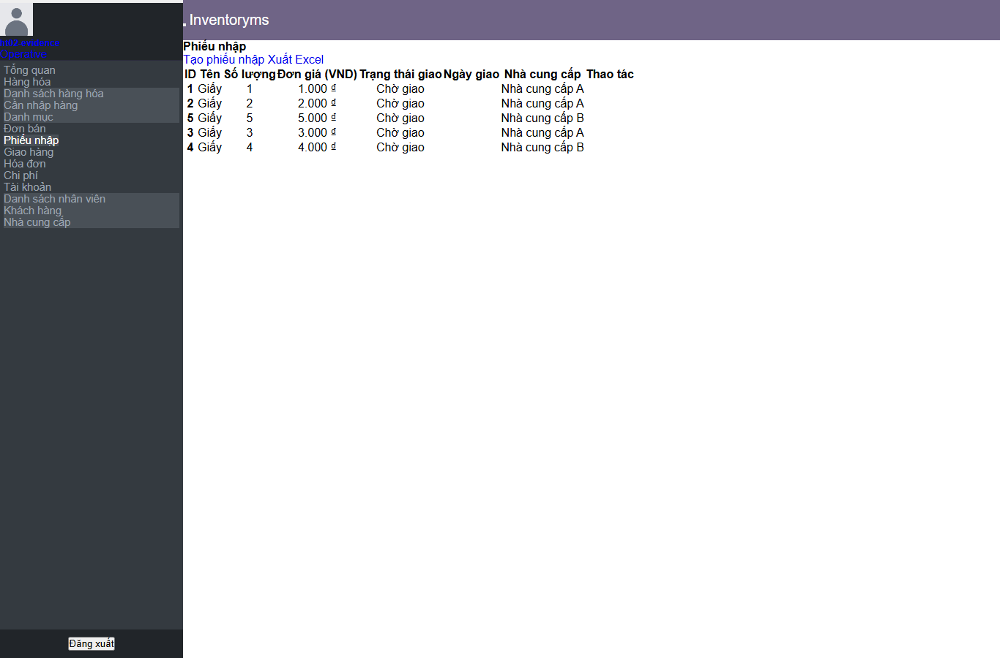
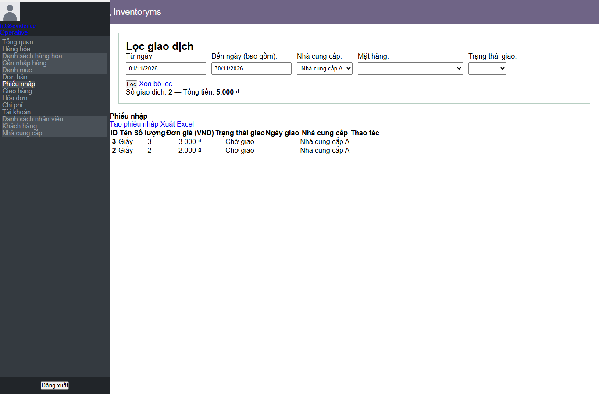

# HT02 – Đối chiếu trước/sau

Nguồn trước 35176c4, nguồn sau 1cee87d. Cùng seed 5 giao dịch và cùng tham số GET tháng 11/2026 + khách A hoặc nhà cung cấp A. DB tạm riêng, không dùng dữ liệu thật.

| Đối chiếu | Trước | Sau |
|---|---|---|
| Danh sách đơn bán | 5 dòng, chưa có bộ lọc | 2 dòng ID 3,2; tổng 5.000 ₫ |
| Danh sách phiếu nhập | 5 dòng, chưa có bộ lọc | 2 dòng ID 3,2; tổng 5.000 ₫ |
| Excel mỗi loại | 5 dòng | 2 dòng, ngày Việt Nam, định dạng VND |
| Filename | sales.xlsx/purchases.xlsx | sales_2026-11-01_2026-11-30.xlsx / purchases_2026-11-01_2026-11-30.xlsx |

## Đơn bán

## Phiếu nhập

Ảnh Playwright đã mở kiểm tra; chặn CDN ngoài khi chụp nên phần trang trí giao diện cũ có thể khác khi chạy có mạng. Mỗi thư mục có capture.json (SHA, URL, status, count, filename), Excel thật và excel_cells.json ghi từng ô/number_format. Script capture.py tái hiện được theo docs/HT02.md.

Log cuối: sau_suite_sqlite.txt, ci-final/. Đối chiếu test/source nguyên vẹn: scope_checks.txt. Bảng 25 TC: test_cases.md. Có lưu log lần chạy test mới đầu tiên và mô tả hai lỗi assertion test mới được chỉnh trong docs/HT02.md; không chỉnh test cũ.
