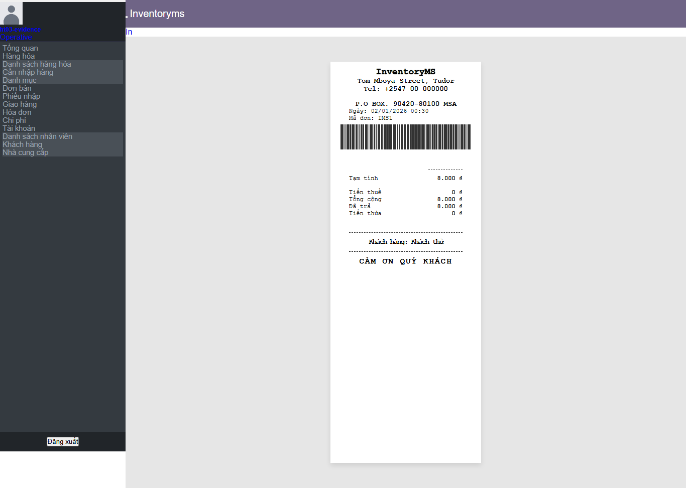
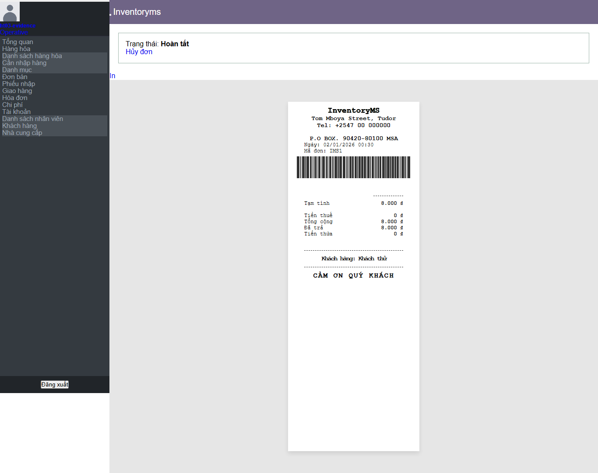
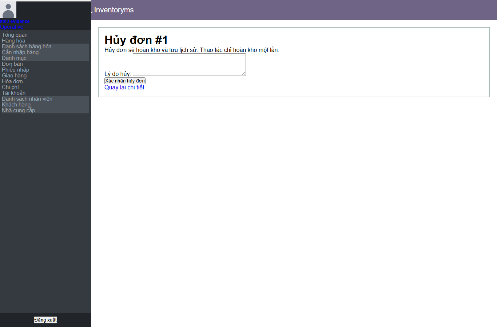
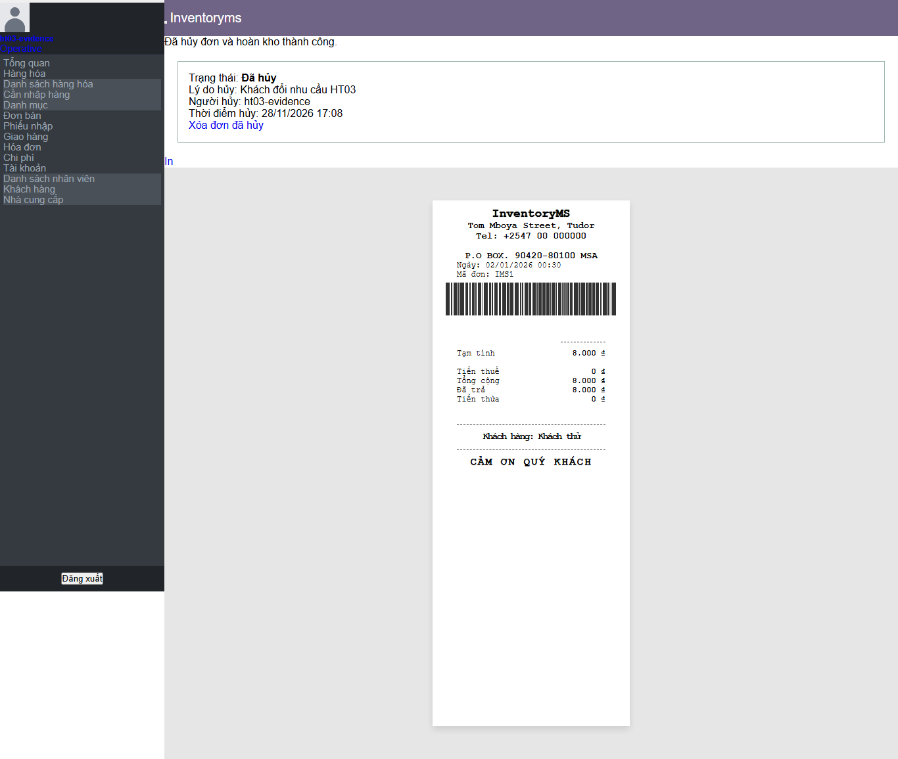

# HT03 – Đối chiếu hủy đơn

Nguồn trước b806fd4; sau 93b2c0f. DB thử riêng: hai mặt hàng nhập 10 mỗi loại, bán A×2 + B×3, kho còn 8/7. Playwright đăng nhập staff/superuser, mở form, nhập lý do và submit POST thật với CSRF.

| Kịch bản | Trước | Sau |
|---|---|---|
| Chi tiết đơn | Chưa có status/hủy/audit | Hoàn tất và nút Hủy; sau POST Đã hủy, lý do, actor, thời điểm giờ VN |
| Kho | A8/B7 | A10/B10 |
| Ledger/audit | Không SALE_CANCEL | 2 bút toán +2/+3; 1 audit A2/B3 |
| List/Excel | Chưa có status | Lọc Đã hủy, doanh thu 0; Excel có trạng thái |
| Đối soát | Chưa có luồng hủy | difference=0 và ledger_minus_trade=0 |

Ảnh chưa chỉnh sửa, CDN ngoài bị chặn nên phần giao diện cũ có thể thiếu trang trí. Đã mở ảnh kiểm tra. capture.json ghi SHA/URL; snapshot.json ghi dữ liệu thật; reconcile_stock.txt là output chỉ đọc trên DB thử; cancelled_sales.xlsx/excel_cells.json ghi Excel thật.

Test: 214 cũ nguyên trạng + 33 mới. SQLite skip đúng một test mới về đồng thời; PostgreSQL16 chạy thực tế test hai luồng trên Python3.10/3.12, không skip. Log đầy đủ ở ci-final/, bảng TC ở test_cases.md, phạm vi nguyên vẹn trong scope_checks.txt. CI: https://github.com/MrTroll219/sales-and-inventory-management/actions/runs/46133645099 .
