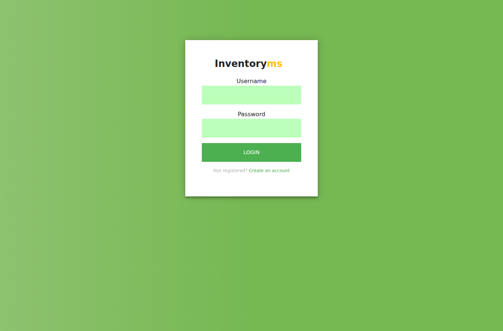

# TU02 bổ sung – MEDIA qua nginx

Ngày kiểm chứng: 24/11/2026. Nhánh tu02-trien-khai-docker.
Base trước bản vá: 0fe76d2. Code đã kiểm chứng: 981a5c4.
[CI 45369830837 PASS](https://github.com/MrTroll219/sales-and-inventory-management/actions/runs/45369830837).

## 3. Phạm vi ảnh hưởng (diff tóm tắt)

| File | Loại | Thay đổi |
|---|---|---|
| docker-compose.yml | sửa | nginx:1.27-alpine nhận cổng public; web expose nội bộ; MEDIA read-only cho nginx |
| nginx/default.conf | thêm | /images/ alias MEDIA; phần còn lại proxy web; chuyển scheme |
| static/images/profile_pics/default.jpg | thêm | Avatar JPEG mặc định, 160x160, 2902 byte |
| scripts/seed_default_media.py, entrypoint.sh | thêm/sửa | Seed ảnh thiếu bằng exclusive create, không ghi đè |
| scripts/ci_compose_smoke.py | sửa | Kiểm tra ảnh/MIME/bytes, nginx, HTTPS, deploy check và persistence |
| transactions/tests/test_tu02_settings.py | sửa | Ba test bổ sung cho seed và local DEBUG media |
| docs/TRIEN_KHAI.md, docs/TU02.md | sửa | Luồng nginx và chuyển ảnh upload cũ |

Không đổi model, migration, nghiệp vụ hoặc static() cho local DEBUG=True.

## 4. Kiểm thử

| Môi trường | Output thực tế |
|---|---|
| Windows Python3.12.10 / SQLite | Ran 85 tests in 7.767s; OK |
| CI Python3.10.22 / PostgreSQL16.16 | Ran 85 tests in 3.484s; OK |
| CI Python3.12.16 / PostgreSQL16.16 | Ran 85 tests in 3.730s; OK |

Ba test mới trong transactions/tests/test_tu02_settings.py::DefaultMediaTests:
- test_missing_default_is_seeded_as_valid_jpeg: tạo đúng JPEG khi thiếu.
- test_existing_default_is_never_overwritten: giữ nguyên file đích đã có.
- test_local_django_media_is_served_only_when_debug_true: local DEBUG=true trả 200
  và đúng bytes; DEBUG=false Django không tự phục vụ MEDIA, trả 404.

Lệnh Windows PowerShell đã chạy (venv Python3.12.10):

```powershell
$env:DEBUG='true'; $env:SECRET_KEY='test'; $env:DB_ENGINE='sqlite'; $env:DJANGO_ENV_FILE='NUL'
python manage.py check
python manage.py makemigrations --check --dry-run
python -W error::DeprecationWarning -W error::PendingDeprecationWarning manage.py test . -v 2
```

```text
System check identified no issues (0 silenced).
No changes detected
Ran 85 tests in 7.767s
OK
```

CI chạy scripts/ci_compose_smoke.py trên Ubuntu24.04, build image thật và ba service:
- nginx -t: syntax is ok; test is successful.
- Login qua nginx: HTTP200.
- /images/profile_pics/default.jpg: HTTP200, image/jpeg, khớp 2902 byte.
- /images/tu02-upload.jpg: HTTP200, image/jpeg, khớp 2902 byte trước/sau down/up.
- Bật SSL=true cho web, gửi X-Forwarded-Proto=https qua nginx: HTTP200,
  Strict-Transport-Security chứa max-age=3600.
- check --deploy với SSL=true/include-subdomains=true/preload=true và key dài:
  System check identified no issues (0 silenced).
- DB/MEDIA persistence: DATABASE_AND_MEDIA_PERSISTENCE_PASS.
- ps_after.txt: db/web/nginx healthy; chỉ nginx publish 127.0.0.1:8000->80.

Log và ảnh Playwright ở ci/; metadata ở ci-run.json. Không lưu .env/secret.

## 5. Bằng chứng trước/sau

| Kịch bản | Trước bản vá | Sau bản vá |
|---|---|---|
| MEDIA khi DEBUG=false | Django không có route phục vụ, chưa có gateway | nginx trả 200, image/jpeg, bytes khớp |
| Ảnh mặc định Profile | model trỏ profile_pics/default.jpg nhưng thiếu asset | Có JPEG và tự seed nếu thiếu |
| File mặc định đã có | Chưa có seed | Test chứng minh không ghi đè |
| Local DEBUG=true | static() phục vụ MEDIA | Giữ nguyên, test trả 200 |
| Login public | Trực tiếp web | nginx trả 200; web không publish host port |
| Restart/down-up | Đã giữ DB/MEDIA | Vẫn giữ dữ liệu, ảnh tiếp tục GET200 |
| SSL production | check --deploy 0 issues | Vẫn 0 issues; forward HTTPS/HSTS được kiểm chứng |



Tái hiện: up --build --wait; GET /accounts/login/ và /images/profile_pics/default.jpg
qua localhost:8000; đặt ảnh vào MEDIA, GET /images/<tên>; down không -v rồi up và GET lại.
Chi tiết chuyển ảnh Profile cũ không ghi đè đích: docs/TRIEN_KHAI.md.

## 7. Rủi ro và việc còn lại

- Windows chưa có Docker; kiểm tra container được thực hiện trên CI Ubuntu24.04.
- Nginx hiện phục vụ HTTP; production vẫn cần proxy TLS tin cậy bên ngoài. Giữ
  loopback hoặc giới hạn mạng để client không thể giả header X-Forwarded-Proto.
- MEDIA /images/ là nội dung public theo cấu hình yêu cầu, không có kiểm tra đăng nhập.
- Không tự di chuyển/xóa ảnh cũ. Hướng dẫn chỉ copy thư mục upload đã xác định,
  giữ đường dẫn tương đối và không ghi đè file có sẵn.
- Không đổi các phần TU02 đã đạt; không mở PR; không làm yêu cầu tiếp theo.
