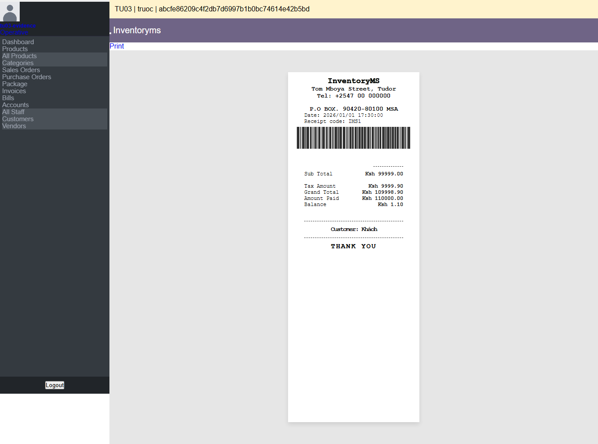
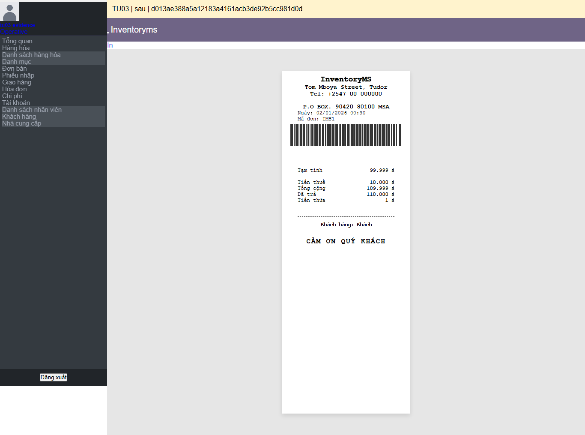

# TU03 – Bằng chứng trước/sau

Ngày kiểm chứng: 28/11/2026. DB demo SQLite riêng, không dùng DB thật.
Trước: abcfe86209c4f2db7d6997b1b0bc74614e42b5bd; sau: d013ae388a5a12183a4161acb3de92b5cc981d0d.

[CI cuối PASS](https://github.com/MrTroll219/sales-and-inventory-management/actions/runs/46127746926).

## Trang chi tiết đơn

Cùng dữ liệu: 3 × 33333, thuế10%, trả110000; timestamp2026-01-01 17:30UTC.
| Giá trị | Trước | Sau |
|---|---|---|
| Tạm tính | Ksh99999.00 | 99.999 ₫ |
| Thuế | Ksh9999.90 | 10.000 ₫ |
| Tổng | Ksh109998.90 | 109.999 ₫ |
| Tiền thừa | Ksh1.10 | 1 ₫ |
| Ngày | 2026/01/01 17:30:00 | 02/01/2026 00:30 |

Capture bằng Playwright, chỉ tài nguyên local; cookie/DB fixture đã hủy. CSS CDN bị chặn có chủ đích, ảnh không đại diện triển khai production.

## Excel thật, đọc bằng openpyxl

| File/ô | Trước | Sau | Format sau |
|---|---|---|---|
| sales.xlsx/B2 | 2026-01-01T17:30:00 | 2026-01-02T00:30:00 | DD/MM/YYYY HH:MM |
| sales.xlsx/D2 | 99999 | 99999 | #,##0 "₫" |
| sales.xlsx/E2 | 109998.9 | 109999 | #,##0 "₫" |
| sales.xlsx/F2 | 9999.9 | 10000 | #,##0 "₫" |
| sales.xlsx/H2 | 110000 | 110000 | #,##0 "₫" |
| sales.xlsx/I2 | 1.1 | 1 | #,##0 "₫" |
| purchases.xlsx/E2 | 2026-01-01T17:30:00 | 2026-01-02T00:30:00 | DD/MM/YYYY HH:MM |
| purchases.xlsx/F2 | None | None | DD/MM/YYYY HH:MM |
| purchases.xlsx/I2 | 1000 | 1000 | #,##0 "₫" |
| purchases.xlsx/J2 | 2000 | 2000 | #,##0 "₫" |

Giữ kiểu ô numeric cho tiền, không ghi chuỗi tiền vào ô số. Ngày giao None vẫn trống.
Các file .xlsx và excel_cells.json lưu nguyên kết quả; không sửa bằng tay sau xuất.

## Test và phạm vi

- Local SQLite/Python3.12.10: Ran 168 tests in 23.352s; OK.
- CI SQLite/Python3.10.22: Ran 168 tests in 13.879s; OK.
- CI SQLite/Python3.12.16: Ran 168 tests in 13.085s; OK.
- CI PostgreSQL16.16/Python3.10.22: Ran 168 tests in 17.740s; OK.
- CI PostgreSQL16.16/Python3.12.16: Ran 168 tests in 13.186s; OK.
- check: 0 issues; makemigrations: No changes detected.
- Scope: 13 test cũ được duyệt, commit riêng7734932; lịch sử DP02 và stock.py không đổi.
- Diff: legacy_test_changes.patch; manifest: approved_test_scope.json; 22 CHECK: scope_checks.txt.
- Model tiền (15,0), 15 CHECK nguyên/phạm vi bổ sung; tỷ lệ thuế vẫn(5,2).
- Migration test xác nhận19.99→20,1234.50→1235, biên13→14 chữ số và từ chối xung đột tổng sau round.
- Không skip/xóa test; không FX Ksh/VND; chưa migrate dữ liệu thật.

## Hồi quy Docker

ci-final/compose-health-persistence/: db/web/nginx healthy, login200, JPEG200 image/jpeg đúng bytes, DB/MEDIA còn sau down/up, production SSL check --deploy0 issues.
Windows chưa có Docker; container chạy trên CI Ubuntu24.04.
